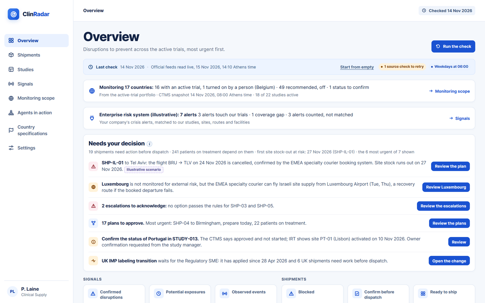
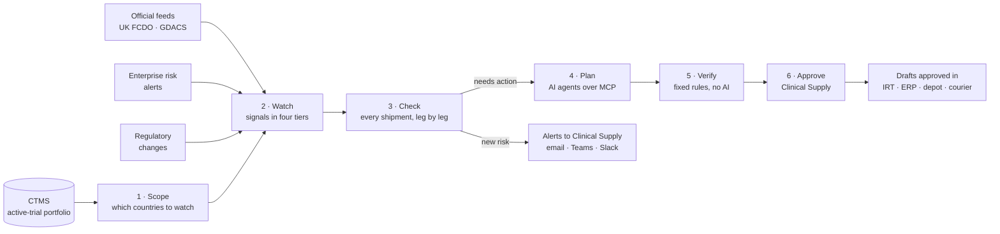
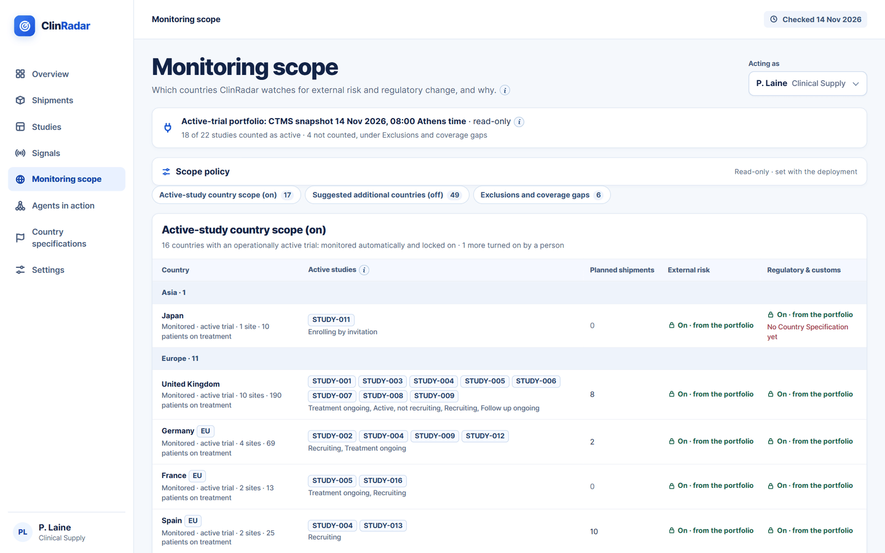
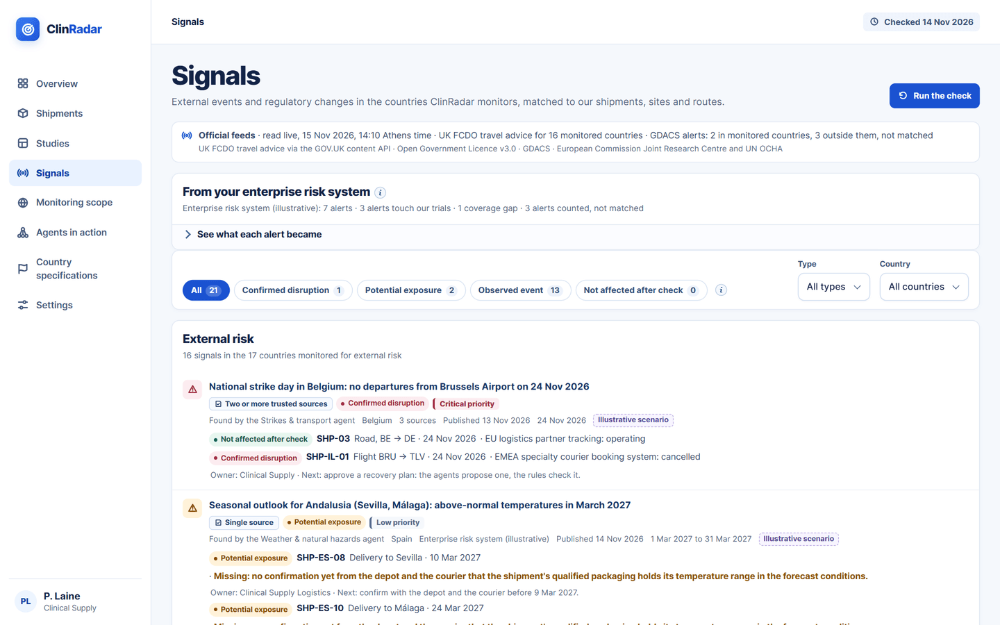
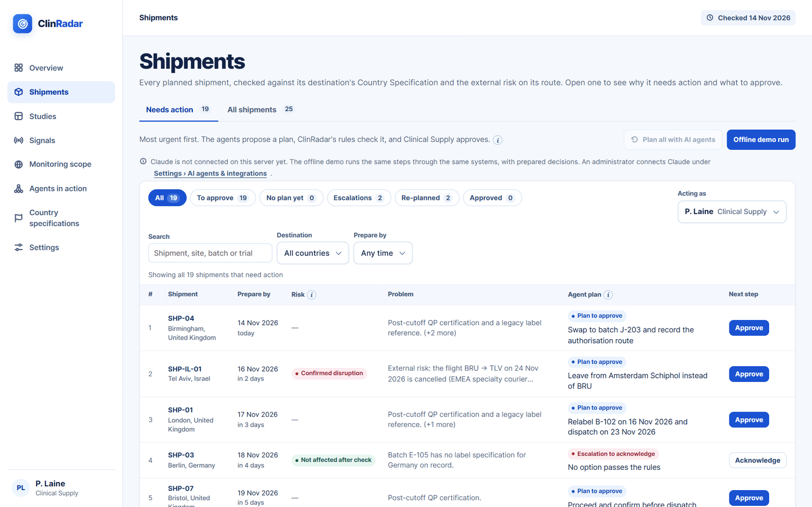
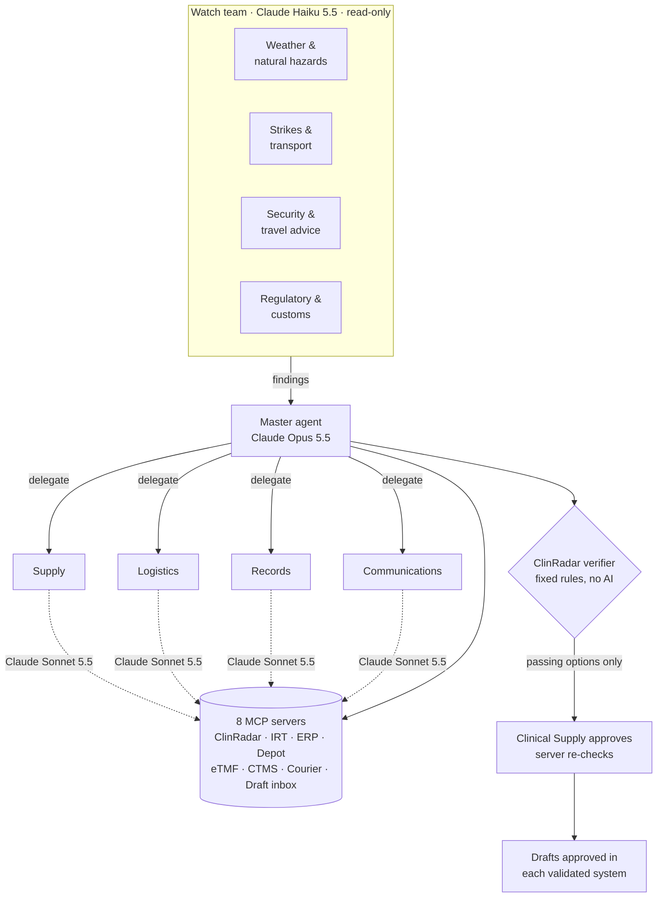
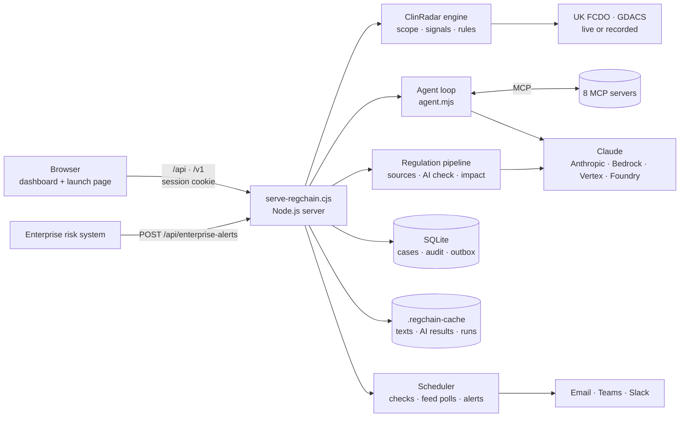

<div align="center">

# ClinRadar

**Stop clinical supply disruptions before patients miss treatment.**

ClinRadar watches the countries where your trials are active, checks every planned shipment before dispatch,<br>
and brings Clinical Supply recovery options that have already passed your rules.

`Node.js ≥ 22.13` · `SQLite` · `Model Context Protocol` · `Claude (Opus, Sonnet, Haiku 5.5)` · `Docker`



</div>

---

## Contents

- [What ClinRadar does](#what-clinradar-does)
- [Why it exists](#why-it-exists)
- [How it works](#how-it-works)
- [Quick start](#quick-start)
- [A tour of the screens](#a-tour-of-the-screens)
- [The agent team](#the-agent-team)
- [Built for validated systems](#built-for-validated-systems)
- [Architecture](#architecture)
- [API](#api)
- [Configuration](#configuration)
- [Tests](#tests)
- [What is real, what is illustrative](#what-is-real-what-is-illustrative)
- [Limits and next steps](#limits-and-next-steps)
- [Documentation](#documentation)

---

## What ClinRadar does

ClinRadar is external risk and country regulatory intelligence for global clinical supply. It is a working prototype, built as one Node.js server with a browser dashboard.

It answers one question for Clinical Supply: **which of our planned shipments will be disrupted, how sure are we, and what do we do about it?**

| | |
|---|---|
| **It watches only what matters** | The monitoring scope comes from the company's own active-trial portfolio in the CTMS. Countries with an operationally active trial are monitored automatically. Every other country is a *recommendation* with its evidence, and stays off until a named person turns it on. |
| **It matches the world to your shipments** | Strikes, weather, security advice, enterprise risk alerts and regulatory changes are matched by place and by day to the company's own shipments, depots, routes and deadlines. |
| **It says how sure it is** | Each match is an **observed event**, a **potential exposure**, a **confirmed disruption** or **not affected after check**. It is confirmed only when the courier's or the depot's system says so. |
| **It proposes, rules decide, people approve** | For a shipment that needs action, AI agents read the company's systems over MCP and propose recovery options. Fixed rules (no AI) check every option. A named person in Clinical Supply approves. Changes reach IRT, ERP, the depot and the courier as drafts that people approve in those systems. |

The goal is a company-specific risk assessment and a controlled action, not a feed of world news.

## Why it exists

The research behind ClinRadar is in [ClinRadar-Research.md](ClinRadar-Research.md). In short:

- **The cross-border leg is the weak point.** In the one multi-company study (Tufts CSDD, 2016), 80% of shipments to in-country depots arrived on time, against 97% of shipments to sites.
- **Keeping patients supplied is a regulatory duty.** ICH E6(R3) 3.15.3(c)(i) asks for timely supply "to avoid any interruption" of treatment. EMA counts systematic missed doses as a serious breach.
- **Nobody links the event to the shipment.** Regulatory intelligence tools (RegASK, Freyr, IQVIA, Clarivate, Veeva) watch rules. The 2026 supply agents (Signant, Endpoint, Suvoda) flag risks inside their own systems. None of them links an external event or a country requirement to a *specific planned shipment*, then proposes a recovery for a person to approve.

## How it works



1. **Scope.** ClinRadar reads the CTMS snapshot with the company's status policy (`config/supplyshield.yaml`). In the demo, 18 of 22 studies count as active, so **16 countries** are monitored automatically. **50 more** are recommended, each with its reason (a depot, a supplier, a transit route, a shared hub, a land border, a sea neighbour, current official advice), all off. 5 registered countries without an active site are excluded. Portugal's contradictory status waits for a person to confirm.
2. **Watch.** Four watch agents sweep the monitored countries, one kind of hazard each: weather, strikes and transport, security and travel advice, regulatory and customs. Duplicate reports of one event merge into one signal with several sources.
3. **Check.** Every planned shipment has a route with the day of each leg: collection, road, flight, import clearance, delivery. ClinRadar tests it against the events on that route and against the destination's Country Specification (labels, import permits and their terms, importer of record, delivery days). Of 25 planned shipments: **14 blocked, 5 to confirm, 6 ready**.
4. **Plan.** For each shipment that needs action, a master agent and four specialists read IRT, ERP, the depot, the eTMF, the CTMS and the courier, and propose two or three options.
5. **Verify.** ClinRadar's rule engine checks every option: will the kits arrive before the site runs out, is the lane qualified for the temperature range, do the import approval's terms still hold? Only passing options can be approved.
6. **Approve.** A named person in Clinical Supply approves one plan. The server checks it again before recording it. Every step goes into a hash-chained audit trail.

### The four tiers

| Tier | When | Example from the demo |
|---|---|---|
| 🔴 **Confirmed disruption** | An authorised system (the courier or the depot) confirmed the impact, with a time | The courier cancelled SHP-IL-01's Brussels → Tel Aviv flight on the Belgian strike day |
| 🟠 **Potential exposure** | It touches one of our shipments, routes or facilities on the day, but nothing has confirmed an impact. The missing evidence and its owner are named | Runway works at Ben Gurion, 4 to 8 Jan, and SHP-IL-02's flight on 5 Jan |
| 🟢 **Not affected after check** | It touched one of ours, and the carrier or depot confirmed normal operation | SHP-03's truck is in Germany before the strike day |
| ⚪ **Observed event** | A verified event in a monitored country that touches nothing of ours | A road protest in France when no shipment of ours is on French roads |

A courier tracking outage is lost visibility, never a lost shipment. A route through a country nobody monitors is never shown as clear: it gets a "confirm" check instead.

### Alerts and the schedule

**The server watches on its own.** On the monitoring schedule (Settings › Monitoring schedule, Athens time, weekdays at 06:00 by default) the server reads the official regulatory sources again, reads the live feeds for every monitored country, matches every signal to the shipments and raises the alerts. Between checks it polls the feeds every 30 minutes and reads the regulatory sources every 24 hours (`config/supplyshield.yaml`). A check missed while the server was down runs once when it starts. Nobody needs the page open, and `REGCHAIN_SCHEDULER=off` stops all of it.

**Alerts reach Clinical Supply with the evidence.** Each new confirmed disruption, potential exposure, rule change that holds shipments, or import approval that no longer covers a shipment raises one alert. It names the event, the shipment and leg, the record that confirmed it (or what is missing and who must confirm it), the number of patients behind it, the sources with their times, the next step and a link to the signal. All the alerts of one check go out together, by email and to a Teams or Slack webhook. Failed deliveries are retried, and everything goes into the audit trail. Without a channel, alerts show in ClinRadar only. **Settings › Alerts** shows the channels, the latest alerts and each delivery, and sends a test alert. Opened as a file, the page replays the recorded checks while it is open.

### The worked example


A national strike day in Belgium on 24 Nov (illustrative) cancels the flight of shipment **SHP-IL-01** to Tel Aviv. The site has 14 patients on treatment and runs out of stock on **27 Nov**. If nobody acts, the courier's next free flight delivers on **29 Nov**: 14 patients go 2 days without treatment.

The agents propose three options. **Leave from Amsterdam** passes every rule and delivers on **26 Nov**. **Leave from Luxembourg** needs a monitoring decision first, because Luxembourg isn't monitored. **Dispatch on 25 Nov** fails, because the kits arrive after the stock runs out. Clinical Supply approves the Amsterdam plan, and two drafts go out: a booking change for the courier and a collection instruction for the depot.

## Quick start

**Requirements:** Node.js 22.13 or later. No API key is needed for the demo.

```bash
npm install
npm start
```

This opens the dashboard at **http://127.0.0.1:4173/**. On Windows you can double-click **`Start-ClinRadar.cmd`** instead. It installs what is missing, starts the server and opens your browser. Keep its window open, and press **Ctrl+C** to stop. Without Node.js, it opens the standalone dashboard file, which works from browser storage.

| Start like this | What you get |
|---|---|
| `npm start` or `Start-ClinRadar.cmd` | One person on this computer, who picks a role with **Acting as**. The prepared demo workspace. |
| http://127.0.0.1:4173/?empty | An empty workspace. ClinRadar monitors nothing until you connect the CTMS on the first check. This is the best start for a demo. |
| http://127.0.0.1:4173/?fresh (or `?fresh=all`) | Clears the decisions (and the plans) to rehearse again. Nothing is deleted from the audit trail. |
| `Start-ClinRadar-Site.cmd` | Named users with sign-in, the public launch page at **/site/**, and one demo account per role (`npm run demo:accounts`). |
| `docker compose up -d` | The shared deployment: named users, data in the `regchain-data` volume. See [Deployment](RegChain-AI-Deployment.md). |

### Turn on live AI (optional)

Without a key, every agent run is the **offline demo run**. It takes the same steps through the same MCP servers, with the decisions written in code instead of made by Claude. To run Claude live, do one of these:

- **Connect it in Settings (with sign-in).** An administrator opens **Settings › AI agents & integrations** and pastes a Claude API key. ClinRadar checks the key with Anthropic and stores it encrypted (AES-256-GCM) in `.regchain-data/`. It never sends the key back to the page. For a shared deployment, set `REGCHAIN_SECRET_KEY` so the encryption key is not kept next to the encrypted one.
- **Or put it in `.env`** next to `serve-regchain.cjs`: `ANTHROPIC_API_KEY=…`. Git ignores this file.

To reach Claude through AWS Bedrock, Google Cloud Vertex AI or Microsoft Foundry instead, set `REGCHAIN_AI_PROVIDER`. See [Which Claude service](RegChain-AI-Deployment.md#which-claude-service).

### Five-minute demo

| Time | Screen | What happens |
|---|---|---|
| 0:00 | Overview (`?empty`) | No portfolio is connected, so ClinRadar monitors nothing |
| 0:20 | First check | It connects the CTMS: 22 studies, 18 counted, 16 countries monitored, Portugal to confirm |
| 0:50 | Monitoring scope | 50 countries are recommended, all off. You turn on Belgium (the central EU depot) and give a reason |
| 1:30 | Signals | The Belgian strike: a confirmed disruption for SHP-IL-01, not affected for SHP-03. The Ben Gurion works are a potential exposure |
| 2:30 | Agents in action → SHP-IL-01 | The agents read the route, the courier and the depot, and propose Amsterdam, Luxembourg and 25 Nov |
| 3:45 | Plan page | **Approve this plan** as Clinical Supply. Two drafts are created and nothing changes in any system yet |
| 4:30 | Plan page, then Settings | **Export the audit record**. Settings shows who turned Belgium on, and why |

Every path through the product, with the clicks for each demo: [User journeys](RegChain-AI-User-Journeys.md).

## A tour of the screens

| Screen | What it is for |
|---|---|
| **Overview** | The decisions waiting for you, most urgent first, with the monitoring scope, the enterprise alerts and the counts of signals and shipments by state. |
| **Shipments** | Every planned shipment, checked against its destination's Country Specification and the external risk on its route. **Needs action** is the work queue, and **Plan all with AI agents** runs the agents on all of it. |
| **Shipment plan page** | Why the shipment needs action, its route leg by leg, the recommended plan with what ClinRadar checked, and one approval button. |
| **Studies** | Every trial with its countries, sites, patients, shipments and supply risk. |
| **Signals** | External events and regulatory changes in the monitored countries, matched to shipments, in four tiers, with what each enterprise alert became. |
| **Monitoring scope** | Which countries are watched and why: the active-trial countries (locked on), the recommendations with their evidence, two switches each, and the exclusions and coverage gaps. |
| **Agents in action** | The agent team at work. Replay any run step by step at 1× to 8×, filter by agent, or follow a live run. |
| **Country specifications** | The governed record per country, with each regulatory change going through the Regulatory SME's decision. |
| **Settings** | The monitoring schedule, the alerts (channels, latest alerts, each delivery and a test alert), the AI connections (the Claude service, each agent's model, the systems over MCP) and the audit export. |

<table>
<tr>
<td width="50%"><br><sub><b>Monitoring scope:</b> countries come from the active-trial portfolio, never from a guess.</sub></td>
<td width="50%"><br><sub><b>Signals:</b> one event, matched to each of our shipments, with its evidence.</sub></td>
</tr>
<tr>
<td width="50%"><br><sub><b>Shipments:</b> the work queue, most urgent first, each with a plan to approve.</sub></td>
<td width="50%"><br><sub><b>Agents in action:</b> 19 shipments, 604 steps, every one replayable.</sub></td>
</tr>
</table>

## The agent team



| Agent | Model | Reads | Does |
|---|---|---|---|
| **Watch team** (4) | Claude Haiku 5.5 | Signals and sources for one hazard, pinned | Sweeps every monitored country and reports one finding each |
| **Master agent** | Claude Opus 5.5 | Checks, specifications, scope, signals, commitments | Triages (patients first), delegates, builds options, drafts the changes |
| **Supply** | Claude Sonnet 5.5 | IRT, ERP | Stock, batches, QP plans |
| **Logistics** | Claude Sonnet 5.5 | Depot, courier, ERP, IRT | Route legs, alternative departures, relabelling slots, site stock |
| **Records** | Claude Sonnet 5.5 | eTMF | Authorisations, import approvals and their terms, site contacts |
| **Communications** | Claude Sonnet 5.5 | none | Messages to sites in English and the local language |
| **Verifier** | none (fixed rules) | The rules, and what approved plans already hold | Passes or fails every option, and counts the kits and slots other plans already hold |

**Plan all with AI agents** runs the whole portfolio as one orchestrated run. The watch team sweeps first, the master agent triages with patients first, each shipment gets its own team, and then ClinRadar checks the plans together so that no kit or relabelling slot is promised twice. On today's data: **19 shipments → 17 plans that pass, 2 escalations, 2 re-plans, 35 drafts, and nothing changed in any validated system.**

Design and compliance notes: [RegChain-AI-Agents.md](RegChain-AI-Agents.md).

## Built for validated systems

Clinical supply runs on validated systems under GxP, EU GMP Annex 11 and 21 CFR Part 11. ClinRadar is designed around them, not on top of them.

| Principle | How |
|---|---|
| **The AI proposes, rules decide** | Pass or fail comes from fixed, testable rules (`regchain-ai/rules.mjs`). They run again on the server at approval. An option that fails cannot be approved. |
| **Validated systems stay the system of record** | The MCP servers for IRT, ERP, the depot and the eTMF expose read tools only. The only write tool creates a **draft** in a separate inbox (`executed: false`). |
| **Never switched on by itself** | A recommended country, a Country Specification change or a shipment plan changes only after a named person decides, with a reason. |
| **Never guessed** | A match is confirmed only by the courier's or depot's record, with its time. A missing route says "insufficient data". A broken feed is a coverage gap, never "no risk". There are no probabilities. |
| **Segregation of duties** | Four roles: Clinical Supply, Regulatory SME, Quality owner and Quality verifier. The verifier is never the approver or the owner. |
| **Every step is traceable** | Each decision, approval, agent run, tool call and monitoring switch goes into an append-only audit trail, with each entry chained to the one before by its SHA-256 hash. |
| **Least privilege for the agents** | Each specialist sees only its own systems' tools. The MCP processes never receive the API key. Tool results are data, never instructions. Turn and tool-call limits stop runaway loops. |

Validation outline (intended use, GAMP 5, Part 11, Annex 11, the draft Annex 22 on AI): [RegChain-AI-Validation.md](RegChain-AI-Validation.md).

## Architecture



One Node.js process serves the dashboard, the API and the launch page. It needs no build step and has three dependencies: the Anthropic SDK, the MCP SDK and Zod.

```
.
├── serve-regchain.cjs          # The server: pages, /api, /v1, sessions, security headers
├── RegChain-AI-Dashboard.html  # The dashboard (one file, with an embedded copy of demo-data/)
├── regchain-ai/
│   ├── supplyshield.mjs        # Scope, recommendations, routes, matching, tiers, route checks
│   ├── monitoring.mjs          # Monitoring decisions and the CTMS connection
│   ├── feeds.mjs               # Live UK FCDO and GDACS feeds, with a recorded copy
│   ├── enterprise.mjs          # Enterprise risk alerts → signals
│   ├── check.mjs               # One check, from the page or the scheduler: sources, feeds, matching, alerts
│   ├── scheduler.mjs           # The server's own checks and polls, on the monitoring schedule
│   ├── alerts.mjs, notify.mjs  # Alerts to Clinical Supply, by email (SMTP) and chat webhook
│   ├── rules.mjs               # Shipment checks and the option verifier (no AI)
│   ├── agent.mjs               # The agent loop: master, specialists, watch team, portfolio run
│   ├── mcp-servers.mjs         # The eight MCP servers
│   ├── approvals.mjs           # Server-side plan approval and re-check
│   ├── claude.mjs              # Which Claude service and which models
│   ├── pipeline.mjs            # Regulation pipeline: snapshot, compare, extract, assess
│   ├── analyze.mjs             # The AI check: quotes, dates and status verified
│   ├── impact.mjs              # Clinical Supply impact rules
│   ├── cases.mjs               # Governed change cases and their workflow
│   ├── db.mjs                  # SQLite, migrations, the hash-chained audit trail, the outbox
│   ├── api.mjs, openapi.mjs    # The /v1 API and its OpenAPI 3.1 description
│   ├── auth.mjs, security.mjs  # Named users, sessions, lockout, CSP, rate limits
│   └── vault.mjs, settings.mjs # Encrypted Claude key, schedule and AI settings
├── config/supplyshield.yaml    # The company's status policy and governance flags
├── demo-data/                  # Fictional portfolio, supply network, events, alerts and feeds
├── sites/clinradar/            # The public launch page, served at /site/
├── scripts/                    # Checks, users, demo accounts, backups, feed recording
└── *.md                        # Product, research, design and operations documents
```

**Where data lives.** The server is the system of record. Cases, decisions, approvals, monitoring switches and the audit trail are in SQLite (`.regchain-data/`). Official text copies, AI results and every version of every agent run are in `.regchain-cache/`. Both folders are ignored by Git, and `npm run backup` makes a checked copy of both.

**Naming.** ClinRadar was called RegChain AI until 15 November 2026. The files, folders and settings keep the old name (`serve-regchain.cjs`, `regchain-ai/`, `REGCHAIN_*`) so that nothing that runs today breaks.

## API

The `/v1` API is described in OpenAPI 3.1 at **`/v1/openapi.json`**, and `GET /v1/health` reports the service health and the audit-chain check.

| Area | Routes |
|---|---|
| **External risk** (read-only) | `GET /v1/monitoring-scope` · `GET /v1/signals` (optionally `?tier=confirmed`) · `GET /v1/signals/{id}` · `GET /v1/shipments/{id}/risk` · `GET /v1/enterprise-alerts` |
| **Change cases** | `GET /v1/cases` · `GET /v1/cases/{id}` · `POST /v1/cases/{id}/commands` · `POST /v1/proposals/{id}/decisions` · `POST /v1/actions/{id}/acknowledgements` |
| **Evidence and history** | `GET /v1/evidence/{id}` · `GET /v1/requirements/{key}/versions` · `GET /v1/specifications/{country}/versions` · `GET /v1/cases/{id}/impact` |
| **Audit and events** | `GET /v1/audit/verify` · `GET /v1/cases/{id}/audit` · `GET /v1/cases/{id}/events` · `POST /v1/outbox/dispatch` |
| **Pipeline** | `GET/POST /v1/replays` (fixture set `uk-labelling` or `es-notice`, extraction `live` or `recorded`) |
| **Inbound** | `POST /api/enterprise-alerts`: the webhook for an enterprise risk system (Everbridge, Dataminr, Crisis24 and the like), with a bearer token in password mode |

Every write is checked against a schema, takes the role from the session (never from the page), refuses stale revisions (409) and is idempotent on retry. Details: [Database, pipeline and API](RegChain-AI-Data-And-API.md).

## Configuration

ClinRadar reads environment variables, or a `.env` file next to `serve-regchain.cjs`. The most used ones:

| Variable | Default | What it does |
|---|---|---|
| `REGCHAIN_AUTH` | `local` | `password` turns on named users with sign-in |
| `REGCHAIN_PORT` / `REGCHAIN_HOST` | `4173` / `127.0.0.1` | Where the server listens |
| `REGCHAIN_PUBLIC_ORIGIN` | none | The public `https://` address. It turns on the Secure cookie and HSTS |
| `ANTHROPIC_API_KEY` | none | Turns on live AI for everyone who may start a run. It wins over a key connected in Settings |
| `REGCHAIN_SECRET_KEY` | none (a `vault.key` is generated in the data folder) | Encrypts a Claude key an administrator connects in Settings. For a shared deployment, set it from your secret store |
| `REGCHAIN_AI_PROVIDER` | `anthropic` | `aws`/`bedrock`, `google-cloud`/`vertex` or `foundry` |
| `REGCHAIN_MODEL_ORCHESTRATOR` · `_SPECIALIST` · `_WATCH` · `_AI_CHECK` | Opus 5.5 · Sonnet 5.5 · Haiku 5.5 · Opus 5.5 | The model for each role. Claude models only |
| `REGCHAIN_ENTERPRISE_TOKEN` | none | The bearer token for the enterprise-alerts webhook |
| `REGCHAIN_SCHEDULER` | on | `off` stops the server's own checks and polls. Checks then run only from the page |
| `REGCHAIN_ALERT_EMAIL_TO` · `REGCHAIN_SMTP_*` | none | Who gets the alerts by email, and the company's mail server |
| `REGCHAIN_ALERT_WEBHOOK_URL` · `_FORMAT` | none · `json` | A chat webhook for the alerts: `teams`, `slack` or `json` |
| `REGCHAIN_DATA_DIR` / `REGCHAIN_CACHE_DIR` | `.regchain-data` / `.regchain-cache` | Where the database and the cache live |

The full list, HTTPS behind a reverse proxy, users, backups and upgrades: [Deployment](RegChain-AI-Deployment.md).

### Running it for a team

Set `REGCHAIN_AUTH=password` (the Docker image does this already). Named users sign in, each holds one role, and the server checks that role on every request.

- **Sign-in:** scrypt password hashes, lockout after repeated failures, sessions that end when idle and after 12 hours, and an HttpOnly, SameSite=Strict cookie. There is no self sign-up.
- **Every response:** a Content Security Policy with a fresh script nonce, no framing, request IDs, JSON logs and a write rate limit.
- **People:** `npm run users` manages accounts (`--admin` for an administrator), and `npm run demo:accounts` creates one per role: `p.laine` (Clinical Supply), `a.novak` (Regulatory SME), `m.okafor` (Quality owner) and `l.chen` (Quality verifier). New passwords are printed once and kept in `.regchain-data/demo-accounts.txt`.
- **Launch page:** `/site/` is public, with a contact form (`POST /api/contact`: same-site JSON, validated and rate-limited, stored without the client address, and no email is sent).

To report a vulnerability, see [SECURITY.md](SECURITY.md).

## Tests

Every check except `check:ai` runs offline: no network, no API calls. CI runs them on pushes to `main` and on every pull request (`.github/workflows/checks.yml`).

| Command | What it checks |
|---|---|
| `npm run check` | Everything below |
| `npm run check:offline` | Everything except the AI step |
| `npm run check:supplyshield` | The scope, recommendations, tiers, hazards, route and option checks, roles, audit, the state with no portfolio, and the live-feed rules |
| `npm run check:alerts` | The alerts, email through a stand-in mail server, the Teams, Slack and JSON webhooks, retries, a check with every official site unreachable, and the schedule |
| `npm run check:agent` | The rules, the eight MCP servers (only the draft inbox can write), the scripted runs, the watch team, the portfolio allocation, server-side approvals, and the live loop with a stand-in for Claude |
| `npm run check:server` | The database, the case workflow against the page's own code, the acceptance answer key, the pipeline and the API |
| `npm run check:security` | Starts the real server with named users: sign-in, lockout, sessions, CSP, rate limits, the launch page and the contact form |
| `npm run check:data` | That the dashboard's embedded copy of `demo-data/` is current (`npm run embed:data` refreshes it) |
| `npm run check:ai` | The official-source fetching and ClinRadar's checks on the AI's draft (network, no API call) |

Of the starter pack's **30 acceptance tests**, 26 are automated, 2 are met by design and 2 are partial. The table, test by test, is in [ClinRadar.md](ClinRadar.md#the-packs-thirty-acceptance-tests).

## What is real, what is illustrative

| | |
|---|---|
| **Real** | UK legislation and MHRA guidance, read at run time for the UK labelling case. UK FCDO travel advice (GOV.UK content API, Open Government Licence) and GDACS alerts, read live by **Run the check** and by the server's scheduled checks, with a recorded copy (`npm run record:feeds`) for offline demos. Countries, borders, sea neighbours, cities and airports. The MCP servers, the agent loop, the rule engine, the database and the audit trail. |
| **Illustrative** (labelled so on screen) | The Belgian strike on 24 Nov 2026, the Ben Gurion runway works, the French road protest, the enterprise risk alerts, the Spanish note and the Israeli label rule. |
| **Fictional** | The studies, sites, shipments, depots, manufacturer and supplier, the courier and depot records, and the import approvals. The systems behind the MCP servers are JSON files in `demo-data/`. |

## Limits and next steps

- **Prove the problem first.** Ask 5 to 10 supply teams for 12 months of holds, relabels and missed deliveries with their root causes. The case is strongest if most of them trace back to a requirement or an event that nobody matched to the shipment in time.
- **Real connectors.** Read-only service accounts for IRT, ERP, the depot, the eTMF and the courier, through the same MCP tools. Drafts delivered into each system's own change workflow.
- **More sources.** MeteoAlarm weather warnings, EASA conflict-zone bulletins, airport and strike notices, sanctions lists and customs portals. GDACS is matched by country today, not yet by location.
- **GxP.** ClinRadar starts as decision support. Once it blocks shipments or edits controlled documents, it needs validation, Part 11 signatures and the company's own procedures.

## Documentation

| Document | What is in it |
|---|---|
| [ClinRadar.md](ClinRadar.md) | The brief, how each of its 12 rules is built, the 30 acceptance tests, the watch team, the enterprise alerts and the demo |
| [ClinRadar-Research.md](ClinRadar-Research.md) | Clinical supply failures, business continuity, competitors, and whether the problem is real |
| [RegChain-AI-Agents.md](RegChain-AI-Agents.md) | How the agents resolve blocked shipments within validated systems |
| [RegChain-AI-Data-And-API.md](RegChain-AI-Data-And-API.md) | The database, the regulation pipeline and the `/v1` API |
| [RegChain-AI-Deployment.md](RegChain-AI-Deployment.md) | Settings, Docker, HTTPS, users, backups and upgrades |
| [RegChain-AI-Validation.md](RegChain-AI-Validation.md) | Intended use, GAMP 5, Part 11 and Annex 11, and what a company still decides |
| [RegChain-AI-User-Journeys.md](RegChain-AI-User-Journeys.md) | Every path, who takes it, and the clicks for each demo |
| [RegChain-AI-Screen-Guide.md](RegChain-AI-Screen-Guide.md) | Every screen, and the gap review |
| [RegChain-AI-Product-Review.md](RegChain-AI-Product-Review.md) | Is the problem real, what was fixed and what is open (15 Nov 2026) |
| [RegChain-AI-Project-Plan.md](RegChain-AI-Project-Plan.md) | What is done and what is next |
| [RegChain-AI-Demo-Scenario.md](RegChain-AI-Demo-Scenario.md) · [Spain](RegChain-AI-Spain-Scenario.md) · [Israel](RegChain-AI-Israel-Scenario.md) | The scenarios: one UK rule change and seven trials, a Spanish rule flagged 107 days ahead, a shared label that splits |
| [RegChain-AI-Master-Specification.md](RegChain-AI-Master-Specification.md) | The original master specification |
