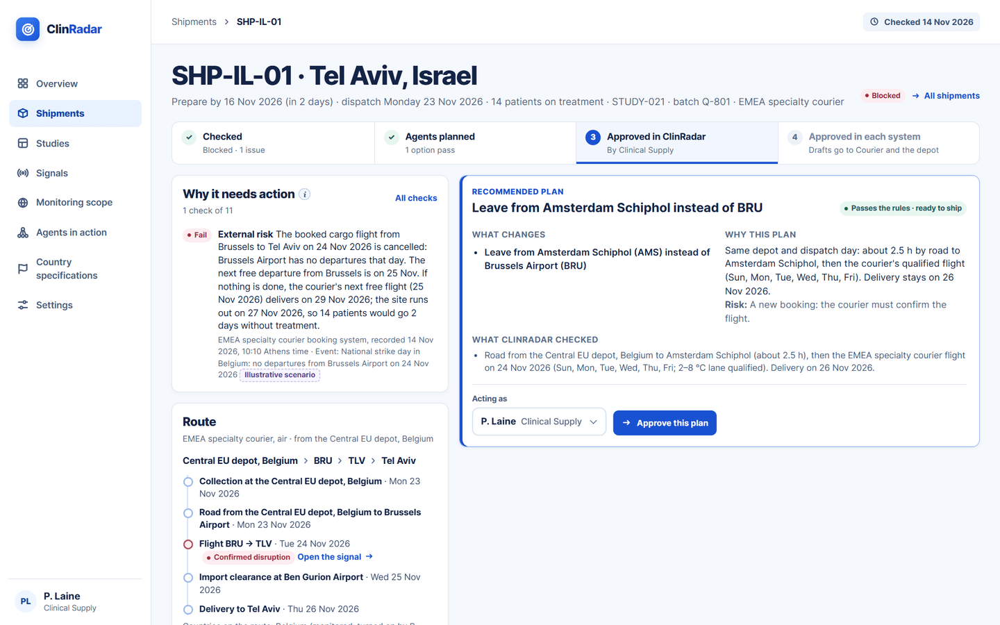
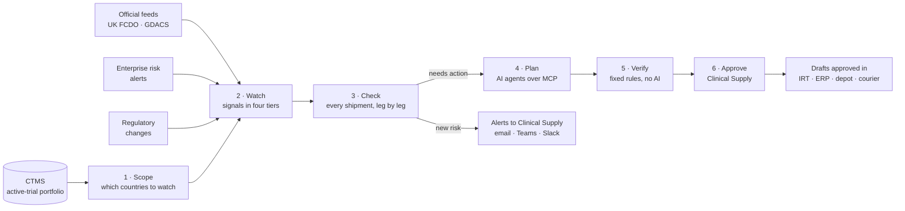
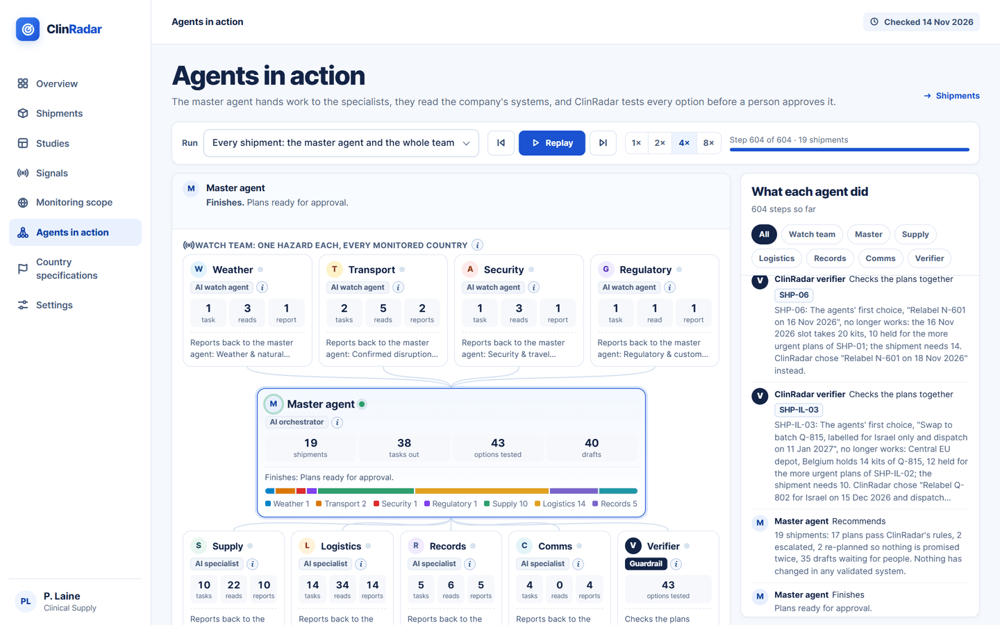

<div align="center">

# ClinRadar

**Stop clinical supply disruptions before patients miss treatment.**

ClinRadar watches the countries where your trials are active, checks every planned shipment before dispatch,<br>
and brings Clinical Supply recovery options that have already passed your rules.

`Node.js ≥ 22.13` · `SQLite` · `Model Context Protocol` · `Claude (Opus, Sonnet, Haiku 5.5)` · `Docker`


</div>

---

## The problem

ClinRadar answers one question for Clinical Supply: **which of our planned shipments will be disrupted, how sure are we, and what do we do about it?**

- **The cross-border leg is the weak point.** In the one multi-company study (Tufts CSDD, 2016), 80% of shipments to in-country depots arrived on time, against 97% of shipments to sites.
- **Keeping patients supplied is a regulatory duty.** ICH E6(R3) 3.15.3(c)(i) asks for timely supply "to avoid any interruption" of treatment. EMA counts systematic missed doses as a serious breach.
- **Nobody links the event to the shipment.** Regulatory intelligence tools (RegASK, Freyr, IQVIA, Clarivate, Veeva) watch rules. The 2026 supply agents (Signant, Endpoint, Suvoda) flag risks inside their own systems. None of them links an external event or a country requirement to a *specific planned shipment*, then proposes a recovery for a person to approve.

Full research: [ClinRadar-Research.md](ClinRadar-Research.md).

## Quick start

**Requirements:** Node.js 22.13 or later. **No API key is needed for the demo.**

```bash
npm install
npm start
```

Then open **http://127.0.0.1:4173/?empty**. This is an empty workspace, and the best way to start a demo. On Windows you can double-click **`Start-ClinRadar.cmd`** instead.

- `?fresh` clears the decisions so you can rehearse again. Nothing is deleted from the audit trail.
- Without a key, every agent run is the **offline demo run**. It takes the same steps through the same MCP servers, with the decisions written in code instead of made by Claude. To run Claude live, put `ANTHROPIC_API_KEY=…` in `.env` next to `serve-regchain.cjs`, or paste a key in **Settings › AI agents & integrations**.

## Five-minute demo

| Time | Screen | What happens |
|---|---|---|
| 0:00 | Overview (`?empty`) | No portfolio is connected, so ClinRadar monitors nothing |
| 0:20 | First check | It connects the CTMS: 22 studies, 18 counted, 16 countries monitored, Portugal to confirm |
| 0:50 | Monitoring scope | 50 countries are recommended, all off. You turn on Belgium (the central EU depot) and give a reason |
| 1:30 | Signals | The Belgian strike: a confirmed disruption for SHP-IL-01, not affected for SHP-03. The Ben Gurion works are a potential exposure |
| 2:30 | Agents in action → SHP-IL-01 | The agents read the route, the courier and the depot, and propose Amsterdam, Luxembourg and 25 Nov |
| 3:45 | Plan page | **Approve this plan** as Clinical Supply. Two drafts are created and nothing changes in any system yet |
| 4:30 | Plan page, then Settings | **Export the audit record**. Settings shows who turned Belgium on, and why |

### The worked example



A national strike day in Belgium on 24 Nov (illustrative) cancels the flight of shipment **SHP-IL-01** to Tel Aviv. The site has 14 patients on treatment and runs out of stock on **27 Nov**. If nobody acts, the courier's next free flight delivers on **29 Nov**, and 14 patients go 2 days without treatment.

The agents propose three options. **Leave from Amsterdam** passes every rule and delivers on **26 Nov**. **Leave from Luxembourg** needs a monitoring decision first, because Luxembourg isn't monitored. **Dispatch on 25 Nov** fails, because the kits arrive after the stock runs out. Clinical Supply approves the Amsterdam plan, and two drafts go out: a booking change for the courier and a collection instruction for the depot.

## How it works



1. **Scope.** Countries with an operationally active trial in the CTMS are monitored automatically (16 in the demo). Every other country is a *recommendation* with its evidence (50 in the demo), and stays off until a named person turns it on.
2. **Watch.** Four watch agents sweep the monitored countries, one kind of hazard each: weather, strikes and transport, security and travel advice, regulatory and customs.
3. **Check.** Every planned shipment's route is tested leg by leg against the events on that route and the destination's Country Specification. Of 25 planned shipments: **14 blocked, 5 to confirm, 6 ready**.
4. **Plan.** For each shipment that needs action, a master agent and four specialists read IRT, ERP, the depot, the eTMF, the CTMS and the courier, and propose two or three options.
5. **Verify.** A rule engine (no AI) checks every option: will the kits arrive before the site runs out, is the lane qualified for the temperature range, do the import approval's terms still hold? Only passing options can be approved.
6. **Approve.** A named person in Clinical Supply approves one plan. The server checks it again before recording it in a hash-chained audit trail.

ClinRadar says how sure it is. It never gives a probability:

| Tier | When | Example from the demo |
|---|---|---|
| 🔴 **Confirmed disruption** | An authorised system (the courier or the depot) confirmed the impact | The courier cancelled SHP-IL-01's Brussels → Tel Aviv flight on the Belgian strike day |
| 🟠 **Potential exposure** | It touches one of our shipments on the day, but nothing has confirmed an impact | Runway works at Ben Gurion, 4 to 8 Jan, and SHP-IL-02's flight on 5 Jan |
| 🟢 **Not affected after check** | It touched one of ours, and the carrier or depot confirmed normal operation | SHP-03's truck is in Germany before the strike day |
| ⚪ **Observed event** | A verified event in a monitored country that touches nothing of ours | A road protest in France when no shipment of ours is on French roads |

<table>
<tr>
<td width="50%"><br><sub><b>Monitoring scope:</b> countries come from the active-trial portfolio, never from a guess.</sub></td>
<td width="50%"><br><sub><b>Signals:</b> one event, matched to each of our shipments, with its evidence.</sub></td>
</tr>
<tr>
<td width="50%"><br><sub><b>Shipments:</b> the work queue, most urgent first, each with a plan to approve.</sub></td>
<td width="50%"><br><sub><b>Agents in action:</b> 19 shipments, 604 steps, every one replayable.</sub></td>
</tr>
</table>

## The agent team

| Agent | Model | Reads | Does |
|---|---|---|---|
| **Watch team** (4) | Claude Haiku 5.5 | Signals and sources for one hazard | Sweeps every monitored country and reports one finding each |
| **Master agent** | Claude Opus 5.5 | Checks, specifications, scope, signals, commitments | Triages (patients first), delegates, builds options, drafts the changes |
| **Supply** | Claude Sonnet 5.5 | IRT, ERP | Stock, batches, QP plans |
| **Logistics** | Claude Sonnet 5.5 | Depot, courier, ERP, IRT | Route legs, alternative departures, relabelling slots, site stock |
| **Records** | Claude Sonnet 5.5 | eTMF | Authorisations, import approvals and their terms, site contacts |
| **Communications** | Claude Sonnet 5.5 | none | Messages to sites in English and the local language |
| **Verifier** | none (fixed rules) | The rules, and what approved plans already hold | Passes or fails every option |

The agents use 8 MCP servers (ClinRadar, IRT, ERP, Depot, eTMF, CTMS, Courier, Draft inbox). **Plan all with AI agents** runs the whole portfolio at once. On the demo data: **19 shipments → 17 plans that pass, 2 escalations, 2 re-plans, 35 drafts, and nothing changed in any validated system.**

## Built for validated systems

Clinical supply runs on validated systems under GxP, EU GMP Annex 11 and 21 CFR Part 11. ClinRadar is designed around them:

- **The AI proposes, rules decide.** Pass or fail comes from fixed, testable rules (`regchain-ai/rules.mjs`), run again on the server at approval.
- **Validated systems stay the system of record.** The MCP servers expose read tools only. The only write tool creates a **draft** in a separate inbox (`executed: false`).
- **Never guessed.** A match is confirmed only by the courier's or depot's record. A broken feed is a coverage gap, never "no risk".
- **Every step is traceable.** Decisions, approvals, agent runs and tool calls go into an append-only audit trail, with each entry chained to the one before by its SHA-256 hash.
- **Segregation of duties.** Four roles: Clinical Supply, Regulatory SME, Quality owner and Quality verifier.

## What is real, what is illustrative

| | |
|---|---|
| **Real** | UK legislation and MHRA guidance, read at run time for the UK labelling case. UK FCDO travel advice and GDACS alerts, read live, with a recorded copy for offline demos. Countries, borders, cities and airports. The MCP servers, the agent loop, the rule engine, the database and the audit trail. |
| **Illustrative** (labelled so on screen) | The Belgian strike on 24 Nov 2026, the Ben Gurion runway works, the French road protest, the enterprise risk alerts, the Spanish note and the Israeli label rule. |
| **Fictional** | The studies, sites, shipments, depots, manufacturer and supplier, the courier and depot records, and the import approvals. The systems behind the MCP servers are JSON files in `demo-data/`. |

**Tests:** `npm run check:offline` runs every check with no network and no API calls. Of the starter pack's **30 acceptance tests**, 26 are automated, 2 are met by design and 2 are partial ([details](ClinRadar.md#the-packs-thirty-acceptance-tests)).

## Next steps

- **Prove the problem.** Ask 5 to 10 supply teams for 12 months of holds, relabels and missed deliveries with their root causes.
- **Real connectors.** Read-only service accounts for IRT, ERP, the depot, the eTMF and the courier, through the same MCP tools.
- **More sources.** MeteoAlarm, EASA conflict-zone bulletins, airport and strike notices, sanctions lists and customs portals.
- **GxP.** Once ClinRadar blocks shipments or edits controlled documents, it needs validation, Part 11 signatures and the company's own procedures.

## More documentation

> ClinRadar was called RegChain AI until 15 November 2026. Files and settings keep the old name (`serve-regchain.cjs`, `regchain-ai/`, `REGCHAIN_*`).

- [ClinRadar.md](ClinRadar.md): the brief, its 12 rules and the 30 acceptance tests
- [RegChain-AI-User-Journeys.md](RegChain-AI-User-Journeys.md): every path, with the clicks for each demo
- [RegChain-AI-Agents.md](RegChain-AI-Agents.md): how the agents work within validated systems
- [RegChain-AI-Deployment.md](RegChain-AI-Deployment.md): configuration, Docker, sign-in and live AI providers
- [RegChain-AI-Data-And-API.md](RegChain-AI-Data-And-API.md): the database, the pipeline and the `/v1` API
- [RegChain-AI-Validation.md](RegChain-AI-Validation.md): intended use, GAMP 5, Part 11 and Annex 11
