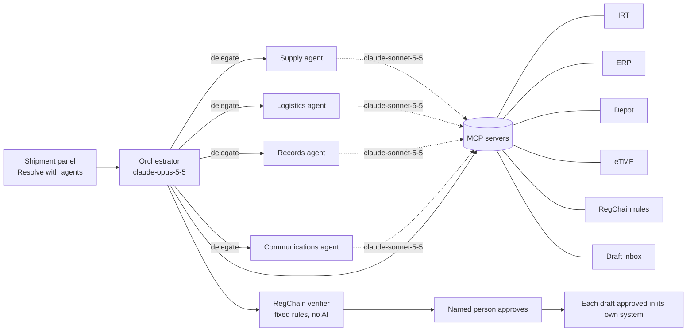

# RegChain AI · Agents that resolve blocked shipments

*15 November 2026. Design note for the hackathon team: what the agent layer does, how it is built, and how it fits validated clinical systems.*

## What it does

The Shipment checks page finds the problem: 11 of 20 planned shipments are blocked. The agent layer works on the next question, **what do we do about it?**

Fixing a blocked shipment today means asking several teams. Supply checks for another batch, the depot looks for a relabelling slot, Regulatory finds the authorisation letter in the eTMF, and someone writes to the site. Each answer sits in a different validated system.

**Resolve with agents** in a shipment's panel hands this to a team of AI agents:

- An **orchestrator** reads the failed checks and the destination's Country Specification, and decides what it needs to know.
- It **delegates** to specialists. Each one can use only the tools of its own systems:
  - the **supply agent** works with IRT and ERP: stock, batches and QP plans;
  - the **logistics agent** works with the depot, ERP and IRT: relabelling, label approvals, site stock and couriers;
  - the **records agent** works with the eTMF: authorisations and site contacts;
  - the **communications agent** writes messages to sites in English and the local language.
- The orchestrator builds two or three options, and **checks each one** with RegChain's rule engine before recommending it.
- It **drafts** the changes for the recommended option, for example a shipment change request in IRT or a relabelling work order for the depot.
- **RegChain's verifier**, which uses fixed rules and no AI, checks every option again. Only options that pass can be approved.
- A **named person** approves the plan in RegChain. Each draft still has to be approved in its own validated system.

Every step appears live on screen, and the whole run can be exported as an audit record.

## Three examples from the data

| Shipment | Why it is blocked | What the agents find | Result |
|---|---|---|---|
| SHP-04 (UK) | Legacy label after the 28 Apr 2026 cutoff; the trial's authorisation route is "unknown" in IRT | The eTMF holds the MHRA letter (old rules). The UK depot has 48 kits of J-203 with the updated label. A relabelling slot is free on 16 Nov. | Swap to J-203 and correct the route in IRT. Relabelling also passes. Delaying alone fails, because the label problem stays. |
| SHP-ES-10 (Spain) | Batch XZ417-26C has no QP release planned; site ES-08 has no pharmacy code | There is a QP slot on 2 Mar 2027. The eTMF has the site contact. The communications agent drafts the request in Spanish and English. | Book the QP release and ask for the code: drafts for ERP and the site portal. |
| SHP-03 (Germany) | No German label specification for the batch | The specification takes 15 business days and the site has 7 days of stock. | Nothing passes, so the agents escalate to Quality instead of guessing. |

The third example matters as much as the first two: the agents stop and escalate when no option passes the rules.

## How it is built

- **Six MCP servers** (`regchain-ai/mcp-servers.mjs`), one per system. Each runs as its own process and is reached through the Model Context Protocol SDK:
  - **RegChain**: shipment checks, Country Specifications, option checks;
  - **IRT**: shipments, depot stock, site stock;
  - **ERP**: batches, label approvals, QP plans;
  - **Depot**: relabelling capacity, couriers;
  - **eTMF**: trial authorisations, site contacts;
  - **Draft inbox**: create a draft.
- **The agent loop** (`regchain-ai/agent.mjs`). Claude's tool use, with the orchestrator delegating through a `delegate_to_agent` tool. Each specialist runs its own loop with only its own tools, and returns a written report. The run is capped at 16 orchestrator turns, 8 per specialist and 60 tool calls.
- **The rule engine** (`regchain-ai/rules.mjs`). The same checks as the Shipment checks page, plus the option check. The option check tests whether an option is possible (stock, label approval, slot dates, site stock against a delay, the eTMF record, lead times) and whether the shipment passes afterwards.
- **The server** streams each step to the page (`/api/agent/run`), keeps the last run per shipment, and refuses a second run while one is in progress.
- **Scripted walkthrough.** The same steps through the same MCP servers, with the decisions written in code instead of made by Claude. It works without an API key and serves as the baseline for tests.

## Compliance design

Clinical supply runs on validated systems: IRT, ERP, the depot's warehouse system, the eTMF and the QMS. They fall under GxP, EU GMP Annex 11 and 21 CFR Part 11. The agents are designed around that, not on top of it.

| Requirement | How the agent layer meets it |
|---|---|
| **Validated systems stay the system of record** | The agents can only read. The MCP servers for IRT, ERP, the depot and the eTMF expose read tools only; the only write tool creates a **draft** in a separate inbox. In production, each connector would use a read-only service account, so the limit holds even if a prompt or a model misbehaves. |
| **Changes go through each system's own change control** | A draft is a proposal, never a change (`executed: false`). A person approves it in IRT, ERP or the QMS with that system's electronic signature (Part 11, Annex 11). RegChain's approval only records that the plan was accepted. |
| **Generative AI is not the decision-maker** | The draft EU GMP Annex 22 on artificial intelligence (public consultation, July 2025) keeps generative AI and large language models out of critical GMP applications. Where they are used in non-critical work, a person reviews the output. Here the AI proposes. Pass or fail comes from fixed, testable rules, and a named person approves. An option that fails the rules cannot be approved. |
| **Credibility in proportion to risk** | The FDA's draft guidance on AI to support regulatory decision-making (January 2025) weighs model influence against decision consequence. A shipment decision has high consequence, so the model's influence is kept low. Verification is deterministic, every option shows its evidence, and a person decides. |
| **Audit trail (ALCOA+)** | Every step is logged with a timestamp: the goal, each delegation, each tool call with its inputs and the system's answer, each report, the options, the rule results, the drafts, the models and token counts, and who approved what. **Export the run** saves it as JSON. |
| **Least privilege** | Each specialist sees only the tools of its own systems. The orchestrator can read checks and specifications, check options and create drafts, but cannot read stock or batch data directly. |
| **Prompt injection and runaway runs** | Tool results are treated as data, and the system prompt says so. Nothing an agent reads can make it execute anything, because no tool executes anything. Turn and tool-call limits stop a loop. |
| **Change control for the AI itself** | Model IDs are pinned in code, prompts are versioned in git, and `npm run check:agent` is the regression test. Changing the model or a prompt means running it again before release. |
| **Data protection** | The prototype uses fictional data. Real Country Specifications and records never go into the repository or an AI request. In production this needs a data processing agreement and the company's approved AI hosting. |

## Running it

- **Scripted walkthrough:** works as soon as RegChain runs. Open Shipment checks, open SHP-04, SHP-03 or SHP-ES-10, then **Resolve with agents** and **Scripted walkthrough (no AI)**.
- **Live agents:** add `ANTHROPIC_API_KEY` to `.env` next to `serve-regchain.cjs` and restart RegChain. **Run the AI agents** is enabled once the key is set. A live run takes a minute or two and uses Claude Opus 5.5 for the orchestrator and Claude Sonnet 5.5 for the specialists.
- **Tests:** `npm run check:agent` checks:
  - the rules match the page (11 blocked, 5 to confirm, 4 ready);
  - the verifier rejects partial and impossible options;
  - all six MCP servers start, and only the draft inbox can write;
  - three scripted runs end as expected (swap, fix the data, escalate);
  - the live loop works end to end with a stand-in for Claude.

  It makes no API call.

## Real and illustrative

- **Real:** the MCP protocol and servers, the agent loop with Claude's tool use, the rule engine, the streaming, the approval and the audit record.
- **Illustrative:** the systems behind the MCP servers are fictional data files (`demo-data/supply-operations.json`), not IRT, ERP, a depot or an eTMF.

## Before it could be used for real

1. **Connectors** to the real systems' APIs with read-only service accounts, owned and validated by each system's team.
2. **Draft delivery** into each system's own change workflow (for example an IRT change request, a QMS record), instead of RegChain's inbox.
3. **A validation package for the agent layer**:
   - intended use: decision support, non-critical, human in the loop;
   - risk assessment;
   - test sets with expected outcomes, of which `check:agent` is the start;
   - a periodic review of runs where people rejected the recommendation.
4. **Roles and sign-in**, so approvals come from authenticated users rather than a role picker.
5. **One live run recorded** for the venue, in case the internet fails.
