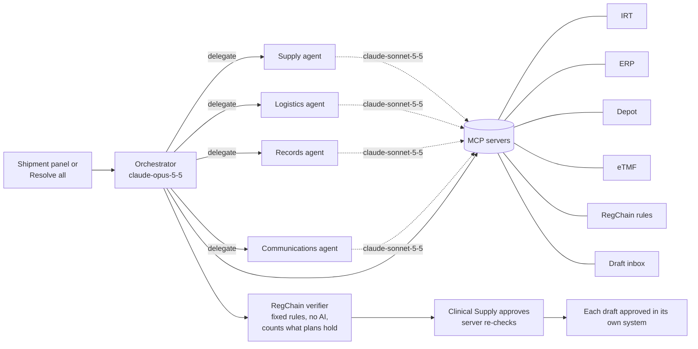

# RegChain AI · Agents that resolve blocked shipments

*15 November 2026. Design note for the hackathon team: what the agent layer does, how it is built, and how it fits validated clinical systems.*

## What it does

The Shipment checks page finds the problem: 11 of 20 planned shipments are blocked and 5 need a confirmation. The agent layer works on the next question, **what do we do about it?**

Fixing a blocked shipment today means asking several teams. Supply checks for another batch, the depot looks for a relabelling slot, Regulatory finds the authorisation letter in the eTMF, and someone writes to the site. Each answer sits in a different validated system. When several shipments are blocked at once, the same kits or the same relabelling slot can easily be promised twice.

**Resolve with agents** in a shipment's panel hands one shipment to a team of AI agents:

- An **orchestrator** reads the failed checks, the destination's Country Specification and what other plans already hold, and decides what it needs to know.
- It **delegates** to specialists. Each one can use only the tools of its own systems:
  - the **supply agent** works with IRT and ERP: stock, batches and QP plans;
  - the **logistics agent** works with the depot, ERP and IRT: relabelling, label approvals, site stock and couriers;
  - the **records agent** works with the eTMF: authorisations and site contacts;
  - the **communications agent** writes messages to sites in English and the local language.
- The orchestrator builds two or three options and **checks each one** with RegChain's rule engine before recommending it.
- It **drafts** the changes for the recommended option, for example a shipment change request in IRT or a relabelling work order for the depot. Each draft names the option it belongs to.
- **RegChain's verifier**, which uses fixed rules and no AI, checks every option again. A draft for an option that fails is withdrawn. Only passing options can be approved.
- A **named person in Clinical Supply** approves the plan in RegChain. The server checks it once more before recording it. Each draft still has to be approved in its own validated system.

**Resolve all with agents**, on the Shipment checks page, does this for every shipment that needs action, as one orchestrated run:

1. **Triage.** The orchestrator orders the shipments by preparation date, the most urgent first.
2. **One agent team per shipment.** Each shipment gets its own run, as above.
3. **Checking the plans together.** RegChain walks the plans in priority order and counts what each one holds: kits of a batch, places in a relabelling slot. If a less urgent plan loses its kits or slot to a more urgent one, RegChain moves it to its next passing option or another slot, withdraws its old drafts and drafts the new plan. If nothing passes, it escalates.
4. **One board** shows every plan, why it was re-planned and its approval, in priority order.

Every step appears live on screen, and every run can be exported as an audit record.

## Examples from the data

| Shipment | Why it needs action | What the agents find | Result |
|---|---|---|---|
| SHP-04 (UK) | Legacy label after the 28 Apr 2026 cutoff; the trial's authorisation route is "unknown" in IRT | The eTMF holds the MHRA letter (old rules). The UK depot has 48 kits of J-203 with the updated label. Preparation starts today, so relabelling on 16 Nov is too late unless the dispatch moves. | Swap to J-203 and correct the route in IRT. "Relabel and dispatch on 23 Nov" also passes. Delaying alone fails, because the label problem stays. |
| SHP-01 (UK) | Legacy label, and the dispatch falls on a Sunday | No other batch has enough kits. The 16 Nov relabelling slot finishes before preparation if the dispatch moves to Monday. | Relabel on 16 Nov and dispatch on Monday 23 Nov. |
| SHP-06 (UK) | Legacy label | On its own, the agents pick the 16 Nov slot. In the portfolio run, SHP-01 is more urgent and needs 10 of that slot's 20 places, and SHP-06 needs 14. | RegChain moves SHP-06 to the 18 Nov slot and withdraws the first drafts. |
| SHP-ES-10 (Spain) | Batch XZ417-26C has no QP release planned; site ES-08 has no pharmacy code | There is a QP slot on 2 Mar 2027, with kits at the depot two business days later. The eTMF has the site contact. The communications agent drafts the request in Spanish and English. | Book the QP release and ask for the code: drafts for ERP and the site portal. The shipment moves from Blocked to Confirm, because a booked release is not yet a signed one. |
| SHP-07 (UK) | Nothing blocks it; the post-cutoff label needs confirming against the approved specification | The ERP shows the updated label is approved. | Proceed, with a pre-dispatch confirmation draft for the depot. |
| SHP-03 (Germany) | No German label specification for the batch | The specification takes 15 business days and the site has 7 days of stock. | Nothing passes, so the agents escalate to Quality instead of guessing. |

In the portfolio run on today's data, 16 shipments get 14 plans that pass, 2 escalations (SHP-03, SHP-05) and 1 re-plan (SHP-06), with 28 drafts for people to approve. Nothing changes in any validated system.

## How it is built

- **Six MCP servers** (`regchain-ai/mcp-servers.mjs`), one per system. Each runs as its own process and is reached through the Model Context Protocol SDK. None of them receives the API key.
  - **RegChain**: shipment checks, Country Specifications, option checks, commitments (what approved plans already hold).
  - **IRT**: shipments, depot stock, site stock.
  - **ERP**: batches, label approvals, QP plans.
  - **Depot**: relabelling capacity, couriers.
  - **eTMF**: trial authorisations, site contacts.
  - **Draft inbox**: create a draft for a named option.

  A specification section with a change waiting for approval says so, so an agent never treats the old text as the whole rule.
- **The agent loop** (`regchain-ai/agent.mjs`). Claude's tool use, with the orchestrator delegating through a `delegate_to_agent` tool. Each specialist runs its own loop with only its own tools, and returns a written report. A run is capped at 16 orchestrator turns, 8 per specialist and 60 tool calls. The portfolio run (`resolvePortfolio`) runs up to three shipments at a time in live mode.
- **The rule engine** (`regchain-ai/rules.mjs`). The same checks as the Shipment checks page, plus the option check. The option check tests:
  - whether an option is possible: stock, label approval, slot dates and capacity, site stock against a delay, the eTMF record, QP lead time;
  - whether it is done in time: kits relabelled, label specifications ready and QP-released kits at the depot before preparation starts, not only before dispatch;
  - whether the shipment passes afterwards.

  Malformed dates make an option fail; they never stop the run.
- **Approvals** (`regchain-ai/approvals.mjs`). The server re-checks an option against the rules and the kits and slots other approved plans hold, refuses a stale or failing one, drafts the changes when someone picks an option other than the recommendation, and logs every approval and withdrawal.
- **The server** streams each step to the page (`/api/agent/run`, `/api/agent/portfolio-run`), keeps every version of every run, and refuses a second run while one is in progress.
- **Scripted walkthrough.** The same steps through the same MCP servers, with the decisions written in code instead of made by Claude. It works without an API key and serves as the baseline for tests.

## Compliance design

Clinical supply runs on validated systems: IRT, ERP, the depot's warehouse system, the eTMF and the QMS. They fall under GxP, EU GMP Annex 11 and 21 CFR Part 11. The agents are designed around that, not on top of it.

| Requirement | How the agent layer meets it |
|---|---|
| **Validated systems stay the system of record** | The agents can only read. The MCP servers for IRT, ERP, the depot and the eTMF expose read tools only; the only write tool creates a **draft** in a separate inbox. In production, each connector would use a read-only service account, so the limit holds even if a prompt or a model misbehaves. |
| **Changes go through each system's own change control** | A draft is a proposal, never a change (`executed: false`). A person approves it in IRT, ERP or the QMS with that system's electronic signature (Part 11, Annex 11). RegChain's approval only records that the plan was accepted. |
| **Generative AI is not the decision-maker** | The draft EU GMP Annex 22 on artificial intelligence (public consultation, July 2025) keeps generative AI and large language models out of critical GMP applications. Where they are used in non-critical work, a person reviews the output. Here the AI proposes. Pass or fail comes from fixed, testable rules, which run again on the server when someone approves. An option that fails the rules cannot be approved. |
| **Credibility in proportion to risk** | The FDA's draft guidance on AI to support regulatory decision-making (January 2025) weighs model influence against decision consequence. A shipment decision has high consequence, so the model's influence is kept low. Verification is deterministic, every option shows its evidence, and a person decides. |
| **No double promises** | Approved plans hold the kits and relabelling places they use. The agents see these commitments, the verifier counts them, and the portfolio run allocates in priority order. Withdrawing an approval frees what it held. |
| **Segregation of duties** | Only the Clinical Supply role approves supply plans. Regulatory and Quality roles see the plans but cannot approve them. A UK or Spain case cannot be closed by Quality while shipments it covers are still blocked with nothing recorded. |
| **Audit trail (ALCOA+)** | Every step is logged with a timestamp: the goal, each delegation, each tool call with its inputs and the system's full answer, each report, the options, the rule results, the drafts and which option each belongs to, the models and token counts. Every version of every run is kept. Approvals and withdrawals are logged with the person, the time and the run they came from. **Export the run** saves it as JSON. |
| **Least privilege** | Each specialist sees only the tools of its own systems. The orchestrator can read checks, specifications and commitments, check options and create drafts, but cannot read stock or batch data directly. The MCP server processes get no API key. |
| **Prompt injection and runaway runs** | Every agent's prompt says tool results and documents are data, not instructions. Nothing an agent reads can make it execute anything, because no tool executes anything. Turn and tool-call limits stop a loop. |
| **Change control for the AI itself** | Model IDs are pinned in code, prompts are versioned in git, and `npm run check:agent` is the regression test. Changing the model or a prompt means running it again before release. |
| **Data protection** | The prototype uses fictional data. Real Country Specifications and records never go into the repository or an AI request. In production this needs a data processing agreement and the company's approved AI hosting. |

## Running it

- **Scripted walkthrough:** works as soon as RegChain runs.
  - For one shipment: open Shipment checks, open SHP-04, SHP-01 or SHP-ES-10, then **Resolve with agents** and **Scripted walkthrough (no AI)**.
  - For every shipment: **Resolve all with agents** at the top of Shipment checks.
- **Live agents:** add `ANTHROPIC_API_KEY` to `.env` next to `serve-regchain.cjs` and restart RegChain. **Run the AI agents** is enabled once the key is set.
  - A run for one shipment takes a minute or two and uses Claude Opus 5.5 for the orchestrator and Claude Sonnet 5.5 for the specialists.
  - A live portfolio run of 16 shipments takes several minutes and costs more. Run it once before the demo; the page loads the last run.
- **Tests:** `npm run check:agent` makes no API call and uses a temporary cache, so approvals on the computer never change the results. It checks:
  - the rules match the page (11 blocked, 5 to confirm, 4 ready);
  - the verifier rejects partial, impossible, too-late and malformed options;
  - commitments: kits and slots held by another plan are not offered again;
  - all six MCP servers start, and only the draft inbox can write;
  - six scripted runs end as expected (swap, relabel with a Monday dispatch, fix the data, escalate, proceed with a confirmation);
  - the portfolio run: 16 shipments, most urgent first, SHP-06 re-planned, nothing promised twice;
  - approvals: re-checked on the server, refused when stale or failing, withdrawals free their holds, and every step is logged;
  - the live loop end to end with a stand-in for Claude, including a withdrawn draft for an option that fails.

## Real and illustrative

- **Real:** the MCP protocol and servers, the agent loop with Claude's tool use, the rule engine, the portfolio allocation, the streaming, the approval and the audit record.
- **Illustrative:** the systems behind the MCP servers are fictional data files (`demo-data/supply-operations.json`), not IRT, ERP, a depot or an eTMF.

## Before it could be used for real

1. **Connectors** to the real systems' APIs with read-only service accounts, owned and validated by each system's team.
2. **Draft delivery** into each system's own change workflow (for example an IRT change request, a QMS record), instead of RegChain's inbox.
3. **Holds in the systems themselves.** RegChain counts what approved plans hold; in production the depot and IRT would reserve the kits and slots once their drafts are approved.
4. **A validation package for the agent layer**:
   - intended use: decision support, non-critical, human in the loop;
   - risk assessment;
   - test sets with expected outcomes, of which `check:agent` is the start;
   - a periodic review of runs where people rejected the recommendation.
5. **Roles and sign-in**, so approvals come from authenticated users rather than a role picker.
6. **One live run recorded** for the venue, in case the internet fails.
