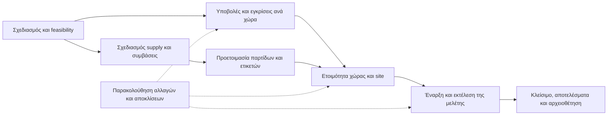

# Clinical trial lifecycle και δεδομένα για το RegChain AI

**Πεδίο εφαρμογής** · Τυπική ροή χορηγούμενης, παρεμβατικής κλινικής δοκιμής φαρμάκου σε ανθρώπους, με έμφαση στο clinical supply. Οι φάσεις αλληλεπικαλύπτονται. Οι απαιτήσεις που ισχύουν για κάθε δραστηριότητα εξαρτώνται από τη δικαιοδοσία, το πρωτόκολλο, το προϊόν και τις διαδικασίες του χορηγού.

## Πού μπαίνει το Clinical Supply Agreement

**Στο study start-up, πριν αρχίσει η δραστηριότητα που καλύπτει.** Το Clinical Supply Agreement (CSA) έχει νόημα όταν άλλος οργανισμός προμηθεύει προϊόν για τη μελέτη, όπως ένας συνεργάτης που διαθέτει το φάρμακό του για δοκιμή συνδυασμού. Η κάλυψη της προμήθειας μπορεί να βρίσκεται σε αυτόνομο CSA, σε ευρύτερη σύμβαση συνεργασίας ή σε ισχύουσα σύμβαση με σχετικό παράρτημα ή εντολή εργασίας. Στην εσωτερική προμήθεια, ο χορηγός τεκμηριώνει τις αρμοδιότητες και τις εγκρίσεις μέσω των εσωτερικών διαδικασιών του. Η ICH E6(R3), §3.3 και §3.6, προβλέπει κατανομή ρόλων πριν αρχίσουν οι δραστηριότητες και τεκμηρίωση των συμφωνιών πριν ξεκινήσει η εργασία που ανατίθεται. [ICH E6(R3), Annex 1](https://www.ema.europa.eu/en/documents/scientific-guideline/ich-e6r3-guideline-good-clinical-practice-step-5_en.pdf)

| Έγγραφο | Τι καλύπτει | Τι κρατά το AI |
| --- | --- | --- |
| **Clinical Supply Agreement (CSA)** ή σύμβαση συνεργασίας με όρους προμήθειας | Ποιος παρέχει ποιο προϊόν και για ποια μελέτη ή χώρες, πρόβλεψη και παραγγελίες, παράδοση, κατανομή ευθυνών και διαδικασία αλλαγών. | ID, έκδοση, μέρη, προϊόντα, μελέτες, χώρες, δραστηριότητες, ημερομηνίες ισχύος και ποιος αναλαμβάνει κάθε εργασία. |
| **Quality / Technical Agreement** | Ποιος αναλαμβάνει ελέγχους ποιότητας, τεκμηρίωση, αποκλίσεις, change control, ανακλήσεις και βήματα release, ανάλογα με το έργο. | Αντιστοίχιση υπευθυνότητας ανά εργασία, προϋποθέσεις, triggers, απαιτούμενο αποδεικτικό και πηγή. |
| **Master Services Agreement (MSA) + Statement of Work (SOW)** ή work order | Γενικοί όροι παρόχου και συγκεκριμένο έργο, π.χ. packaging, depot ή logistics. | Ποιος πάροχος καλύπτει κάθε δραστηριότητα, σε ποιες εγκαταστάσεις και χώρες, από πότε και με ποια εξάρτηση. |
| **Clinical Trial Agreement (CTA) με site ή ίδρυμα** | Διεξαγωγή της μελέτης στο site, συμβατικές υποχρεώσεις, προϋπολογισμό και αρμοδιότητες. | Σύνδεση με το site, κατάσταση συμφωνίας και σχετικές υποχρεώσεις παραλαβής, αποθήκευσης ή λογοδοσίας προϊόντος. |
| **Clinical supply plan / pharmacy manual** | Λειτουργικό σχέδιο και οδηγίες, όπως forecast, διαδρομές εφοδιασμού, παραλαβή, αποθήκευση, χορήγηση και επιστροφές, ανάλογα με το έγγραφο. | ID και εγκεκριμένη έκδοση, προϊόντα, χώρες, sites, λειτουργικές ημερομηνίες και σύνδεση με τις αντίστοιχες προδιαγραφές. |

Σε δημοσιευμένη συμφωνία συνεργασίας, τα μέρη όρισαν ότι το χωριστό **Clinical Supply Quality Agreement** έπρεπε να έχει συναφθεί πριν από την πρώτη προμήθεια του συγκεκριμένου προϊόντος. Είναι παράδειγμα συμβατικού οροσήμου. Για το RegChain, το κρίσιμο πεδίο είναι **ποια συμφωνία καλύπτει ποια δραστηριότητα και μέχρι πότε πρέπει να έχει τεθεί σε ισχύ**. Καταγράφουμε χωριστά την υπογραφή και την έναρξη ισχύος. Το ακρωνύμιο CTA χρειάζεται πλήρη ονομασία στα δεδομένα, επειδή μπορεί επίσης να σημαίνει *Clinical Trial Application* ή, ανάλογα με τη χρήση, *Clinical Trial Authorisation*. [Δημοσιευμένη σύμβαση συνεργασίας, §2.4 και §8](https://www.sec.gov/Archives/edgar/data/1861123/000119312526008888/d903262dex1017.htm) · [FDA, Quality Agreements για συμβατική παραγωγή](https://www.fda.gov/media/86193/download)

## 1. Χάρτης της μελέτης



| Στάδιο | Τι γίνεται και ποιος το χειρίζεται | Πληροφορίες που χρειάζεται το RegChain |
| --- | --- | --- |
| **1. Σχεδιασμός και feasibility** | Sponsor και Clinical Development ορίζουν στόχους, πληθυσμό, σχεδιασμό, endpoints και πρωτόκολλο. Clinical Operations εξετάζει τις χώρες και τα sites. Clinical Supply εκτιμά ζήτηση και εφικτότητα. | `study_id`, έκδοση πρωτοκόλλου, φάση και κατάσταση, υποψήφιες χώρες/sites, κωδικοί προϊόντων και ρόλος τους, προγραμματισμένα ορόσημα. Συγκεντρωτικά στοιχεία ζήτησης μόνο αν χρειάζονται. |
| **2. Start-up και συνεργάτες** | Clinical Supply επιλέγει μοντέλο προμήθειας, παραγωγή/συσκευασία, depot και διαδρομές. Procurement, Legal, Quality και οι υπεύθυνοι των υπηρεσιών συμφωνούν στο αντικείμενο και στις αρμοδιότητες. | `partner_id`, ρόλος, εγκαταστάσεις, χώρες, `agreement_id`, έκδοση, υπογεγραμμένο/σε ισχύ, δραστηριότητα που καλύπτεται, ημερομηνία που απαιτείται, υπεύθυνος. |
| **3. Regulatory και ethics** | Regulatory Affairs συντονίζει την υποβολή και την απόφαση ανά αρμόδια αρχή. Το dossier περιλαμβάνει τα σχετικά έγγραφα της μελέτης, τα στοιχεία του προϊόντος και τις πληροφορίες labeling όπου απαιτούνται. | `study_country_id`, δικαιοδοσία, αρχή ή ethics body, τύπος και κατάσταση απόφασης, αριθμός έγκρισης, ημερομηνία υποβολής/ισχύος, όροι, έκδοση εγκεκριμένου πρωτοκόλλου και αναφορές εγγράφων. |
| **4. Supply readiness και release** | Clinical Supply, Packaging και Quality προετοιμάζουν παρτίδες, εγκεκριμένες προδιαγραφές ετικέτας και διαθεσιμότητα. Όπου εφαρμόζεται, καταγράφονται πιστοποίηση από Qualified Person (QP) και release ως χωριστά ορόσημα. | `product_id`, `batch_id`, `label_spec_id` και έκδοση, συσχέτιση παρτίδας–ετικέτας, ημερομηνία παραγωγής, ημερομηνία QP, κατάσταση release, expiry, συνθήκες αποθήκευσης, έγγραφα και υπεύθυνοι. |
| **5. Site activation και πρώτη αποστολή** | Clinical Operations καταγράφει site readiness και ενεργοποίηση. Logistics οργανώνει την αποστολή σύμφωνα με τις εγκρίσεις, το release, τις διαθέσιμες άδειες και τις διαδικασίες που ισχύουν για τη συγκεκριμένη διαδρομή. | Χωριστές καταστάσεις και planned/actual ημερομηνίες για ενεργοποίηση, αποστολή, τελωνειακή είσοδο, παραλαβή, πρώτη πράξη recruitment και έναρξη εφοδιασμού του site. `shipment_id`, παρτίδες, origin/transit/destination και σχετικές άδειες. |
| **6. Εκτέλεση και αλλαγές** | Τα sites κάνουν recruitment, consent, επισκέψεις και συλλογή δεδομένων. Ο χορηγός επιβλέπει την ασφάλεια και τη διεξαγωγή. Clinical Supply κάνει replenishment, ελέγχει stock και expiry και αξιολογεί αλλαγές σε πρωτόκολλο, χώρες, ετικέτες και αποστολές. | Ενεργές εκδόσεις, πραγματικές και σχεδιαζόμενες ημερομηνίες, stock σε συγκεντρωτικό επίπεδο, αλλαγές διαδρομών/προμηθευτών, κατάσταση αποστολών, αναφορές αποκλίσεων και υπεύθυνος. |
| **7. Close-out** | Clinical Operations και Data Management ολοκληρώνουν follow-up και ανάλυση. Ο χορηγός χειρίζεται τις απαιτούμενες αναφορές και την αρχειοθέτηση. Clinical Supply και τα sites κάνουν reconciliation, επιστροφές ή εγκεκριμένη τελική διάθεση. | Ημερομηνία λήξης ανά χώρα και για το σύνολο της μελέτης όπου χρειάζεται, κατάσταση λογοδοσίας, υπόλοιπα ανά παρτίδα/τοποθεσία, `disposition_id`, αποδεικτικό επιστροφής ή διάθεσης και διατήρηση αρχείου. |

**Η «έναρξη» έχει περισσότερες από μία ημερομηνίες.** Στο EU Clinical Trials Regulation, ως έναρξη ορίζεται η πρώτη πράξη recruitment προς δυνητικό συμμετέχοντα, εκτός αν το πρωτόκολλο ορίζει διαφορετικά. Το site activation, η πρώτη αποστολή και το first patient enrolled ή dosed καταγράφονται χωριστά. Για τη ροή της ΕΕ, η καθοδήγηση χειρισμού και αποστολής IMP περιγράφει χωριστά την πιστοποίηση παρτίδας από QP και το regulatory release από τον χορηγό προς τα sites. [EU CTR, άρθρο 2(2)(25), άρθρα 36–37 και Παράρτημα I](https://eur-lex.europa.eu/legal-content/EN/TXT/?uri=CELEX%3A32014R0536) · [Ευρωπαϊκή Επιτροπή, καθοδήγηση χειρισμού και αποστολής IMP, §2–5](https://health.ec.europa.eu/document/download/6e8ae778-73d0-4a1e-a374-a06e791152a7_en?filename=guideline_handling-shipping_investigational-mp_en.pdf)

## 2. Ελάχιστες εγγραφές και πηγές

| Εγγραφή | Κλειδιά και ελάχιστα πεδία | Ενδεικτική πηγή |
| --- | --- | --- |
| **Study → StudyCountry → Site** | Σταθερά IDs, πρωτόκολλο και έκδοση, δικαιοδοσία, κατάσταση, υπεύθυνος, ορόσημα planned/actual. | CTMS, το σύστημα διαχείρισης κλινικών μελετών. eTMF, το ηλεκτρονικό αρχείο τεκμηρίωσης της μελέτης. |
| **Country approval** | `study_country_id`, αρχή, είδος, αποτέλεσμα, όροι, ημερομηνίες υποβολής/απόφασης/ισχύος και αναφορά στην εγκεκριμένη έκδοση. | Regulatory tracking / επίσημη απόφαση, π.χ. CTIS στην ΕΕ. |
| **Product → Batch ↔ Label specification** | Τύπος/ρόλος προϊόντος, παρτίδα, QP όπου εφαρμόζεται, ημερομηνίες release, έκδοση ετικέτας, ποια παρτίδα έλαβε ποια έκδοση, κατάσταση και proof reference. | ERP για προϊόν και παρτίδα, σύστημα labeling, QMS για Quality. |
| **Shipment ↔ Batch / Site / Partner** | Γραμμές αποστολής για τις συνδεδεμένες παρτίδες, προορισμός και transit, ημερομηνίες γεγονότων, status, χρόνος προετοιμασίας, depot και υπεύθυνοι όπου χρειάζεται. | Logistics / ERP / depot. IRT ή RTSM για επιτρεπόμενη, συγκεντρωτική ορατότητα διανομής, όταν χρειάζεται. |
| **Agreement ↔ Activity coverage** | Τύπος εγγράφου, ενεργή έκδοση, κατάσταση, μέρη, `study_id` ή κοινό πεδίο κάλυψης, προϊόν/χώρα, λίστα δραστηριοτήτων, `signed_at`, `valid_from`, `valid_to`, `required_before_event`, ιδιοκτήτης και ελεγχόμενη αναφορά. | Contract management. QMS για το quality agreement και τις αναθέσεις. |
| **Requirement version → Evidence → Assessment → Action** | Δικαιοδοσία, ημερομηνία ισχύος, κανόνας και εξαιρέσεις, ενεργοποιητικό γεγονός, έκδοση πηγής, έκδοση εταιρικής ερμηνείας, per-object εύρημα, υπεύθυνος, προθεσμία και αποδεικτικό υλοποίησης. | Country Intelligence Platform, επίσημες πηγές και QMS. |

Οι συσχετίσεις είναι συχνά πολλές-προς-πολλές. Μία σύμβαση μπορεί να καλύπτει πολλές μελέτες. Μία μελέτη μπορεί να έχει πολλούς παρόχους και μία αποστολή πολλές παρτίδες. Κάθε κρίσιμο πεδίο κρατά `source_system`, `record_ref`, `record_version` όπου υπάρχει, και `observed_at`. Χρησιμοποιούμε τη γεωγραφία του **site και της διαδρομής**, την **έκδοση ετικέτας ανά παρτίδα** και την **κάλυψη της συγκεκριμένης δραστηριότητας από τη σύμβαση**. Ένα συνολικό `study_status` ή `agreement_signed` δεν αρκεί.

## 3. Οδηγίες εισόδου για το AI

Δώσε μαζί με το υπάρχον master prompt αυτόν τον χάρτη και το [ενδεικτικό JSON εισόδου](RegChain-AI-Clinical-Trial-Input.example.json). Το JSON είναι συνθετικό και δείχνει μόνο τα δεδομένα που χρειάζονται για την περίπτωση UK labeling.

```text
Σκοπός: εκτίμησε τη δυνητική επίδραση μιας ρυθμιστικής αλλαγής σε
μελέτες, προϊόντα, παρτίδες, αποστολές, sites και συνεργάτες.

1. Ξεκίνα από την έκδοση της απαίτησης και την τεκμηριωμένη δικαιοδοσία,
   ημερομηνία ισχύος, προϋποθέσεις, εξαιρέσεις και γεγονός εφαρμογής.
2. Σύνδεσε εγγραφές με σταθερά IDs και έλεγξε την προέλευση και την
   ενημερότητα των σχετικών πεδίων.
3. Έλεγξε κάλυψη σύμβασης ανά δραστηριότητα, προϊόν, χώρα και συνεργάτη.
   Χρησιμοποίησε την ημερομηνία του συγκεκριμένου ορόσημου και τις
   ημερομηνίες υπογραφής/ισχύος. Άγνωστη κάλυψη χρειάζεται έλεγχο.
4. Δώσε ανά αντικείμενο status, αιτιολογία, evidence IDs, ελλείποντα
   πεδία, υπεύθυνο και προτεινόμενη ημερομηνία επανεξέτασης.
   Τα public registry δεδομένα στηρίζουν μόνο screening.
5. Κράτησε χωριστά τη δυνητική κανονιστική εφαρμογή, την ετοιμότητα
   της λειτουργίας και την επείγουσα προθεσμία προετοιμασίας.
6. Πρότεινε ενέργεια για τον αρμόδιο SME. Η έκδοση παρτίδας, η
   αποστολή, η ενεργοποίηση site και οι επίσημες εγκρίσεις
   τεκμηριώνονται από τα υπεύθυνα συστήματα και τους κατόχους τους.
```

**Παράδειγμα από το πρωτότυπο.** Για το συνθετικό `B-102`, η φυσική παραγωγή ήταν στις 20 Απριλίου και η πιστοποίηση του τελικού IMP από QP στις 5 Μαΐου 2026. Για το συγκεκριμένο UK labeling transition, η καθοδήγηση MHRA χρησιμοποιεί την ημερομηνία QP. Ο συνδυασμός μεταγενέστερης πιστοποίησης και παλαιότερης έκδοσης ετικέτας δίνει **«απαιτείται έλεγχος labeling»**. Η σχεδιαζόμενη αποστολή και ο χρόνος προετοιμασίας ορίζουν πότε πρέπει να ανοίξει ο έλεγχος. Η συμφωνία δείχνει ποιος χειρίζεται το packaging και ποιος χειρίζεται το logistics. [MHRA, μεταβατικές διατάξεις για labeling IMP](https://www.gov.uk/guidance/clinical-trials-for-medicines-clinical-trials-regulations-transitional-arrangements#transitional-arrangements-for-labelling-of-investigational-medicinal-products)

**Πρώτη υλοποίηση.** Αρκούν συνθετικές εγγραφές για **Study/Country, Product/Batch/Label, Shipment/Partner και Agreement coverage**, μαζί με την εγκεκριμένη country requirement και το source evidence. Εισάγουμε μεταδεδομένα συμβάσεων και εγκεκριμένες αναφορές σε όρους. Τα στοιχεία ασθενών, οι ατομικές αναθέσεις θεραπείας και τα εμπορικά στοιχεία συμβάσεων μένουν στα αντίστοιχα συστήματα.
