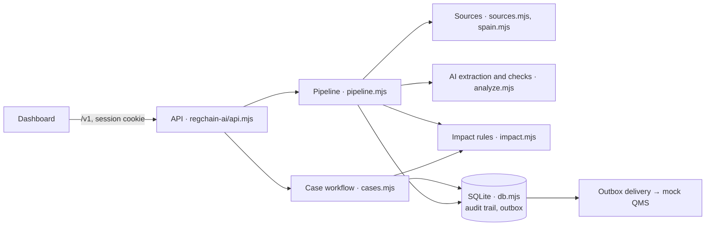

# RegChain AI · Database, pipeline and API

*15 November 2026. The server side planned for Giannis in the Master Specification (sections 8 and 9), built in Node so the product stays one codebase. The `/v1` contract is the one the specification defines, so the backend could still be replaced later without changing its callers.*

## What changed

Until now, the dashboard kept every case decision, publication, Quality task, shipment action and change decision in the browser. Now **the server is the system of record**:

- A SQLite database (Node's built-in `node:sqlite`) holds what RegChain owns.
- Every step of a case is checked on the server, with the role taken from the session, never from the page.
- Every step is written to an append-only audit trail, with each entry chained to the one before by its hash.
- Lifecycle events go through an outbox to their consumers, including a mock Quality system.
- A regulation pipeline snapshots the official sources, finds meaningful changes, resolves the evidence passages in the stored text, records the AI extraction and assesses the portfolio with fixed rules.

The dashboard looks the same. Served by RegChain, it reads and writes through `/v1`; opened as a file, it still works from browser storage, with an orange notice.

## Components

| Module | Responsibility |
|---|---|
| `regchain-ai/db.mjs` | Opens the database, runs migrations once each, transactions, the hash-chained audit trail, the outbox and idempotency keys. |
| `regchain-ai/impact.mjs` | The Clinical Supply impact rules, the same as the dashboard's: the UK labelling rule on the finished-IMP QP date, and the Spain shipping-document rule. Each finding names its rule version (`uk_imp_labeling@1`, `es_shipping_documents@1`). |
| `regchain-ai/cases.mjs` | The governed cases and their workflow: decisions, publication, the Quality task and closure. Each step stores the new state, proposal revision, decision, published requirement and specification versions, the downstream action, audit entries and outbox events in one transaction. |
| `regchain-ai/pipeline.mjs` | Replays a fixture set end to end, live or with the recorded extraction. |
| `regchain-ai/api.mjs` | The `/v1` routes, sessions, the same-site guard, idempotency and outbox delivery. |
| `regchain-ai/openapi.mjs` | The OpenAPI 3.1 description, served at `/v1/openapi.json`. |

## The pipeline

`POST /v1/replays` with `fixture_set` (`uk-labelling` or `es-notice`) and `extraction_mode` (`live` or `recorded`):

1. **Sources.** Fetch the official texts (live) or use the last stored copy (recorded). Each version is stored once per SHA-256 of its text, with its normalised hash, edition and retrieval time.
2. **Extraction.** In live mode, Claude drafts the change and RegChain checks every quote, the date and the status. In recorded mode, the last result is used.
3. **Evidence.** Each evidence passage is located in the stored text. Its offsets and hash are kept, and `GET /v1/evidence/{id}` returns them. A passage that can't be found is reported, not assumed.
4. **Comparison.** One of four outcomes:
   - **material change:** the before and after versions differ after normalisation;
   - **new document:** the Spanish note, which has no predecessor;
   - **no relevant change:** whitespace or typography only;
   - **source unavailable.**

   Identical inputs reuse the case they produced, so a change is detected once.
5. **Assessment.** The impact rules run against a stored portfolio snapshot. Each finding records the rule version, the inputs used and the evidence. The UK result matches the acceptance answer key (`demo-data/uk-labelling-expected-impact.json`): 7 trials and 6 UK shipments need action, the earliest deadline is 14 Nov 2026, and 101 patients are at those sites.
6. **Events.** The pipeline emits `regulatory_change.detected`, `impact_assessment.prepared` and `expert_review.requested`. A passing extraction becomes the proposal under review, as a new revision.

On first start, the server creates the cases and replays both fixture sets in recorded mode, so the database is populated without network or AI calls.

## The case workflow

The steps and their rules are the dashboard's own. `scripts/check-server.mjs` runs the page's code and the server's side by side and requires identical states and refusals.

| Step | Who | Result |
|---|---|---|
| Approve, edit and approve, reject, request investigation, defer, resume | Regulatory SME | Approval publishes the next requirement version and specification version, assigns the Quality task, and emits `requirement_version.approved`, `country_intelligence.updated` and `downstream_action.required`. |
| Acknowledge, submit evidence | Quality owner | `downstream_action.acknowledged`, `downstream_action.implemented` |
| Return or verify evidence | Quality verifier, never the approver or the owner | `implementation_evidence.verified`, `change.closed`. Closing is refused while a covered shipment is still blocked with nothing recorded. |
| Return from deferral | RegChain scheduler, on the date | The case goes back to review. |

The server also enforces the AI gate:

- a failed AI check blocks approval;
- without any AI check, approval needs an explicit override, which is recorded.

## Rules every write follows

- **Role from the session.** In the one-person mode, `POST /v1/session` sets the role, kept in an HttpOnly, SameSite=Strict cookie. With named users (`REGCHAIN_AUTH=password`) the role comes from the signed-in account instead: see Commercial hardening below.
- **Same site only.** Writes need JSON, and requests from other sites are refused.
- **Version preconditions.** A command names the proposal revision it was made against. A stale revision returns 409.
- **Idempotency.** With an `Idempotency-Key`, an exact retry returns the first response. A different request under the same key returns 409. `POST /v1/proposals/{id}/decisions` requires the key.
- **Status codes:**
  - 401: no role chosen, or not signed in when people sign in;
  - 403: wrong role or another site;
  - 409: a conflict or a blocked closure;
  - 422: invalid input, or a rule refuses the step.
- **Audit.** Entries can't be updated or deleted: triggers refuse it. Each entry's hash covers the previous one, so `GET /v1/audit/verify` finds any edited, inserted or removed entry.
- **Outbox.** Events are stored in the same transaction as the change, then delivered at least once. The mock QMS keeps one receipt per event, and `POST /v1/outbox/dispatch` retries failures.
- **Rehearsal reset.** `POST /v1/cases/{id}/reset` starts a case again. Versions it published are marked withdrawn, never deleted, and the audit trail keeps the earlier run.

## API

| Route | Purpose |
|---|---|
| `GET /v1/health` | Status, schema version and the audit-chain check |
| `GET /v1/openapi.json` | The full contract |
| `GET, POST /v1/session` | The session's role |
| `GET /v1/cases`, `GET /v1/cases/{id}` | Cases with evidence, proposals, decisions and workflow |
| `POST /v1/cases/{id}/commands` | Any workflow step |
| `POST /v1/proposals/{id}/decisions` | Approve or reject an exact revision (spec section 9) |
| `POST /v1/actions/{id}/acknowledgements` | The action owner acknowledges |
| `POST /v1/cases/{id}/reset` | Rehearsal reset |
| `GET /v1/cases/{id}/impact` | Versioned impact with per-object findings |
| `GET /v1/cases/{id}/events`, `GET /v1/cases/{id}/audit`, `GET /v1/audit/verify` | Events with their delivery status, the audit trail and its check |
| `GET /v1/evidence/{id}` | Excerpt, locator, offsets, hash and source version |
| `GET /v1/requirements/{key}/versions?applicable_on=&known_at=` | Requirement history and the version in force on a date |
| `GET /v1/specifications/{country}/versions` | Country Specification versions |
| `GET, POST /v1/replays` | Pipeline runs |
| `POST /v1/outbox/dispatch` | Retry event delivery |
| `GET /v1/shipment-actions`, `PUT` and `DELETE /v1/shipment-actions/{id}` | Manual hold, swap or proceed |
| `GET /v1/change-decisions`, `PUT /v1/change-decisions/{id}` | Owner decisions on changes without a governed case |
| `GET /v1/monitoring-scope` | ClinRadar's scope: countries with an operationally active trial, recommended countries with their evidence and switches, registered countries that are not operationally active; undetermined with no portfolio connected |
| `GET /v1/signals?tier=`, `GET /v1/signals/{id}` | External signals in monitored countries, matched to shipments and classified, with the evidence or the missing evidence |
| `GET /v1/shipments/{id}/risk` | A shipment's route with the day of each leg, its external-risk matches, and its route and import-approval checks |

The ClinRadar routes are read-only. The scope changes only through the page's monitoring switches (`POST /api/supplyshield/monitoring`: Clinical Supply for external risk, the Regulatory SME for regulatory and customs, always with a reason), and every change is in the audit trail.

## Data

The database is `.regchain-data/regchain.db`. Git ignores it, and `REGCHAIN_DATA_DIR` or `REGCHAIN_DB` can move it. The tables follow section 8 of the specification:

- `source`, `source_version`, `evidence_span`
- `change_case`, `proposal`, `decision`
- `requirement_version`, `specification_version`
- `portfolio_snapshot`, `impact_assessment`, `impact_finding`
- `action`, `qms_receipt`
- `shipment_action`, `change_decision`
- `session`, `idempotency_key`, `replay_run`
- `audit_entry`, `outbox_event`

Migrations are numbered and run once. A shipped migration is never edited; a new one is added instead.

## Tests

`npm run check:server` runs in temporary folders, with no network and no AI calls. It checks:

- **Database:** migrations, and that audit entries can't be changed or deleted and that tampering breaks the chain.
- **Upgrade:** approvals that earlier versions kept in `agent-approvals.json` are imported once, with an audit entry, and the file is renamed.
- **Parity:** five workflow sequences give identical states and refusals in the page and on the server.
- **Answer key:** the UK impact matches all 33 batches and 10 shipments, and the totals.
- **Pipeline:** detection happens once, identical inputs reuse the case, a whitespace-only change is ignored, and evidence resolves.
- **API:**
  - every status code, and refusals from other sites;
  - idempotent decisions, outbox delivery, and acknowledgement by the owner only;
  - the closure block, requirement history and the date lookup;
  - evidence, impact, shipment actions and change decisions;
  - reset and the scheduled return from deferral;
  - an intact audit chain at the end.

`npm run check:security` tests sign-in, roles, headers, limits, the users command and a backup on the real server started with named users. `npm run check` runs every check in the repository; CI runs them on every pull request.

## Differences from the specification

- **Node instead of Python and FastAPI**, so there is one codebase. The routes and payloads follow section 9.
- **Proposals are addressed by case** (`/v1/proposals/uk/decisions`) and carry the revision in the body. The decision is bound to that exact revision.
- **The impact rules run on portfolio snapshots** stored as JSON. Separate study, batch and label tables come with real portfolio imports.

## Commercial hardening

The second pull request made the server fit for a team:

- **Named users** (`REGCHAIN_AUTH=password`) instead of the role switch. Each person holds one role. Authorisation runs on the server for every route, reads included, and the page and the agent routes need a signed-in user.
- **Sign-in rules:** salted scrypt hashes, a 12-character minimum, lockout per username and per client address, idle and maximum session length, and an audit entry for every attempt.
- **Headers and limits:** a Content Security Policy with a per-page script nonce, `X-Frame-Options: DENY`, `nosniff`, HSTS over HTTPS, a Host header check, a write rate limit with `Retry-After`, a body size limit and a zod schema for every request body.
- **Operations:** JSON logs with request IDs, `/v1/health` with the schema version and the audit chain, a Docker image, a Compose file, a CI workflow, `npm run users` and `npm run backup`.
- **Agent approvals in the database:** each approval, acknowledgement and withdrawal is a row plus an audit entry. Approvals that earlier versions saved in `agent-approvals.json` are imported once and the file is renamed. Agent run outputs stay as files in the cache folder.
- **The person, not the role:** with named users, every workflow step and every case reset is recorded under the signed-in person's name.

`npm run check:security` tests these rules on the real server, started with named users in temporary folders. Running it: [RegChain-AI-Deployment.md](RegChain-AI-Deployment.md). Validation: [RegChain-AI-Validation.md](RegChain-AI-Validation.md).

## Next

- Single sign-on (OIDC or SAML) and electronic signatures with re-authentication for approvals and verification.
- PostgreSQL when more than one instance is needed.
- Real connections to the Quality system, IRT, ERP, the depot and the eTMF in place of the mock systems.
