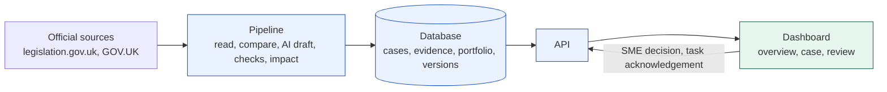

# RegChain AI · project plan

Status on 14 November 2026 · Gen AI Summit hackathon · Update this file whenever a piece of work lands.

## Where we are

We have a detailed product specification, a working dashboard for one regulatory case (the UK IMP labeling change of 28 April 2026), and a first live AI check that reads the official regulation texts and drafts the change. Almost everything else in the dashboard is sample data written into the page, and every decision lives only in the browser. Giannis is building the database and the pipeline. The remaining work is to connect the dashboard to that database, save the human decisions properly, test the results against the expected answers, and prepare the demo.

Blue: Giannis. Green: dashboard and product side. The API between them is the first thing to agree.

## What is done

| Area | What exists | Where | Limits today |
| --- | --- | --- | --- |
| Product specification | Vision, requirements, evidence and time rules, approval and audit model, MVP architecture, API, acceptance tests, 36-hour build plan | `RegChain-AI-Master-Specification.md` (v1.1) | Written for the full MVP; most of it is not built yet |
| Research | Data sources (ClinicalTrials.gov, CTIS, AACT), comparable products, real registry examples | `RegChain-AI-Dashboard-Research.md` | |
| Trial workflow and data map | Clinical trial stages, minimum records, AI input instructions (in Greek) and a synthetic input file | `RegChain-AI-Clinical-Trial-Workflow.md`, `RegChain-AI-Clinical-Trial-Input.example.json` | Not yet used by any code |
| Dashboard | Four pages (Overview, Country requirements, Source log, Monitoring schedule) and the UK case with evidence, batch and shipment impact, SME decision, versioned publication, mock Quality task, case history and JSON export. Four demo roles: viewer, Regulatory SME, Quality owner, Quality verifier | `RegChain-AI-Dashboard.html` | See "What is still simulated" |
| Batch rules | The UK rule that sorts batches A-101 to F-106 by finished-IMP QP date | Inside the dashboard (`batchFinding`) | Runs in the browser; status names differ from the spec (see decision 4) |
| Live AI check | Fetches regulation 46 before and from 28 April 2026, Schedule 14 paragraph 6 and the MHRA labelling guidance; Claude (`claude-opus-5-5`) drafts the change with quotes; RegChain checks every quote, the effective date and the change status; a failed check blocks SME approval | `regchain-ai/`, `serve-regchain.cjs`, panel at the top of the UK case | Tested with a stand-in AI only. The first real run needs an API key in `.env` |
| Local start | `Start-RegChain.cmd` starts the server at http://127.0.0.1:4173 and installs the Anthropic SDK the first time | `Start-RegChain.cmd`, `package.json`, `package-lock.json` | Needs Node.js 20.12 or later |
| Tests | `npm run check:ai` fetches the four sources and tests the quote, date and status checks without calling the API | `scripts/check-ai-step.mjs` | No tests for the dashboard or the batch rules yet |
| Backup idea | Build plan for a Challenge 3 entry (conversational ePRO) | `conversational-epro/PLAN.md` | Not being built; the team chose RegChain |

## What is still simulated

Say these out loud in the demo, and replace them in this order where time allows.

1. **Portfolio data.** Studies, batches, shipments and partners are written into the page. They should come from the database.
2. **Decisions.** SME decisions, the published version, the Quality task and the case history are saved only in the browser (`localStorage`). They should be saved in the database.
3. **Roles.** Anyone can pick "Regulatory SME" from a dropdown. A demo session with a fixed role per user is enough for the hackathon.
4. **Replay and schedule.** The Replay button and the monitoring schedule fetch nothing; they update a counter and show a fixed message. Only the AI check fetches real sources.
5. **The EU and GB import changes.** Their summaries are written in advance. Only the UK labeling case has the AI check.

## Who does what

| Workstream | Owner | Covers |
| --- | --- | --- |
| Database and pipeline | Giannis | Database schema and seed data, source fetching and comparison, AI extraction with evidence checks, the UK batch rule, impact report, event log, API |
| Dashboard and review flow | Dashboard and product side (name an owner) | Connect every screen to the API, send SME decisions and acknowledgements, show versions, events and exports, retire the dashboard's own AI call |
| Test cases | Product side with Giannis | Expected results for A-101 to F-106 and the acceptance tests in spec section 10.2 |
| Demo and pitch | Whole team (name an owner) | Script, slides, judge questions, recorded backup, demo laptop |

## What needs to be done

### Step 1 · Team decisions (today)

- [ ] **Pre-event code.** Check whether the hackathon allows code written before the event. If not, what is on main can be shown only as design, and the build happens during the 36 hours.
- [ ] **AI platform.** Check whether the hackathon requires a sponsor's AI platform. If not, keep Claude.
- [ ] **One process or two.** The spec plans one Python process (FastAPI with SQLite) that also serves the dashboard page. If Giannis builds that, the Node server can go, and the AI check moves into the pipeline.
- [ ] **Status names.** Pick one list, then use it in the pipeline, the dashboard and the tests:

  | Batch | Spec section 10.1 | Dashboard today |
  | --- | --- | --- |
  | A-101 | Potential transition eligibility | Potential transition eligibility |
  | B-102 | Labeling review required | Labeling review required |
  | C-103 | Verify specification and approvals | Verify specification |
  | D-104 | Needs review (missing QP date) | Insufficient information |
  | E-105 | Out of scope | Out of scope |
  | F-106 | Needs review (QP date on the cutoff day) | Needs SME assessment |

- [ ] **Owners.** Put a name on every workstream above.

### Step 2 · Agree the API between dashboard and database (before building)

The spec (section 9) already defines most routes. Confirm them with Giannis and agree on one sample response for each, even a hand-written one, so the dashboard can be connected in parallel.

| Route | Used by the dashboard for |
| --- | --- |
| `POST /v1/replays` | The Replay button: run the pipeline on the official sources, live or recorded |
| `GET /v1/cases/{id}` | The case page: source diff, citations, AI draft, check results, batch assessment, proposal revision |
| `GET /v1/evidence/{id}` | The evidence drawer: verified excerpt, locator, source version, fingerprint, link |
| `GET /v1/cases/{id}/impact` | Impact report download |
| `POST /v1/proposals/{id}/decisions` | SME approve or reject, with revision, rationale and an idempotency key |
| `GET /v1/requirements/{id}/versions` | Country record history and the "as of" date lookup |
| `GET /v1/cases/{id}/events` | Case history timeline and event export |
| `POST /v1/actions/{id}/acknowledgements` | Quality owner acknowledges the mock task |

Also agree:

- [ ] One seed file for the fictional portfolio, merging the dashboard's sample data with `RegChain-AI-Clinical-Trial-Input.example.json`.
- [ ] What the pipeline returns when a check fails: no approvable proposal, with the reason shown.
- [ ] How the dashboard learns the user's role (a demo session per role is enough).

### Step 3 · Database and pipeline (Giannis · spec hours 0 to 21)

- [ ] SQLite schema for sources, evidence, cases, proposals, requirement versions, portfolio, decisions, events and actions (spec section 8).
- [ ] Seed and reset command for the fictional portfolio.
- [ ] Source fetching, normalisation, fingerprints and diff. `regchain-ai/sources.mjs` already does this for the four UK sources and can be ported.
- [ ] AI extraction with a typed schema and the evidence gate. The quote, date and status checks in `regchain-ai/analyze.mjs` can be ported as they are.
- [ ] The UK batch rule, using the finished-IMP QP date, and the impact report with shipment preparation dates.
- [ ] Event log and outbox for the mock Quality task.
- [ ] A recorded extraction saved for offline demos, labelled as recorded.

### Step 4 · Dashboard and review flow (spec hours 21 to 32)

- [ ] Replace the sample data in the page with calls to the API: overview counts, change list, case page, batch and shipment tables, source log.
- [ ] Send the SME decision to `POST /v1/proposals/{id}/decisions` and show the publication receipt and the new version.
- [ ] Show version history, the event timeline and the impact export from the API.
- [ ] Send the Quality owner's acknowledgement to the API. The case stays open after acknowledgement.
- [ ] Show the pipeline's AI draft and check results in the existing AI panel, then remove the dashboard's own AI call.
- [ ] Clear states for "pipeline failed", "recorded result" and "no internet".
- [ ] Keep the approval block when any check fails.

### Step 5 · Tests (from spec section 10)

- [ ] Batch results match the agreed status list for A-101 to F-106. B-102 must use the 5 May QP date, not the 20 April manufacture date.
- [ ] Minimum acceptance set for the demo:
  - AT-01 · replaying the official pair creates one material case, and replaying again returns the same case.
  - AT-05 and AT-06 · A-101 to F-106 get their expected results, with missing inputs named.
  - AT-07 · a made-up quote, a wrong date or a broken response blocks approval.
  - AT-09 · a rejection publishes nothing, and a viewer cannot approve.
  - AT-10 · approval stores exactly one new version and one task.
  - AT-13 · acknowledging the task keeps the case open.
- [ ] If time allows: AT-02 (cosmetic change), AT-03 (EU-only scope), AT-04 (future-dated version), AT-08 (consultation), AT-11 (duplicate approval), AT-12 (failed dispatch and retry).

### Step 6 · Demo and pitch (spec hours 32 to 36)

- [ ] **Three-minute script** based on spec section 10.1, opening with the consequence: shipment SHP-01 carries batch B-102 to the UK on 22 November, and under the new rule that batch needs a labeling review before it ships.
- [ ] **Slides:** the problem, how RegChain works (the diagram above), the live demo, why it can be trusted (quotes checked, people decide, everything logged), and what comes next.
- [ ] **Judge questions:** where the AI is; what stops it inventing things; who decides; what data it uses (no patient data); how it scales to more countries.
- [ ] **Recorded backup** of the whole demo.
- [ ] **Demo laptop:** Node.js installed, `npm install` done, API key in `.env`, one AI check run beforehand so a recorded result is ready.

### If time runs short

Keep, in this order: the official replay, the AI draft with checked quotes, the batch assessment, the guarded SME approval, one stored version, and the mock Quality task. Plain tables and JSON downloads are fine. Drop the extra pages and the EU and GB import cases first.

## How to run what exists today

1. Install Node.js 20.12 or later.
2. Put `ANTHROPIC_API_KEY=your-key` in a file named `.env` next to `serve-regchain.cjs`. Git ignores this file.
3. Double-click `Start-RegChain.cmd`. It installs the Anthropic SDK the first time and opens http://127.0.0.1:4173.
4. Open the **UK IMP labeling transition** case and press **Run AI check**.

The server reads `.env` only when it starts, so restart the launcher after changing the key.

## Files in this repository

| File | What it is |
| --- | --- |
| `README.md` | Short introduction and how to run |
| `RegChain-AI-Project-Plan.md` | This plan |
| `RegChain-AI-Master-Specification.md` | Full product specification and hackathon brief |
| `RegChain-AI-Dashboard-Research.md` | Research notes |
| `RegChain-AI-Clinical-Trial-Workflow.md` | Trial workflow, data map and AI input instructions (Greek) |
| `RegChain-AI-Clinical-Trial-Input.example.json` | Synthetic input for the UK case |
| `RegChain-AI-Dashboard.html` | The dashboard (current version) |
| `RegChain-AI-Prototype.html` | Earlier prototype, kept for reference |
| `RegChain-AI-Dashboard-Mockup.png` | Dashboard screenshot |
| `serve-regchain.cjs`, `Start-RegChain.cmd` | Local server and Windows launcher |
| `regchain-ai/` | Source fetching and the AI check |
| `scripts/check-ai-step.mjs` | Test for the AI check, no API call |
| `package.json`, `package-lock.json` | Node dependency (Anthropic SDK 1.8.0) |
| `conversational-epro/` | Backup idea for Challenge 3 |

## Next three actions

1. Settle the team decisions in step 1, especially pre-event code and status names.
2. Giannis shares one sample case response, and together we confirm the API table in step 2.
3. Run the first real AI check with an API key, to confirm the live path works before anyone builds on it.
