# RegChain AI · screen guide and gap review

Status on 14 November 2026. The screens were captured with the portfolio and the Spain scenario loaded; the screens themselves carry no demo labels. The AI panel shows the test run from `scripts/check-ai-step.mjs`, which uses a stand-in instead of Claude and is labelled as such on screen; no real AI run has been done yet.

**In short:** the dashboard tells the story end to end, from one regulation change to the trials, batches and shipments it affects, then the expert's decision, the updated Country Specification and the Quality task. Two things weaken it today: the quote check proves words exist but not that they support the claim, and the system only watches four known pages, so it would miss a brand-new regulation or guidance page. (A third, the expert approving pre-written text instead of the AI's draft, is now fixed; see logic gap 1.)

## Part 1 · The screens

### 1. Overview

**Shows:** the starting point for a Clinical Supply lead. Four tiles summarise the replayed checks, the new portfolio impact card states the problem in one sentence, and the regional list opens each change.

**Proves for the pitch:** the need. One rule change means 7 of 18 trials need action, and 6 shipments to UK sites need work, the first today, at sites with 101 patients on treatment.

**Real or simulated:** the portfolio is fictional; the rule applied to it is the one in the specification. The "Countries with open changes", "Open changes" and "Checks to retry" tiles still use the built-in sample.

### 2. UK case · AI reading of the source change

**Shows:** the live AI step. The server fetches the official texts, shows their versions and fingerprints and a line-by-line comparison of regulation 46, then Claude drafts the change, and RegChain runs four checks. A failed check blocks approval.

**Proves for the pitch:** the AI cannot invent evidence. In this test run, a made-up quote is marked "Not found" and SME approval is blocked.

**Real or simulated:** the sources are fetched live from legislation.gov.uk and GOV.UK. The draft in this capture comes from the test stand-in, not from Claude.

### 3. UK case · Regulatory evidence and assessment

**Shows:** the evidence the case rests on (the statutory instrument, Schedule 14 and the MHRA guidance, with short excerpts) and the assessment: severity, urgency, the legal date basis (QP certification of the finished product) and the portfolio scope.

**Real or simulated:** the excerpts are written into the page, not taken from the AI run. The scope and urgency are now calculated from the portfolio.

### 4. UK case · Trials

**Shows:** all 18 trials, those needing action first, with locations and the reason for each result. The "Public registry" switch shows real ClinicalTrials.gov studies with UK sites, as a screening example.

**Trial detail** gives the result and reason for each UK batch, here for STUDY-004, which runs in the UK, Germany, Poland and Spain.

### 5. UK case · Batches and shipments

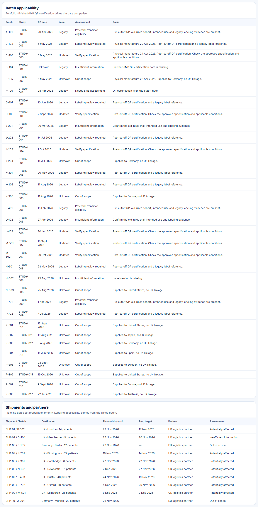

**Shows:** the reasoning per batch (QP date, label version, result and why) and each shipment with its site, patients on treatment, dispatch date, preparation deadline and partner.

**Proves for the pitch:** the trap case. B-102 was manufactured on 20 April, before the cutoff, but certified on 5 May, so it needs a labelling review.

### 6. SME decision

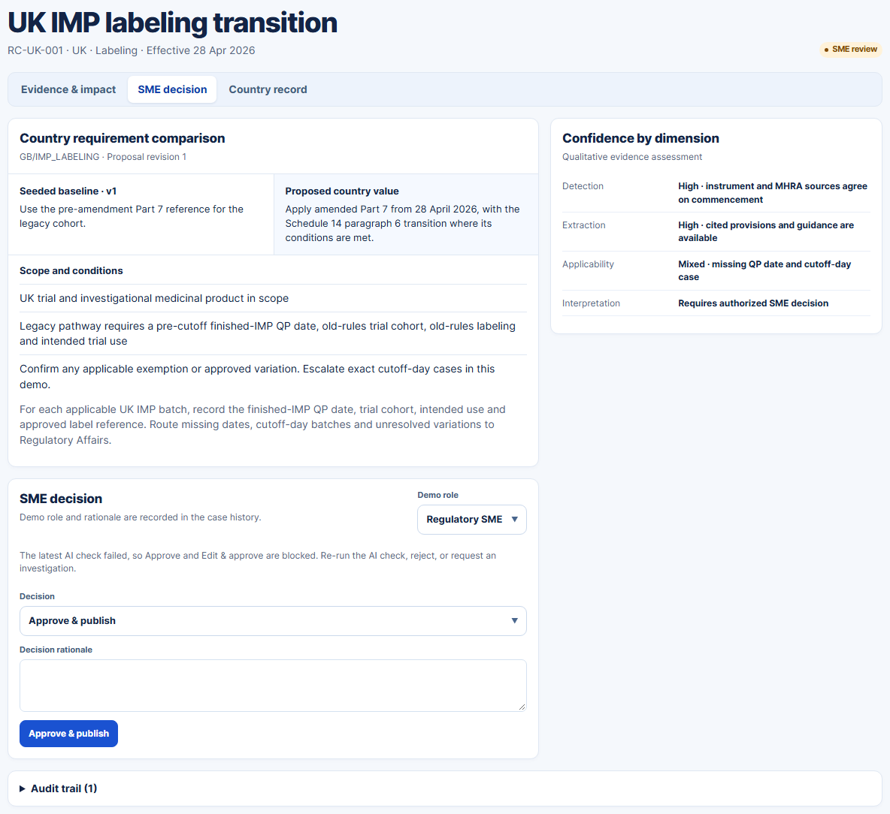

**Shows:** the current specification text next to the suggested one, the scope and conditions, confidence calculated from the checks, and the decision form for the Regulatory SME (approve, edit and approve, reject, request investigation, defer). Approval needs a passing AI check. In this capture no check has run, so Approve stays greyed out until the SME ticks an override and gives a reason; the override is logged. A failed check blocks approval with no override.

**Real or simulated:** the proposal is the text prepared before the AI check; a passing check replaces it with the AI's draft as a new revision. People are picked from the "Acting as" list (A. Novak, M. Okafor, L. Chen), and the verifier can never be the approver.

### 7. Quality follow-up

**Shows:** the Quality task created on approval: owner, due date (the earliest shipment preparation date), published version, the trials and batches in scope, the shipments to act on and to check, and the look-back batches. The Quality owner acknowledges and submits evidence; the verifier verifies or returns it, and only then does the case close.

### 8. Country specification (in the case)

**Shows:** the UK specification's regulatory section before (v12) and after (v13) the SME's approval, the publication receipt, a lookup of which version applies on a given date, and a link to the section on the Country specifications page.

### 9. Audit trail

**Shows:** every step with who, when, which revision and why, with JSON export and a demo reset.

### 10. Country specifications

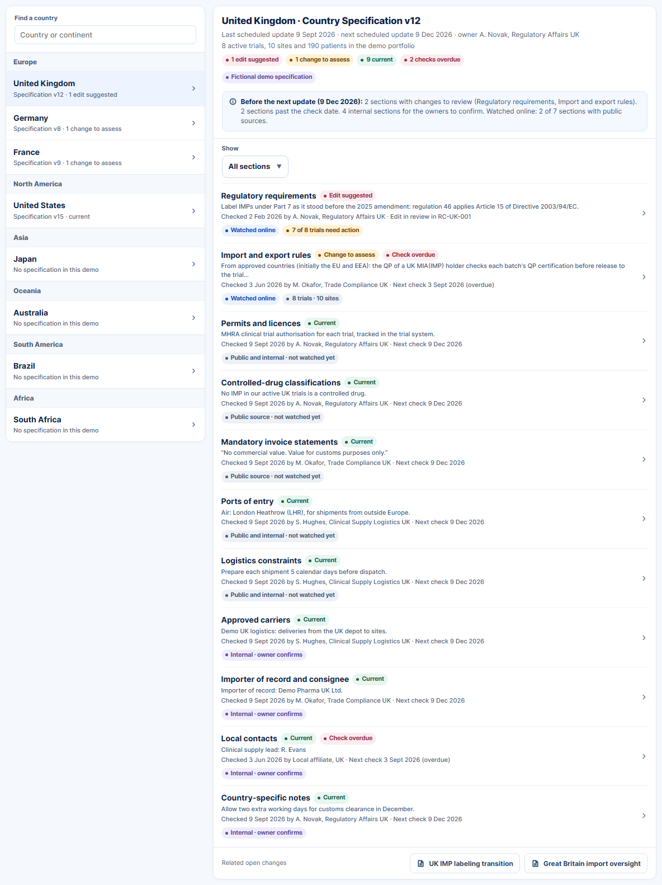

**Shows:** the Country Specifications colleagues maintain for each country and update 4 to 7 times a year. The UK example has the 11 sections of a real specification: regulatory requirements, import and export rules, permits and licences, controlled-drug classifications, mandatory invoice statements, ports of entry, logistics constraints, approved carriers, importer of record and consignee, local contacts, and country-specific notes. For each section the screen shows:

- **Is it current?** *Current*, *Change to assess* (an open change may alter it) or *Edit suggested* (the section is out of date and RegChain has drafted an edit), plus the section owner, when it was last checked and a *Check overdue* flag. The UK specification had a scheduled update on 9 Sep 2026, but its regulatory section was last checked on 2 Feb 2026, so it still describes the labeling rule that changed on 28 Apr 2026.
- **How is it kept current?** *Watched online* (RegChain watches its official sources), *Public source, not watched yet*, or *Internal, owner confirms* for sections that only change through internal events, such as carriers, importer of record and contacts. The summary says how many sections have changes to review before the next scheduled update and how many public-source sections are watched today (2 of 7 for the UK).
- **Which of our trials does it touch?** The UK regulatory section shows the 7 trials, 12 batches and 6 shipments that need action. Logistics, carrier, port, invoice and importer sections show the shipments planned for the country.

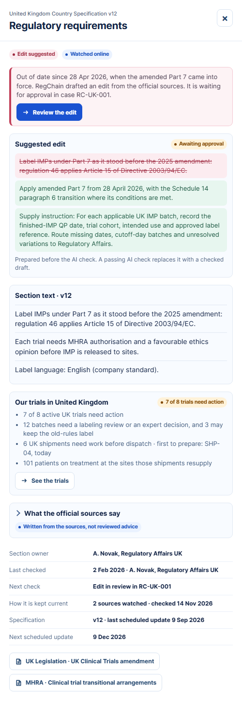

Opening the UK regulatory section shows the **suggested edit** as a redline: the outdated line struck through, the new text and supply instruction from the UK case, and whether the AI drafted it. **Review the edit** opens the case. Once the SME approves, the specification becomes **v13, published between scheduled updates**, the section shows the new text with the v12 text kept, and the next scheduled update stays on 9 Dec 2026. Each watched section also has **What the official sources say**: short answers paraphrased from the sources (what the label must show, when a shorter label is allowed, who must oversee imports, who can receive a US shipment), with lead times and what is still to confirm.

**Real or simulated:** everything in the specifications is fictional and shaped like a real one. Do not paste a real Country Specification into the repo or into an AI request unless the company's rules allow it. The regulatory lines and the source answers paraphrase official sources checked on 14 Nov 2026 (regulation 46 and Schedule 14 on legislation.gov.uk, MHRA's transitional and import guidance, Regulation (EU) 536/2014 as amended by 2022/2239, 21 CFR 312.6, 312.40 and 312.110, and FDA's import page). They are examples, not reviewed regulatory advice. Carriers, ports, the importer of record, contacts, notes, owners and dates are invented. The UK has all 11 sections; Germany and France have the regulatory section, and the US has regulatory and import. Japan, Australia, Brazil and South Africa have none. Trial counts need the server (`Start-RegChain.cmd`).

### 11. Source log

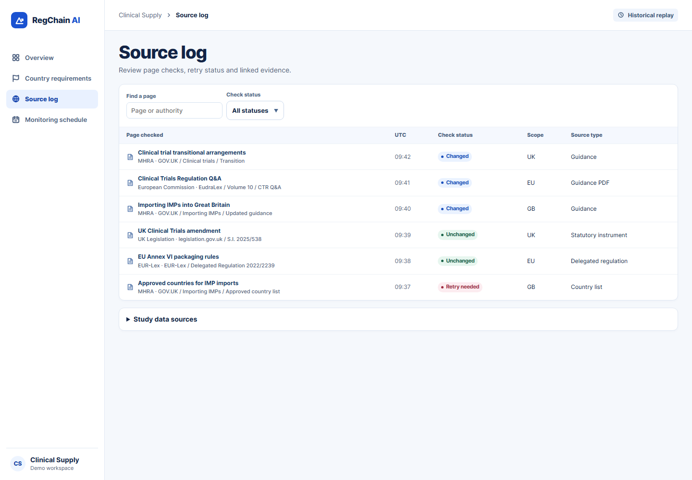

**Shows:** the pages RegChain monitors, when each was checked and whether it changed, failed or needs a retry.

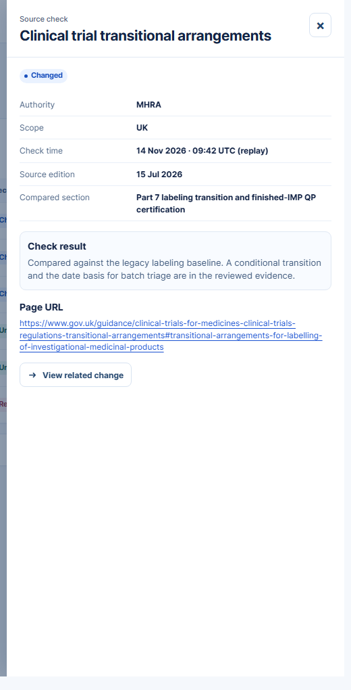

**Source detail** shows the authority, edition, compared section, check result and the official link.

**Real or simulated:** all six rows are fixed sample results. They are not the four sources the AI check actually fetches.

### 12. Monitoring schedule

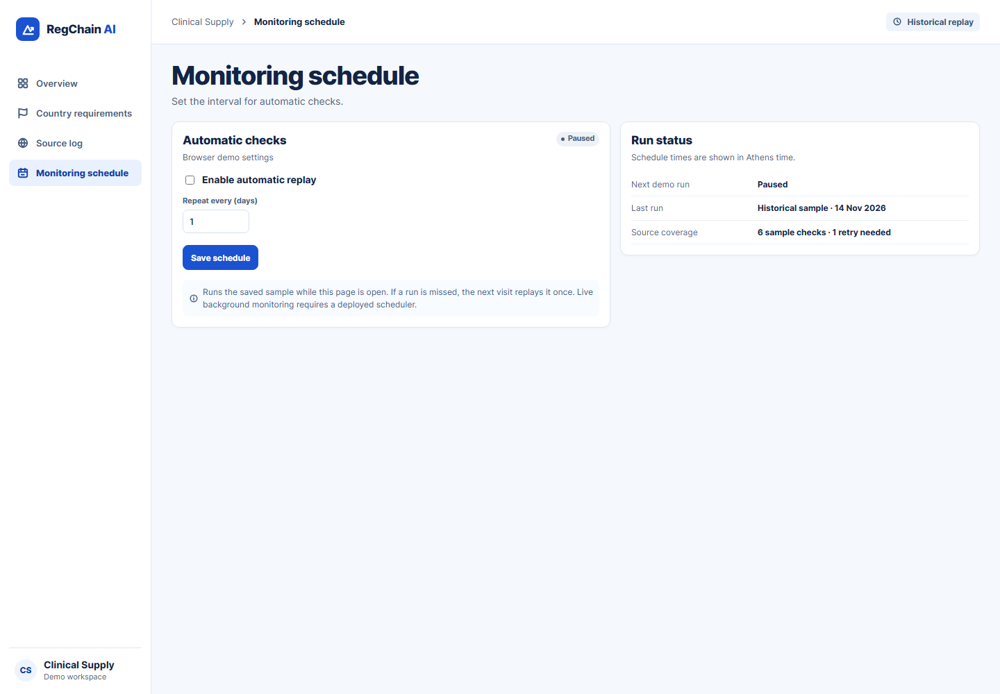

**Shows:** how often checks run and the last and next run.

**Real or simulated:** it replays the sample in the open browser tab only. Nothing is fetched on a schedule.

### 13. Spain case · early warning (fictional)

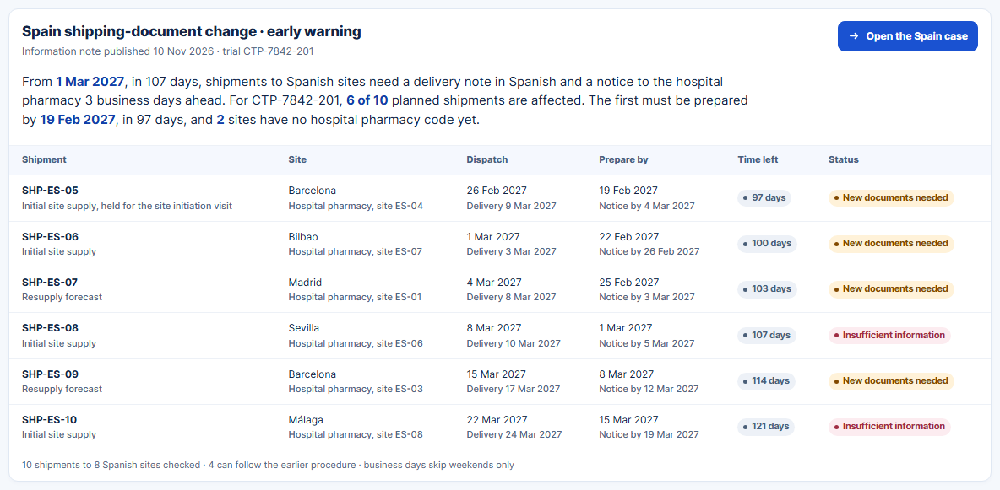

**Shows:** a second case, this time **before** a rule applies. A fictional Spanish information note, published on 10 Nov 2026, requires a delivery note in Spanish and a notice to the hospital pharmacy 3 business days before each delivery from 1 Mar 2027. The Overview card counts the days left (107), the shipments of the fictional trial CTP-7842-201 that are affected (6 of 10), the first preparation date (19 Feb 2027, in 97 days) and the sites without a hospital pharmacy code (2).

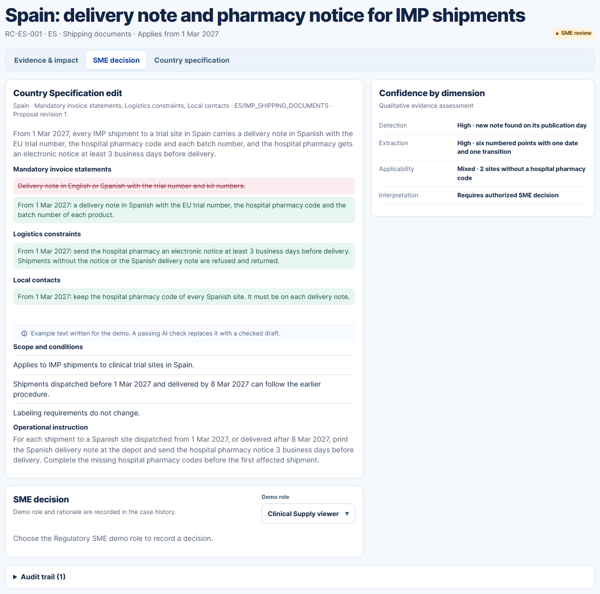

The Spain case has the same steps as the UK case. The AI panel reads the note in Spanish and quotes it without translating. The shipments table shows each result and its reason, including three boundary cases. The SME decision is a redline across three sections of the Spain Country Specification (invoice statements, logistics constraints, local contacts). Approval publishes Spain v5 between scheduled updates and creates a Quality task due 19 Feb 2027.

**Real or simulated:** the whole scenario is fictional (note, authority, trial, sites and people) and lives in `demo-data/spain-scenario.json`. The AI check works the same way as in the UK case, plus one extra check: every edit must target a real line of the specification. It has been tested with a stand-in AI only. The story, the numbers and a demo script are in [RegChain-AI-Spain-Scenario.md](RegChain-AI-Spain-Scenario.md).

### 14. Shipment checks

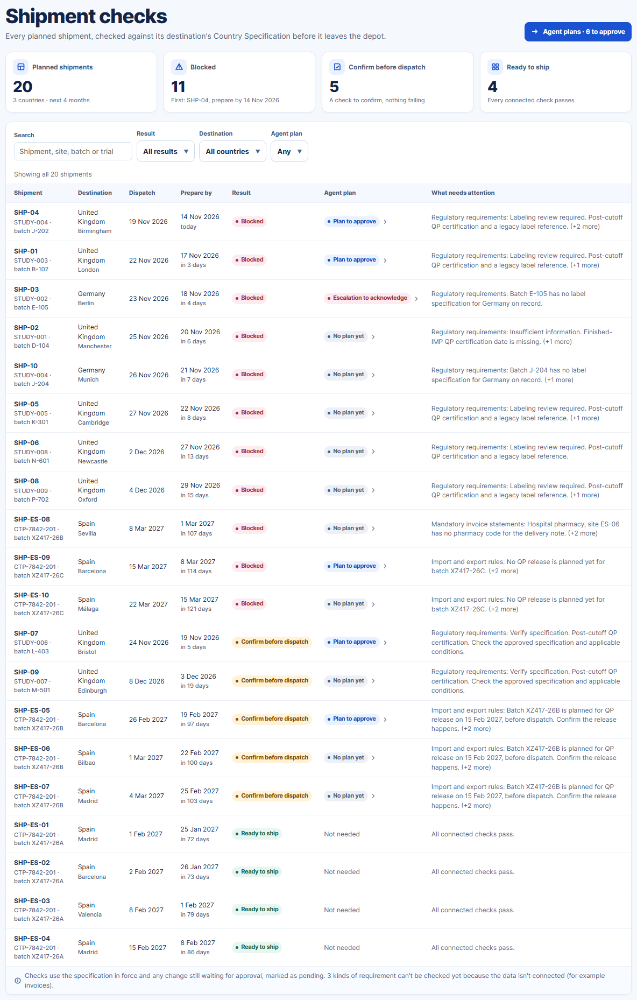

**Shows:** the pre-shipment check, now the second item in the menu. Every planned shipment (20, to the UK, Germany and Spain) is tested against its destination's Country Specification before it leaves the depot. The result is **Blocked** (a check fails, data is missing, or an expert decision is needed), **Confirm before dispatch**, or **Ready to ship**. Today: 11 blocked, 5 to confirm, 4 ready. The Overview's first tile, "Shipments blocked", opens this page, and every shipment row on the Overview cards opens its check.

The list has a search box (shipment, site, batch or trial) and filters for result, destination and agent plan, with "Showing N of 20" as you filter. The **Agent plan** column shows where each shipment that needs action stands: no plan yet, plan to approve, plan to review, escalation, or approved. Choosing it opens the plan. **Agent plans**, at the top right, says how many plans are waiting for approval.

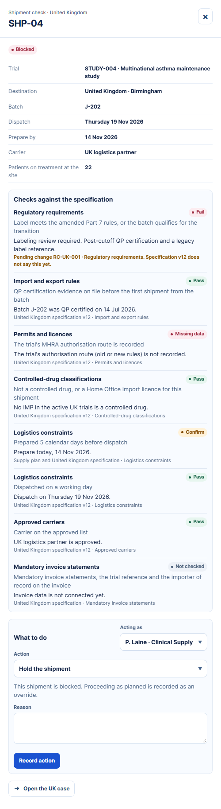

Opening a shipment shows its **Agent plan** first, with **Open the plan** or **Plan with agents**. Then come the checks, each with its result, the reason and where the requirement comes from. A requirement from a change still waiting for approval is marked **Pending change** in orange: before RC-UK-001 is approved, specification v12 still has the earlier labeling text, but SHP-04 already fails the amended rule. Requirements whose data isn't connected yet, such as invoices, show as **Not checked** and never block. Below them, under **Or record an action yourself**, the planner can **hold the shipment, swap the batch or proceed as planned**, with a reason recorded under their name. Proceeding with a blocked shipment is an override. Once an agent plan is approved, it replaces that form until someone withdraws it.

**What it finds:**
- **Rule changes:** UK legacy labels after the cutoff, and from 1 Mar 2027 the Spanish delivery note and pharmacy notice.
- **Requirements that already existed but weren't met**, which is the failure mode the research found most often:
  - two German shipments have no German label specification on record;
  - a trial's UK authorisation route isn't recorded;
  - a batch has no QP certification date;
  - a Spanish batch has no QP release planned;
  - two Spanish sites have no pharmacy code.
- **Plan problems:** a UK dispatch planned on a Sunday, and preparation dates on weekends.

**Real or simulated:** the checks are rules written in the page, run on the demo portfolio and the Spain scenario. Invoices, label texts and courier data aren't connected, so those requirements show as Not checked. Actions are saved in the browser.

### 15. Agent plans · resolving shipments with agents

**Agent plans** is in the menu, after Shipment checks. It is the work queue for Clinical Supply, and every plan page opens under it. The journeys and demo scripts are in [RegChain-AI-User-Journeys.md](RegChain-AI-User-Journeys.md).

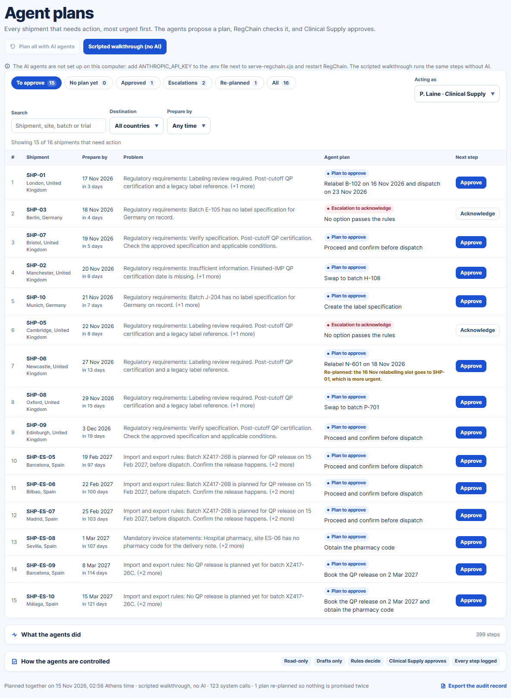

**Agent plans** lists every shipment that needs action, most urgent first, with:

- **Status chips with counts:** To approve, No plan yet, Approved, Escalations, Re-planned, All.
- **Filters:** search, destination, and "Prepare by" (within 7 days, within 30 days, later).
- **Each row:** the problem, the agent plan and the next step. That is **Approve** for a plan that passes, **Acknowledge** for an escalation, or **Plan** when there is no plan yet.

**Plan all with AI agents**, or **Scripted walkthrough (no AI)**, runs the agent team on every shipment and shows a progress bar. RegChain then checks the plans together, so no kits or relabelling slot is promised twice. A re-planned row says why, for example "the 16 Nov relabelling slot goes to SHP-01, which is more urgent". **What the agents did** and **How the agents are controlled** stay folded until opened.

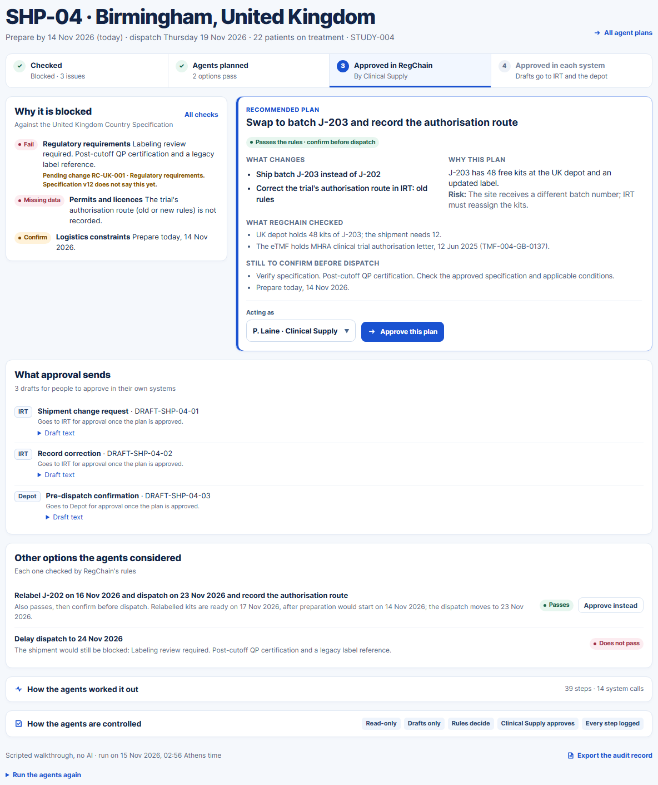

**The plan page** reads top to bottom:

1. **Where the shipment stands:** Checked → Agents planned → Approved in RegChain → Approved in each system.
2. **Why it is blocked:** the failing checks only, each with its specification section.
3. **The recommended plan:**
   - what changes, in plain words, such as "Ship batch J-203 instead of J-202";
   - why, and the risk;
   - what RegChain checked;
   - what is still to confirm before dispatch;
   - **Approve this plan**, for Clinical Supply only.
4. **What approval sends:** one draft per system, each with its text on request.
5. **Other options the agents considered**, each with RegChain's verdict and the reason it fails, or **Approve instead** when it passes.
6. **The run line:** when the agents ran, **Export the audit record**, and **Run the agents again**.

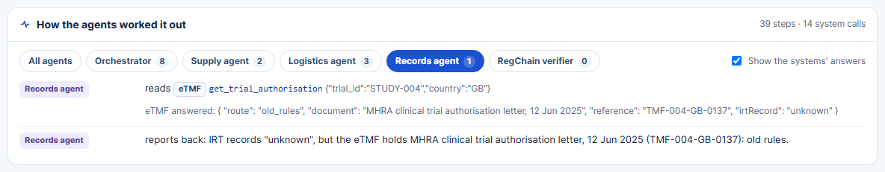

**How the agents worked it out** is folded by default. Opened, it shows every step:

- the goal;
- each delegation;
- each system the agents read;
- each report;
- RegChain's checks;
- the drafts.

It can show one agent at a time. "Show the systems' answers" adds the raw replies, which the audit record keeps in full.

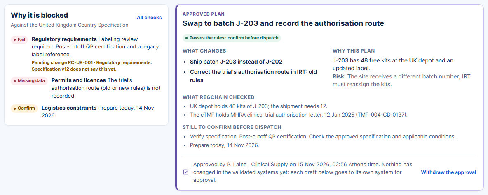

After approval, the plan says who approved it and when, and **What happens next** lists the drafts waiting in IRT and the depot. Nothing changes in a validated system until someone approves each draft there. **Withdraw the approval** frees the kits and slot places the plan held. A new run never inherits an earlier approval.

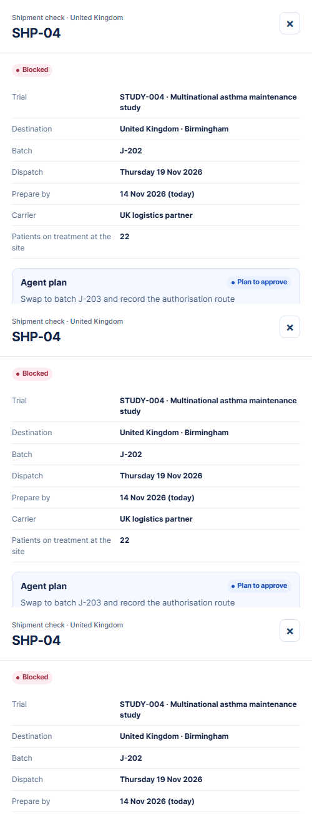

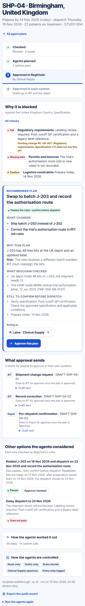

When no option passes, as for SHP-03 (the German label specification takes 15 business days and the site has 7 days of stock), the plan page says **No option passes the rules**, lists why each option fails, and offers **Acknowledge the escalation**.

**Rehearsals:**

- Opening the dashboard with **?fresh** (http://127.0.0.1:4173/?fresh) clears the decisions saved in the browser and archives the approvals.
- **?fresh=all** also moves the plans to the run history, so every shipment starts with no plan.
- Nothing is deleted.

**Real or simulated:**

- **Real:** the MCP servers, the agent loop, the rule checks, the portfolio allocation, the streaming and the approval.
- **Fictional:** the systems behind the MCP servers are data in `demo-data/supply-operations.json`.
- **Run modes:** **Run the AI agents** needs the API key and has not been run yet. **Scripted walkthrough (no AI)** runs the same steps with coded decisions and is what these screens show.

See [RegChain-AI-Agents.md](RegChain-AI-Agents.md).

## Part 2 · What is missing

**For the demo:**

- [ ] One real AI run with an API key, and a recorded result for the venue in case the internet fails. The same for one live agent run (SHP-04 is the best one to show).
- [x] An agentic step: agents read the supply systems over MCP, propose fixes for a blocked shipment, check them against the rules and draft the changes for approval (section 15).
- [x] The SME should approve the AI's draft, not pre-written text (logic gap 1, fixed).
- [x] A future-dated change that shows the early warning: the fictional Spain case.
- [x] Country specifications show, section by section, whether each is current, how it is kept current, which portfolio trials it touches, and the suggested edit.
- [ ] The Overview tiles, the Source log and the specifications' countries should match the demo portfolio (17 countries) and the four real sources, or the pitch should say they are samples.
- [ ] Display names for batch results (the specification and the dashboard still differ; see the project plan, step 1).

**For a real product:**

- Discovery of new documents, not only known pages (see Part 4).
- More countries and topics, with sources per country.
- Suggested edits for every watched section, not only UK labeling, drafted by the AI and approved by the section owner. Authority lead times are not in the watched sources yet.
- Import of the real Country Specifications (format and owners to confirm with the colleagues who maintain them), and a feed for internal changes such as carriers, importer of record and contacts.
- Site stock and depot stock, not only planned shipments.
- Real login and roles, saved decisions, and links to the trial database (EDC), Quality system (QMS) and safety database.
- An inbox for the SME: every open change across countries, by deadline.

## Part 3 · Logic gaps

Ordered by how much they matter for the pitch. The [product review of 15 Nov 2026](RegChain-AI-Product-Review.md) adds the newer findings and what was fixed then (one impact model, the AI gate, version dates, no dead ends, named people).

| # | Gap | Example | Fix |
| --- | --- | --- | --- |
| 1 | **Fixed: the SME now decides on the AI draft.** Before, the AI check could only block, and the published version came from text written into the page. | Screen 6 shows the old example text, because the AI result in that capture failed. | When all checks pass, the AI's requirement statement, scope, conditions and instruction become a new proposal revision, logged as "AI draft adopted". An SME edit is never overwritten, a case past review is never changed, and a failed check leaves the proposal as it is and blocks approval. |
| 2 | **The quote check proves the words exist, not that they support the claim.** | In screen 2, a real but unrelated phrase from regulation 46 is marked "Found in source" for the claim "The new regulation 46 sets the labelling rules". | A second check (a separate AI call or a rule) that the quote supports the claim; show the surrounding text; the SME reads each quote. |
| 3 | **The date check is circular.** It compares the AI's date with a date we already recorded. A new change has no recorded date. | The check passes because both say 28 April 2026. | Compare with the official "in force from" date in the legislation data, which the server already fetches (2026-04-28 for the new regulation 46). |
| 4 | **The batch rule is hand-coded and uses the recorded cutoff, not the AI's findings.** Each new regulation would need new code. | The cutoff is fixed in the page as 2026-04-28. | Store rules as data the AI proposes and the SME approves: jurisdiction, date field, cutoff, conditions. |
| 5 | **Only four known pages are watched.** A new guidance page or a new statutory instrument would be missed. | See Part 4. | Watch the official feeds and filter them for relevance with the AI. |
| 6 | **Consolidated legislation can lag.** legislation.gov.uk updates its consolidated text after the law changes. | On 14 November 2026 its change list for the 2004 regulations still had 38 "not yet applied" markers. | Also read the amending instrument itself, and flag sources with pending changes. |
| 7 | **The AI runs again on every click.** Identical sources should reuse the earlier result (acceptance test AT-01). | Two clicks mean two paid calls with possibly different drafts. | Skip the call when all source fingerprints are unchanged. |
| 8 | **Shipments are simplified.** One batch per shipment, a fixed 5-day lead time, no stock already at sites or depots, and patient counts are everyone on treatment at the site, not those waiting for that shipment. | 101 patients is the total at six sites. | Add site and depot stock, lead times per partner, and patients due for resupply. |
| 9 | **Transition conditions are three yes/no fields.** The legal conditions in Schedule 14 need expert reading. RegChain follows the MHRA guidance that the QP certification date decides. | J-201 only shows "cohort unknown". | Keep these as expert questions with evidence, never automatic eligibility. |
| 10 | **The Quality task is too broad.** It includes batches that only need a specification check or may use the transition. | All 21 UK batches are in one task. | One task per owner and action type, with only the batches that need that action. |
| 11 | **Dates mix the replay and the real clock.** "Today" means 14 November 2026 (the replay date), but publication times use the real clock. | Screen 8 shows the real time of publication. | Use one clock per demo run, shown on screen. |

## Part 4 · How often do changes happen, and would our AI detect them?

### What we measured from official sources (14 November 2026)

| Source | Changes |
| --- | --- |
| [UK clinical trials regulations (S.I. 2004/1031)](https://www.legislation.gov.uk/changes/affected/uksi/2004/1031) | 563 recorded amendments since 2004, in bursts: at least 198 from the 2025 overhaul, 76 in 2006, 67 in 2019 and 40 in 2012. Most years have few or none. (Counts by year cover the 500 entries the feed returned) |
| [MHRA guidance: labelling](https://www.gov.uk/guidance/clinical-trials-for-medicines-labelling) | First published 25 June 2025, updated 7 times since, last on 28 April 2026 |
| [MHRA guidance: transitional arrangements](https://www.gov.uk/guidance/clinical-trials-for-medicines-clinical-trials-regulations-transitional-arrangements) | First published 25 June 2025, updated 7 times since, 4 of them in 2026, last on 15 July 2026 |
| [MHRA guidance: applying for authorisation](https://www.gov.uk/guidance/clinical-trials-for-medicines-apply-for-authorisation-in-the-uk) | 39 updates since 2014, 12 of them since 2024 |
| [MHRA: importing IMPs from approved countries](https://www.gov.uk/government/publications/importing-investigational-medicinal-products-into-great-britain-from-approved-countries) | 4 updates since 2020, last on 12 February 2025 |
| [Everything MHRA publishes on GOV.UK](https://www.gov.uk/search/all?organisations%5B%5D=medicines-and-healthcare-products-regulatory-agency) | The 10 most recent items are dated 10 to 13 November 2026. The ones we checked covered product information, MHRA finances, a medicine approval, AI medical devices and a register of brokers, none about clinical trial supply |

**What this means:** binding law changes rarely but in large bursts around a reform. Guidance on an active topic changes every one to three months. And the regulator publishes most working days, mostly on other topics, so the hard part is finding the few items that matter. These counts cover the UK only; we found no reliable public count of changes per year across countries, so the pitch should not quote one.

### Would our AI detect it?

| Kind of change | Today | With the fixes in Part 3 |
| --- | --- | --- |
| Edit to one of the four pages we watch | Yes, when someone presses "Run AI check": the comparison shows it and Claude drafts it | Automatically, on a schedule, when a fingerprint or the page's update date changes |
| New amendment not yet in the consolidated text | No | Yes, from the legislation.gov.uk change list and new legislation feed |
| New guidance page or new statutory instrument | No | Yes, from the GOV.UK and legislation.gov.uk feeds, with the AI judging relevance |
| Change in another country | No, the check covers the UK only | Yes, once that country's sources are added |
| Change inside a PDF (for example the EU Q&A) | No | Yes, with PDF text extraction |
| Wording-only edit | Partly: the comparison shows it, but RegChain then expects "material" or "cosmetic" without checking meaning | Yes, with a cosmetic-change test (acceptance test AT-02) |

The official feeds exist and respond today: [legislation.gov.uk new legislation](https://www.legislation.gov.uk/new/data.feed), [changes to the 2004 regulations](https://www.legislation.gov.uk/changes/affected/uksi/2004/1031/data.feed) and [MHRA on GOV.UK](https://www.gov.uk/search/all.atom?organisations%5B%5D=medicines-and-healthcare-products-regulatory-agency).

## Part 5 · How much are trials affected, and what is the impact?

**In the demo portfolio (fictional):** one change touches 7 of 18 trials, 12 batches need a labelling review or an expert decision, and 6 shipments need work within 15 days, at sites with 101 patients on treatment. See `RegChain-AI-Demo-Scenario.md`.

**What a delay costs (real figures):** Tufts Center for the Study of Drug Development estimates the direct cost of running a trial at about **$40,000 per day** on average: $55,716 per day in Phase III and $23,737 in Phase II (2023 US dollars, 409 protocols from 2016 to 2021). It also estimates about $500,000 per day in unrealised sales for marketed drugs. Critics point out that most drugs in trials never reach the market and that sales are delayed rather than lost, so the direct cost is the safer number to quote ([Getz, Applied Clinical Trials, 2024](https://www.appliedclinicaltrialsonline.com/view/how-much-does-a-day-of-delay-in-a-clinical-trial-really-cost-); [Tufts white paper](https://csdd.tufts.edu/sites/default/files/2025-02/Aug2024%20Day%20of%20Delay%20White%20Paper%20Final.pdf); [critique](https://firstpatientin.substack.com/p/saturday-archive-a-day-late-and-half)).

**Illustration only:** if a relabelling problem delayed one Phase III trial by two weeks, the direct cost alone would be about 14 × $55,716 ≈ $780,000. This is arithmetic on the Tufts figure, not a measured case.

**Beyond money:** patients may miss doses or visits when resupply slips, sites log protocol deviations, and wrongly labelled supply is an inspection finding. We have no reliable public figures for these, so describe them, don't quantify them.

**Still to collect from colleagues:** hours spent per regulation change today, how many countries and changes a supply team handles per year, and one real (anonymised) example of a late-found change.
