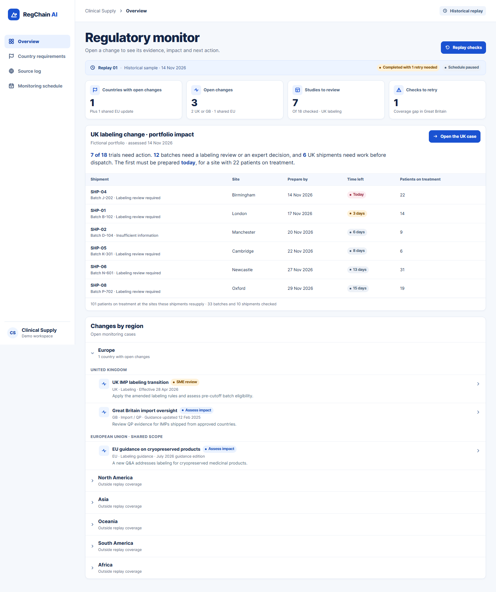
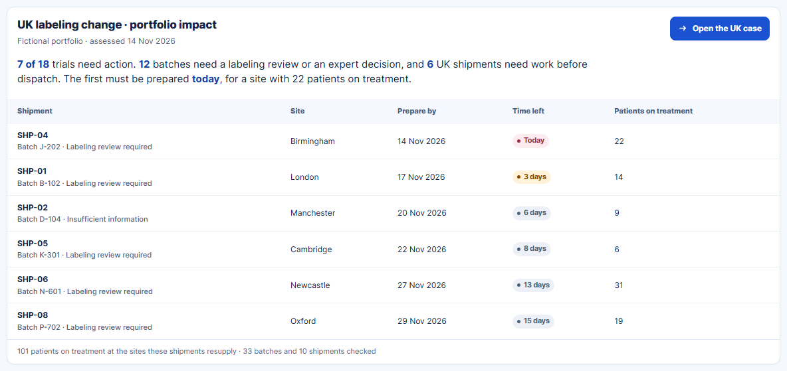
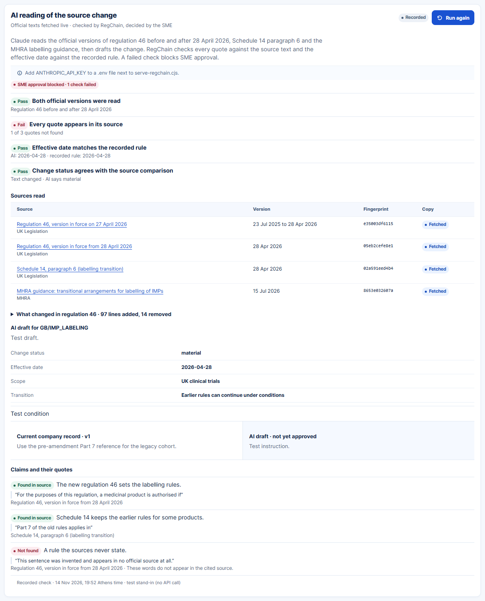
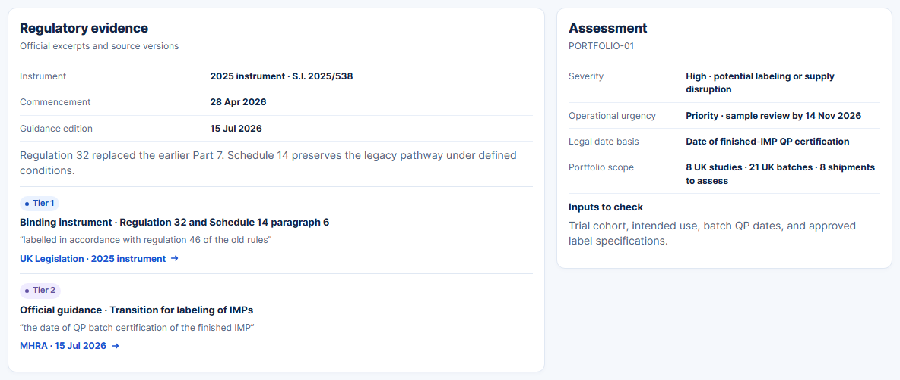
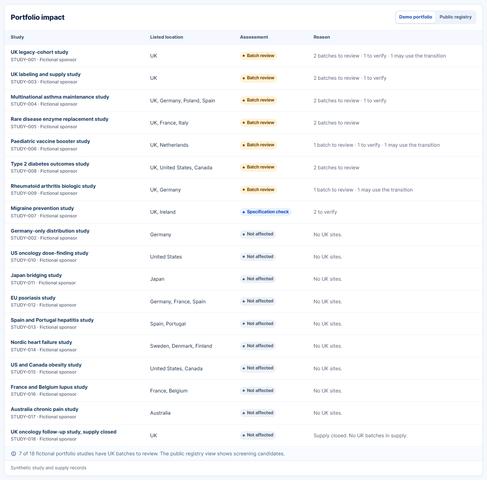
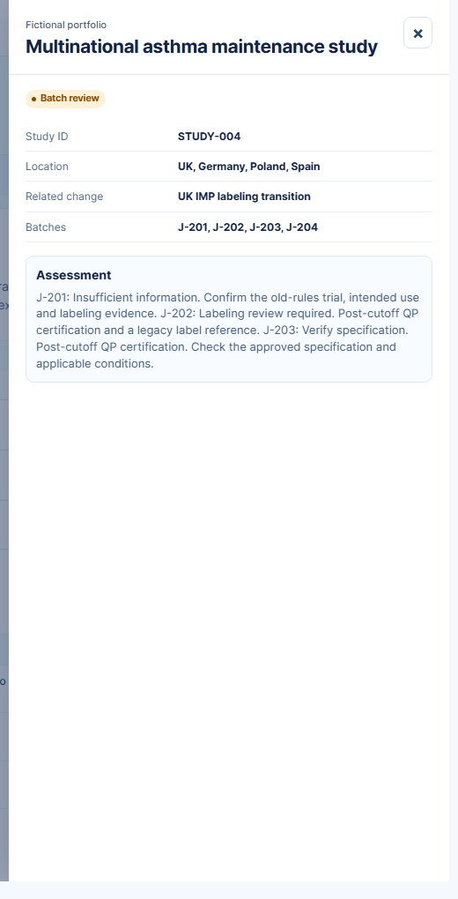
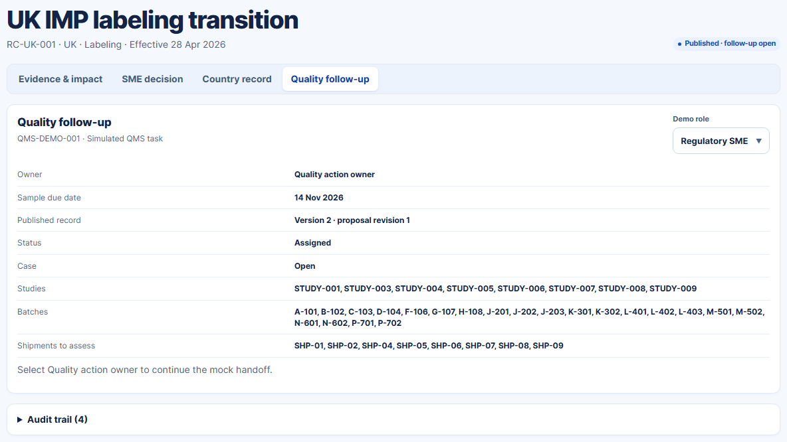
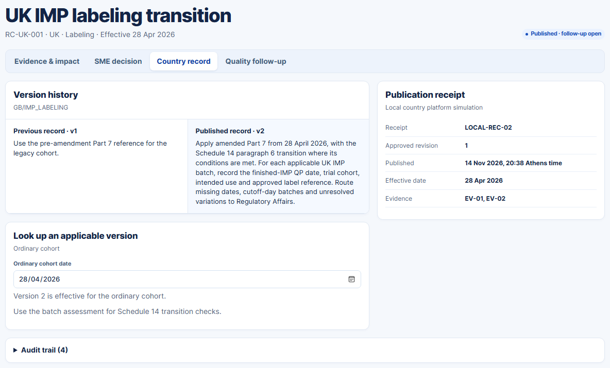
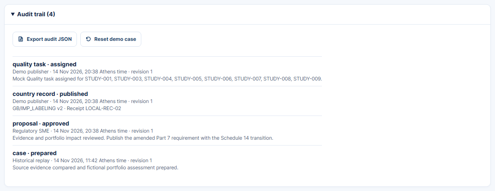
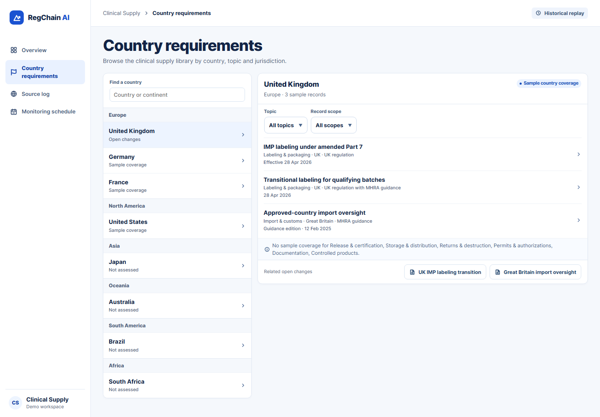

# RegChain AI · screen guide and gap review

Status on 14 November 2026. The screens were captured from `main` with the demo portfolio loaded. The AI panel shows the test run from `scripts/check-ai-step.mjs`, which uses a stand-in instead of Claude and is labelled as such on screen; no real AI run has been done yet.

**In short:** the dashboard tells the story end to end, from one regulation change to the trials, batches and shipments it affects, then the expert's decision, the updated country record and the Quality task. Three things weaken it today: the expert approves pre-written text rather than the AI's draft, the quote check proves words exist but not that they support the claim, and the system only watches four known pages, so it would miss a brand-new regulation or guidance page.

## Part 1 · The screens

### 1. Overview

**Shows:** the starting point for a Clinical Supply lead. Four tiles summarise the replayed checks, the new portfolio impact card states the problem in one sentence, and the regional list opens each change.

**Proves for the pitch:** the need. One rule change means 7 of 18 trials need action, and 6 shipments to UK sites need work, the first today, at sites with 101 patients on treatment.

**Real or simulated:** the portfolio is fictional; the rule applied to it is the one in the specification. The "Countries with open changes", "Open changes" and "Checks to retry" tiles still use the built-in sample.

### 2. UK case · AI reading of the source change

**Shows:** the live AI step. The server fetches the official texts, shows their versions and fingerprints and a line-by-line comparison of regulation 46, then Claude drafts the change, and RegChain runs four checks. A failed check blocks approval.

**Proves for the pitch:** the AI cannot invent evidence. In this test run, a made-up quote is marked "Not found" and SME approval is blocked.

**Real or simulated:** the sources are fetched live from legislation.gov.uk and GOV.UK. The draft in this capture comes from the test stand-in, not from Claude.

### 3. UK case · Regulatory evidence and assessment

**Shows:** the evidence the case rests on (the statutory instrument, Schedule 14 and the MHRA guidance, with short excerpts) and the assessment: severity, urgency, the legal date basis (QP certification of the finished product) and the portfolio scope.

**Real or simulated:** the excerpts are written into the page, not taken from the AI run. The scope and urgency are now calculated from the portfolio.

### 4. UK case · Trials

**Shows:** all 18 trials, those needing action first, with locations and the reason for each result. The "Public registry" switch shows real ClinicalTrials.gov studies with UK sites, as a screening example.

**Trial detail** gives the result and reason for each UK batch, here for STUDY-004, which runs in the UK, Germany, Poland and Spain.

### 5. UK case · Batches and shipments

**Shows:** the reasoning per batch (QP date, label version, result and why) and each shipment with its site, patients on treatment, dispatch date, preparation deadline and partner.

**Proves for the pitch:** the trap case. B-102 was manufactured on 20 April, before the cutoff, but certified on 5 May, so it needs a labelling review.

### 6. SME decision

**Shows:** the current company record next to the proposed one, the scope and conditions, confidence by dimension, and the decision form for the Regulatory SME (approve, edit and approve, reject, request investigation, defer). Here approval is blocked because the AI check failed.

**Real or simulated:** the proposed text is written into the page. It is not the AI's draft (see logic gap 1). Roles are picked from a dropdown.

### 7. Quality follow-up

**Shows:** the mock Quality task created on approval: owner, due date (the earliest shipment preparation date), published version, and the studies, batches and shipments in scope. The Quality owner acknowledges and submits evidence; the verifier verifies or returns it, and only then does the case close.

### 8. Country record

**Shows:** version history (v1 before, v2 after), the publication receipt, and a lookup of which version applies on a given date.

### 9. Audit trail

**Shows:** every step with who, when, which revision and why, with JSON export and a demo reset.

### 10. Country requirements

**Shows:** the country library: requirements by country, topic and scope, coverage gaps per topic, and links to open changes.

**Real or simulated:** sample records for a handful of countries. It does not reflect the 17 countries in the demo portfolio.

### 11. Source log

**Shows:** the pages RegChain monitors, when each was checked and whether it changed, failed or needs a retry.

**Source detail** shows the authority, edition, compared section, check result and the official link.

**Real or simulated:** all six rows are fixed sample results. They are not the four sources the AI check actually fetches.

### 12. Monitoring schedule

**Shows:** how often checks run and the last and next run.

**Real or simulated:** it replays the sample in the open browser tab only. Nothing is fetched on a schedule.

## Part 2 · What is missing

**For the demo:**

- [ ] One real AI run with an API key, and a recorded result for the venue in case the internet fails.
- [ ] The SME should approve the AI's draft, not pre-written text (logic gap 1).
- [ ] The Overview tiles, the Source log and Country requirements should match the demo portfolio and the four real sources, or the pitch should say they are samples.
- [ ] Display names for batch results (the specification and the dashboard still differ; see the project plan, step 1).

**For a real product:**

- Discovery of new documents, not only known pages (see Part 4).
- More countries and topics, with sources per country.
- Site stock and depot stock, not only planned shipments.
- Real login and roles, saved decisions, and links to the trial database (EDC), Quality system (QMS) and safety database.
- An inbox for the SME: every open change across countries, by deadline.

## Part 3 · Logic gaps

Ordered by how much they matter for the pitch.

| # | Gap | Example | Fix |
| --- | --- | --- | --- |
| 1 | **The SME approves pre-written text, not the AI draft.** The AI check only blocks; the proposal and the published version come from text written into the page. | Screen 6 shows the proposal as fixed text, whatever the AI drafted. | When all checks pass, the AI's proposed requirement becomes the proposal, and the SME can edit it before approving. |
| 2 | **The quote check proves the words exist, not that they support the claim.** | In screen 2, a real but unrelated phrase from regulation 46 is marked "Found in source" for the claim "The new regulation 46 sets the labelling rules". | A second check (a separate AI call or a rule) that the quote supports the claim; show the surrounding text; the SME reads each quote. |
| 3 | **The date check is circular.** It compares the AI's date with a date we already recorded. A new change has no recorded date. | The check passes because both say 28 April 2026. | Compare with the official "in force from" date in the legislation data, which the server already fetches (2026-04-28 for the new regulation 46). |
| 4 | **The batch rule is hand-coded and uses the recorded cutoff, not the AI's findings.** Each new regulation would need new code. | The cutoff is fixed in the page as 2026-04-28. | Store rules as data the AI proposes and the SME approves: jurisdiction, date field, cutoff, conditions. |
| 5 | **Only four known pages are watched.** A new guidance page or a new statutory instrument would be missed. | See Part 4. | Watch the official feeds and filter them for relevance with the AI. |
| 6 | **Consolidated legislation can lag.** legislation.gov.uk updates its consolidated text after the law changes. | On 14 November 2026 its change list for the 2004 regulations still had 38 "not yet applied" markers. | Also read the amending instrument itself, and flag sources with pending changes. |
| 7 | **The AI runs again on every click.** Identical sources should reuse the earlier result (acceptance test AT-01). | Two clicks mean two paid calls with possibly different drafts. | Skip the call when all source fingerprints are unchanged. |
| 8 | **Shipments are simplified.** One batch per shipment, a fixed 5-day lead time, no stock already at sites or depots, and patient counts are everyone on treatment at the site, not those waiting for that shipment. | 101 patients is the total at six sites. | Add site and depot stock, lead times per partner, and patients due for resupply. |
| 9 | **Transition conditions are three yes/no fields.** The legal conditions in Schedule 14 need expert reading. RegChain follows the MHRA guidance that the QP certification date decides. | J-201 only shows "cohort unknown". | Keep these as expert questions with evidence, never automatic eligibility. |
| 10 | **The Quality task is too broad.** It includes batches that only need a specification check or may use the transition. | All 21 UK batches are in one task. | One task per owner and action type, with only the batches that need that action. |
| 11 | **Dates mix the replay and the real clock.** "Today" means 14 November 2026 (the replay date), but publication times use the real clock. | Screen 8 shows the real time of publication. | Use one clock per demo run, shown on screen. |

## Part 4 · How often do changes happen, and would our AI detect them?

### What we measured from official sources (14 November 2026)

| Source | Changes |
| --- | --- |
| [UK clinical trials regulations (S.I. 2004/1031)](https://www.legislation.gov.uk/changes/affected/uksi/2004/1031) | 563 recorded amendments since 2004, in bursts: at least 198 from the 2025 overhaul, 76 in 2006, 67 in 2019 and 40 in 2012. Most years have few or none. (Counts by year cover the 500 entries the feed returned) |
| [MHRA guidance: labelling](https://www.gov.uk/guidance/clinical-trials-for-medicines-labelling) | First published 25 June 2025, updated 7 times since, last on 28 April 2026 |
| [MHRA guidance: transitional arrangements](https://www.gov.uk/guidance/clinical-trials-for-medicines-clinical-trials-regulations-transitional-arrangements) | First published 25 June 2025, updated 7 times since, 4 of them in 2026, last on 15 July 2026 |
| [MHRA guidance: applying for authorisation](https://www.gov.uk/guidance/clinical-trials-for-medicines-apply-for-authorisation-in-the-uk) | 39 updates since 2014, 12 of them since 2024 |
| [MHRA: importing IMPs from approved countries](https://www.gov.uk/government/publications/importing-investigational-medicinal-products-into-great-britain-from-approved-countries) | 4 updates since 2020, last on 12 February 2025 |
| [Everything MHRA publishes on GOV.UK](https://www.gov.uk/search/all?organisations%5B%5D=medicines-and-healthcare-products-regulatory-agency) | The 10 most recent items are dated 10 to 13 November 2026. The ones we checked covered product information, MHRA finances, a medicine approval, AI medical devices and a register of brokers, none about clinical trial supply |

**What this means:** binding law changes rarely but in large bursts around a reform. Guidance on an active topic changes every one to three months. And the regulator publishes most working days, mostly on other topics, so the hard part is finding the few items that matter. These counts cover the UK only; we found no reliable public count of changes per year across countries, so the pitch should not quote one.

### Would our AI detect it?

| Kind of change | Today | With the fixes in Part 3 |
| --- | --- | --- |
| Edit to one of the four pages we watch | Yes, when someone presses "Run AI check": the comparison shows it and Claude drafts it | Automatically, on a schedule, when a fingerprint or the page's update date changes |
| New amendment not yet in the consolidated text | No | Yes, from the legislation.gov.uk change list and new legislation feed |
| New guidance page or new statutory instrument | No | Yes, from the GOV.UK and legislation.gov.uk feeds, with the AI judging relevance |
| Change in another country | No, the check covers the UK only | Yes, once that country's sources are added |
| Change inside a PDF (for example the EU Q&A) | No | Yes, with PDF text extraction |
| Wording-only edit | Partly: the comparison shows it, but RegChain then expects "material" or "cosmetic" without checking meaning | Yes, with a cosmetic-change test (acceptance test AT-02) |

The official feeds exist and respond today: [legislation.gov.uk new legislation](https://www.legislation.gov.uk/new/data.feed), [changes to the 2004 regulations](https://www.legislation.gov.uk/changes/affected/uksi/2004/1031/data.feed) and [MHRA on GOV.UK](https://www.gov.uk/search/all.atom?organisations%5B%5D=medicines-and-healthcare-products-regulatory-agency).

## Part 5 · How much are trials affected, and what is the impact?

**In the demo portfolio (fictional):** one change touches 7 of 18 trials, 12 batches need a labelling review or an expert decision, and 6 shipments need work within 15 days, at sites with 101 patients on treatment. See `RegChain-AI-Demo-Scenario.md`.

**What a delay costs (real figures):** Tufts Center for the Study of Drug Development estimates the direct cost of running a trial at about **$40,000 per day** on average: $55,716 per day in Phase III and $23,737 in Phase II (2023 US dollars, 409 protocols from 2016 to 2021). It also estimates about $500,000 per day in unrealised sales for marketed drugs. Critics point out that most drugs in trials never reach the market and that sales are delayed rather than lost, so the direct cost is the safer number to quote ([Getz, Applied Clinical Trials, 2024](https://www.appliedclinicaltrialsonline.com/view/how-much-does-a-day-of-delay-in-a-clinical-trial-really-cost-); [Tufts white paper](https://csdd.tufts.edu/sites/default/files/2025-02/Aug2024%20Day%20of%20Delay%20White%20Paper%20Final.pdf); [critique](https://firstpatientin.substack.com/p/saturday-archive-a-day-late-and-half)).

**Illustration only:** if a relabelling problem delayed one Phase III trial by two weeks, the direct cost alone would be about 14 × $55,716 ≈ $780,000. This is arithmetic on the Tufts figure, not a measured case.

**Beyond money:** patients may miss doses or visits when resupply slips, sites log protocol deviations, and wrongly labelled supply is an inspection finding. We have no reliable public figures for these, so describe them, don't quantify them.

**Still to collect from colleagues:** hours spent per regulation change today, how many countries and changes a supply team handles per year, and one real (anonymised) example of a late-found change.
