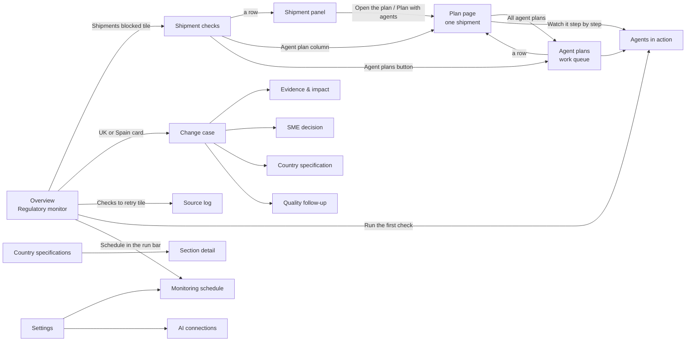
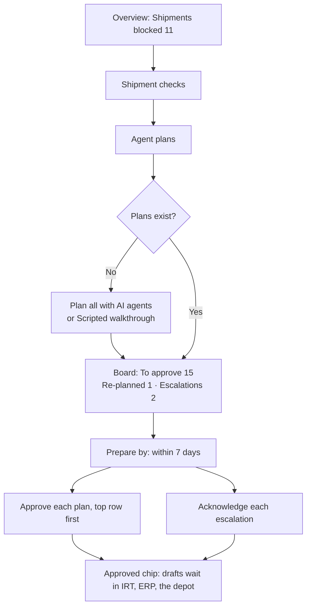
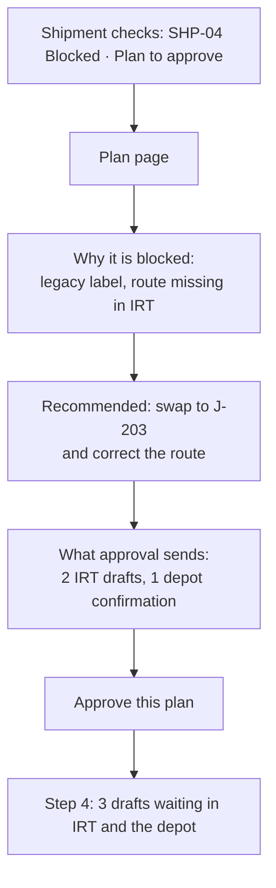
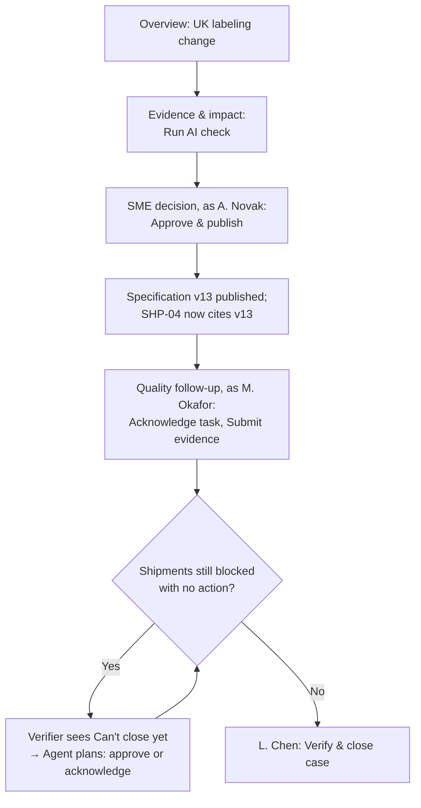

# RegChain AI · User journeys and demo scenarios

*15 November 2026. Every path through the dashboard, who takes it, and the exact clicks for each demo.*

## The people in the journeys

The **Acting as** menu switches between them. Each role can do different things, so the demo shows who decides what.

| Role | Name in the demo | Can do | Cannot do |
|---|---|---|---|
| **Clinical Supply** | P. Laine | Run the agents, approve or withdraw a shipment plan, acknowledge an escalation, record a manual action | Approve a regulatory change |
| **Regulatory SME** | A. Novak (UK), C. Ruiz (Spain) | Run the AI check, approve, edit, reject or defer a regulatory change | Approve a supply plan |
| **Quality owner** | M. Okafor | Acknowledge the Quality task, submit evidence | Close the case |
| **Quality verifier** | L. Chen | Verify the evidence and close the case, but only once every blocked shipment has an action | Approve a supply plan |

People outside RegChain approve each draft in their own validated system: IRT, ERP, the depot, the QMS or the site portal.

## Where everything is

The menu has: **Overview · Shipment checks · Agent plans · Agents in action · Country specifications · Source log · Settings**. A plan page always opens under **Agent plans**, and its breadcrumb leads back there.

### What each screen is for

| Screen | The question it answers | Main action |
|---|---|---|
| **Overview** | What has changed in the rules, and what does it affect? | Open a change, or the blocked shipments |
| **Shipment checks** | Which planned shipments break their country's rules? | Filter and search, open a shipment, open its plan |
| **Agent plans** | What do I need to approve, most urgent first? | Plan all with agents; approve or acknowledge each row |
| **Plan page** | For one shipment: why it is blocked, what the agents recommend, what approval sends | Approve this plan, or approve another option |
| **Change case** | Is this rule change real, and how does the specification change? | Run AI check, then Approve & publish |
| **Country specifications** | What does each country require today, and what is changing? | Open a section |
| **Source log** | Did every official source get checked? | Retry this check |
| **Settings › Monitoring schedule** | When are the sources checked, and do the agents start on their own after a check? | Save the schedule; Run checks now |
| **Settings › AI connections** | Which Claude models and company systems do the agents use, and is the AI ready? | Request a new connection; the Quality owner approves or rejects it |

### Filters

| Screen | Filters |
|---|---|
| **Shipment checks** | Search (shipment, site, batch or trial), Result (Blocked, Confirm, Ready), Destination, Agent plan (no plan yet, plan to approve, plan to review, escalation, approved). "Showing N of 20" updates as you filter. |
| **Agent plans** | Status chips with counts (To approve, No plan yet, Approved, Escalations, Re-planned, All), Search, Destination, Prepare by (within 7 days, within 30 days, later) |
| **Plan page, "How the agents worked it out"** | One agent at a time, and "Show the systems' answers" for the raw replies |

## The plan page, top to bottom

1. **Where the shipment stands**: Checked → Agents planned → Approved in RegChain → Approved in each system.
2. **Why it is blocked**: the failing checks, each with its specification section.
3. **The recommended plan**:
   - what changes, in plain words;
   - why, and the risk;
   - what RegChain checked, and what is still to confirm;
   - **Approve this plan**.
4. **What approval sends**: one draft per system, for example IRT or the depot. After approval this becomes **What happens next**.
5. **Other options the agents considered**: each with RegChain's verdict, and **Approve instead** when it passes.
6. Folded away until needed:
   - **How the agents worked it out**: every step, filterable by agent;
   - **How the agents are controlled**: the guardrails and the six MCP systems.
7. **The run**: when it ran, **Export the audit record**, and **Run the agents again**.

## Journeys

### J1 · Morning triage: plan and approve the urgent shipments

**Who:** Clinical Supply. **When:** at the start of the day, or after a regulatory change.

1. **Overview** → tile **Shipments blocked**.
2. **Shipment checks** → **Agent plans** (top right).
3. **Plan all with AI agents**. Without a key, use **Scripted walkthrough (no AI)**. A progress bar shows "Planning 18 shipments · N done".
4. Choose **Prepare by: Within 7 days**.
5. Go down the list. Choose **Approve** for a plan; choose **Acknowledge** for an escalation (SHP-03, SHP-05). For anything you want to read first, open the shipment.
6. The **Approved** chip counts what is done. Each draft waits for approval in its own system.

### J2 · One urgent shipment: SHP-04, to be prepared today

1. **Shipment checks** → in the **Agent plan** column, choose **Plan to approve** next to SHP-04. Opening the row first shows the same plan at the top of the panel.
2. Read **Why it is blocked**: the label fails the amended UK rule, and IRT doesn't record the authorisation route.
3. The recommended plan, **Swap to batch J-203 and record the authorisation route**, changes two things:
   - "Ship batch J-203 instead of J-202";
   - "Correct the trial's authorisation route in IRT: old rules".

   RegChain checked that the depot holds 48 kits of J-203 and that the eTMF holds the MHRA letter.
4. **Approve this plan** as P. Laine. The step strip moves to **Approved in each system**.

### J3 · Approving another option

On SHP-04, **Other options the agents considered** shows "Relabel J-202 on 16 Nov 2026 and dispatch on 23 Nov 2026" with **Passes**. **Approve instead** does three things:

- drafts that plan's changes: a relabelling work order and a dispatch date change;
- withdraws the swap drafts;
- holds the 12 relabelling places.

### J4 · The agents re-plan around a more urgent shipment (SHP-06)

**Agent plans** → chip **Re-planned** shows SHP-06 with the reason: "the 16 Nov relabelling slot goes to SHP-01, which is more urgent". On its plan page, the struck-through drafts are under **Withdrawn drafts**.

### J5 · No safe option: escalate (SHP-03)

The German label specification takes 15 business days and the site has 7 days of stock, so nothing passes. The plan page says **No option passes the rules** and lists why each option fails. **Acknowledge the escalation** sends a QMS escalation draft; Regulatory Affairs and Clinical Supply decide whether to delay, split or cancel.

### J6 · Nothing blocks, but something needs confirming (SHP-07)

SHP-07 is "Confirm before dispatch": its post-cutoff label needs checking against the approved specification. The agents confirm in the ERP that the label is approved. The plan is **Proceed and confirm before dispatch**, with one pre-dispatch confirmation draft for the depot.

### J7 · Changing your mind

- **Withdraw the approval**, on the plan page or in the shipment panel. The kits and slot places the plan held are free again, and the withdrawal is logged.
- **Run the agents again**, at the bottom of the plan page, makes a new run. A new run never inherits an earlier approval: the page says the approval came from an earlier run until someone withdraws it.

### J8 · A regulatory change reaches the shipments (UK labelling)

### J9 · Early warning: a new Spanish rule, 107 days ahead

1. **Overview** → **Spain shipping-document change · early warning** → the case.
2. **Run AI check** on the Spanish note, then approve, which publishes specification v5.
3. In **Agent plans**, filter **Destination: Spain**. In the plan for SHP-ES-10:
   - the agents book the QP release for 2 Mar 2027;
   - they ask the site for its pharmacy code, with the message drafted in Spanish and English.

### J12 · The first check, from an empty workspace

1. Open **http://127.0.0.1:4173/?empty**. The Overview says what RegChain is connected to: 8 official sources, 25 planned shipments, 6 company systems over MCP, 5 AI agents and one rule checker. Every other page says "Nothing here yet".
2. **Run the first check**. Four steps run in about a minute, each with what it found:
   1. the sources are read and compared: the UK regulation changed, with both evidence passages found word for word; a new Spanish note; a new Israeli notice;
   2. the impact: 7 of 18 UK trials, the Israeli label pool split, 6 of 10 Spanish shipments;
   3. 25 shipments re-checked: 13 blocked, 5 to confirm, 7 ready;
   4. the 18 that need action go to the agent team.
3. The page opens **Agents in action** and replays the run at 4×. Pause, step, change the speed, or filter by agent.
4. At the end: **Review the plans** opens Agent plans.

### J13 · One label, two countries (Israel, illustrative)

1. Overview → **Israel label** tab: from 3 Jan 2027 Israel refuses the booklet shared with Greece and Cyprus. 70 kits stay with Greece and Cyprus; Israel has 14 Israel-only kits for the 22 it needs. 2 of 3 Israeli shipments are blocked.
2. **Open the Israel change**: the evidence, the assessment and the **Label pool after the change**.
3. **Agents in action → Run → SHP-IL-03**: the master agent sends Logistics to find a Thursday delivery (Friday is not an Israeli working day), Records to check the import approval, Communications to draft a Hebrew and English note, and Supply to find Israel-only stock. The verifier tests three ways out.
4. **Agent plans**: SHP-IL-02 takes the Israel-only kits, so SHP-IL-03 is re-planned to relabelling.

### J14 · Setting the schedule and the connections

1. **Settings → Monitoring schedule**, acting as the **Regulatory SME** (A. Novak): weekdays at 06:30, and **Have the agents prepare plans**. **Save schedule**. The next three checks appear, and the change is in the audit trail.
2. After the next check, blocked shipments without a plan go to the agent team on their own. Clinical Supply finds the plans under **Agent plans** and still approves each one.
3. **Settings → AI connections**, acting as **Clinical Supply** (P. Laine): **Request a new connection**, for example courier tracking, read-only, with its business owner and why it is needed.
4. Acting as the **Quality owner** (M. Okafor): **Approve**, or **Reject** with a reason. An approved connection is built and validated before any agent uses it; until then the agents keep to the six systems listed.

### J10 · A source check failed

**Overview** → tile **Checks to retry** → **Source log** → the GOV.UK check → **Retry this check**. The page fetches the official page again and records the result.

### J11 · Audit

- On a plan page, **Export the audit record** saves the whole run: every step and system answer, the options, the rule results, the drafts, the approval and its log.
- On **Agent plans**, **Export the audit record** saves the run for all shipments.
- Every version of every run is kept on the computer in `.regchain-cache/agent-runs/`.

## Demo scenarios

### Before any demo (2 minutes)

1. Open **Start-RegChain.cmd** and keep its window open. Always use the address **http://127.0.0.1:4173**, never the HTML file itself: opened as a file, the page shows an orange notice, and the agents, approvals and live checks don't work.
2. Open **http://127.0.0.1:4173/?empty** for Scenario A: an empty workspace, plans and approvals archived, cases started again. The address goes back to normal by itself.
   - For the other scenarios, open **http://127.0.0.1:4173/?fresh** (clears decisions, keeps the plans) or **?fresh=all** (no plans at all).
3. Check **Acting as**: P. Laine · Clinical Supply.
4. On **Agent plans**, check that **Plan all with AI agents** is enabled. If it isn't, the key is missing; use the scripted walkthrough.
5. The day before, run **Plan all with AI agents** once. The board keeps the plans, so the demo works even if the venue's internet fails.

### Scenario A · The 5-minute pitch, from an empty workspace

| Time | Screen | Click | Say |
|---|---|---|---|
| 0:00 | Overview, empty | Nothing yet | "RegChain is connected to 8 official sources and to the supply plan: 25 shipments. Nothing has been checked." |
| 0:15 | Overview | **Run the first check** | Read the lines as they appear: "The UK regulation changed, and both evidence passages are found word for word. A new Spanish note. A new Israeli rule. 13 shipments would leave the depot breaking their country's rules." |
| 1:00 | Agents in action | Watch the replay; chip **Verifier** | "The master agent ranks 18 shipments and hands tasks to four specialists. They read IRT, ERP, the depot and the eTMF over MCP, read-only. Every option goes to the RegChain verifier: fixed rules, not AI." |
| 2:00 | Agents in action | **Run → SHP-IL-03** | "Israel will refuse the label it shares with Greece and Cyprus. Friday is not a working day there, and the import approval is pending. Watch the team split the work." |
| 3:00 | Agent plans | Chip **Re-planned** | "SHP-IL-02 is more urgent and takes the Israel-only kits, so SHP-IL-03 is relabelled instead. Nothing is promised twice." |
| 3:45 | Plan page SHP-04 | **Approve this plan** | "I approve as Clinical Supply. The drafts still go to IRT for their own signature. Nothing changed in any validated system." |
| 4:30 | Plan page | **How the agents are controlled** | "Read-only, drafts only, rules decide, people approve, every step logged." |

### Scenario A2 · The original 5-minute pitch, with plans prepared

| Time | Screen | Click | Say |
|---|---|---|---|
| 0:00 | Overview | Tile **Shipments blocked** | "13 of 25 planned shipments would leave the depot breaking their country's rules." |
| 0:30 | Shipment checks | SHP-04's row | "This one must be prepared today: 22 patients, a legacy label after the UK cutoff, and IRT doesn't know the trial's authorisation route." |
| 1:00 | Shipment panel → plan page | **Open the plan**, then **Run the agents again → Run the AI agents** | "An orchestrator delegates to supply, logistics and records agents. They read IRT, ERP, the depot and the eTMF through MCP, read-only." While it runs, open **How the agents worked it out**. |
| 2:15 | Plan page | Read the recommended plan, then **Approve this plan** | "RegChain's fixed rules checked every option. The delay fails, so it can't be approved. I approve as Clinical Supply; the drafts still go to IRT for their own e-signature." |
| 3:00 | Agent plans | Menu → **Agent plans** | "The same team on every shipment, most urgent first." Show the chips: To approve, Escalations, Re-planned. |
| 3:30 | Agent plans | Chip **Re-planned** | "SHP-06's agents wanted the 16 Nov slot. SHP-01 needs it first, so RegChain moved SHP-06 to 18 Nov. Nothing is promised twice." |
| 4:00 | Agent plans | Chip **Escalations** → SHP-03 | "When nothing is safe, the agents escalate instead of guessing." |
| 4:30 | Plan page | Open **How the agents are controlled** | "Read-only, drafts only, rules decide, Clinical Supply approves, every step logged, in line with the draft EU GMP Annex 22." |

### Scenario B · The 3-minute version

1. **Shipment checks**: 13 blocked.
2. Plan page for SHP-04: the plan recorded beforehand, then **Approve this plan**.
3. **Agent plans**: the **Re-planned** chip, then **Escalations**.
4. **How the agents are controlled**.

### Scenario C · Deep dives for questions

| Question | Show |
|---|---|
| "What if the AI is wrong?" | SHP-04 → **Other options**: the delay fails with its reason. In a live run, a recommendation that fails RegChain's rules has its drafts withdrawn. |
| "Who decides?" | Change **Acting as** to Regulatory SME: **Approve this plan** is disabled, with "Clinical Supply approves supply plans". |
| "Can it double-book stock?" | **Re-planned** chip, SHP-06. Then approve SHP-01, and try to approve SHP-04's relabel option: it is refused because the 16 Nov slot is now held. |
| "What does it change in our validated systems?" | **What happens next**: drafts only, each waiting for approval in its own system. |
| "Is there an audit trail?" | **Export the audit record**; **How the agents worked it out → Show the systems' answers**. |
| "How does a rule change reach the shipments?" | J8: the UK case, then **Quality follow-up** saying "Can't close yet" while shipments are blocked. |
| "Is it only the UK?" | J9: Spain, 107 days early, with the bilingual message to the site. |

### Scenario D · No internet, or no API key

- Plans recorded beforehand stay on the board and the plan pages, so nothing on screen depends on the venue.
- **Scripted walkthrough (no AI)** runs the same steps through the same MCP servers in a few seconds. Say so plainly: "This is the scripted walkthrough: the same tools and rules, with the decisions written in code instead of made by Claude." Mention a live run only if one has been recorded; its time and token use are in the run's audit record.
- The AI check on the change cases also shows its last recorded result.

### After the demo

Open **http://127.0.0.1:4173/?empty** to be ready for the next Scenario A, or **?fresh** to clear only the approvals made on stage. Nothing is deleted: approvals and runs are archived in `.regchain-cache/`.
