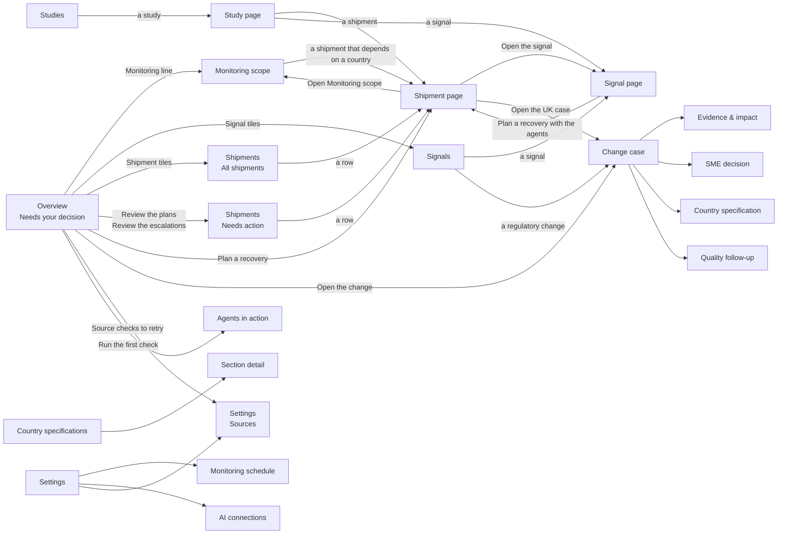
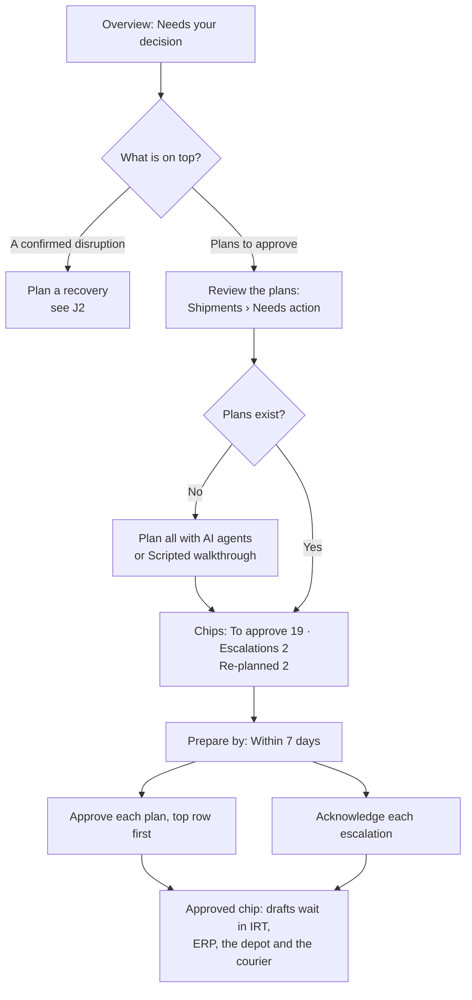
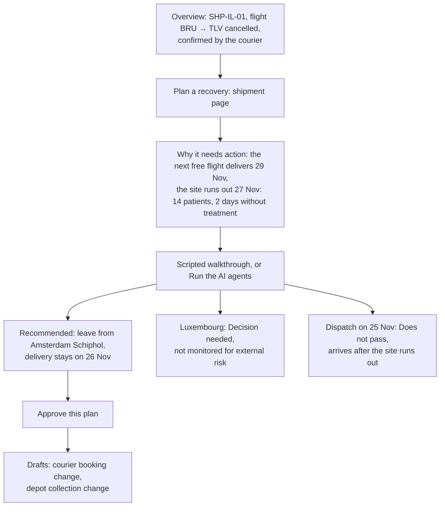
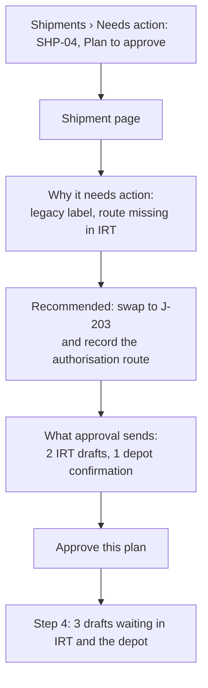
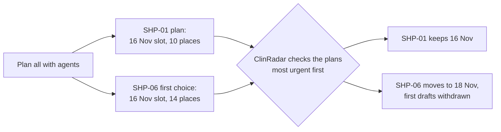
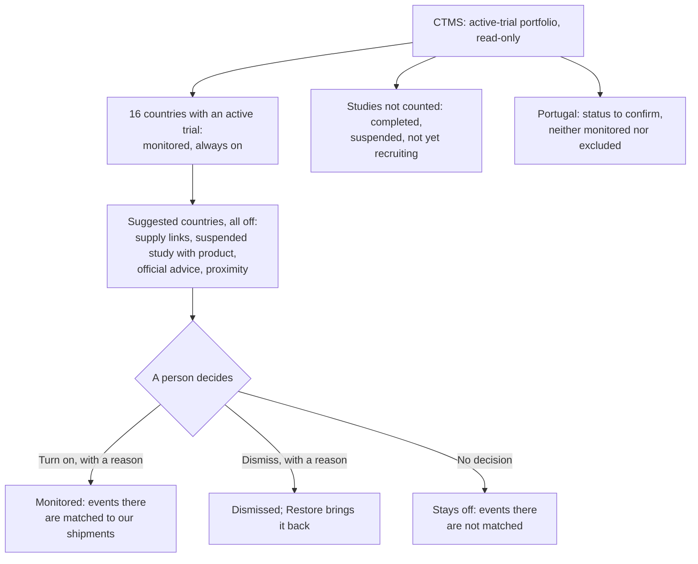
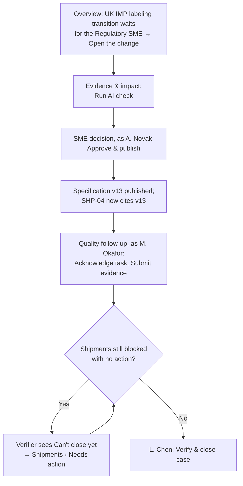

# ClinRadar · User journeys and demo scenarios

*15 November 2026. Every path through the dashboard, who takes it, and the exact clicks for each demo. Updated for ClinRadar: the new menu, the monitoring scope, the signals and the route checks.*

## The people in the journeys

The **Acting as** menu switches between them. It appears wherever a decision is made: Monitoring scope, Shipments, a shipment page, a change case and Settings. Each role can do different things, so the demo shows who decides what.

| Role | Name in the demo | Can do | Cannot do |
|---|---|---|---|
| **Clinical Supply** | P. Laine | Run the agents; approve or withdraw a shipment plan; acknowledge an escalation; record a manual action; turn **External risk** monitoring on or off for a suggested country; dismiss or restore a suggestion | Approve a regulatory change; switch **Regulatory & customs** monitoring |
| **Regulatory SME** | A. Novak (UK), C. Ruiz (Spain) | Run the AI check; approve, edit, reject or defer a regulatory change; turn **Regulatory & customs** monitoring on or off for a suggested country; dismiss or restore a suggestion; change the monitoring schedule | Approve a supply plan; switch **External risk** monitoring |
| **Quality owner** | M. Okafor | Acknowledge the Quality task, submit evidence; approve or reject a connection request; change the monitoring schedule | Close the case |
| **Quality verifier** | L. Chen | Verify the evidence and close the case, but only once every blocked shipment has an action | Approve a supply plan |

Nobody switches off a country with an active trial: the CTMS puts it in scope and it stays on. People outside ClinRadar approve each draft in their own validated system: IRT, ERP, the depot, the courier, the QMS or the site portal.

## Where everything is

The menu follows the day's work: **Overview · Shipments · Studies · Signals · Monitoring scope · Agents in action · Country specifications · Settings**.

- A shipment page opens under **Shipments**, and its breadcrumb leads back there.
- A study page opens under **Studies**.
- A signal and a change case open under **Signals**.
- Earlier page names still open the right place, so old links keep working:
  - **Agent plans** is now the **Needs action** tab of Shipments;
  - **Shipment checks** is the **All shipments** tab;
  - the **Source log** is the **Sources** tab of Settings.

### What each screen is for

| Screen | The question it answers | Main action |
|---|---|---|
| **Overview** | What needs a decision today, and what did the last check find? | One button per line under **Needs your decision**; **Run the check** |
| **Studies** | Which studies do we supply, where, to how many patients, and what puts each one's supply at risk? | Open a study |
| **Study page** | For one study: active countries, sites and patients, planned shipments with their result and plan, and the signals that touch them. Each number names its system (CTMS, IRT, ERP, depot, courier) | Open a shipment or a signal |
| **Monitoring scope** | Which countries does ClinRadar watch, and why? | Turn a suggested country on or off, with a reason; dismiss or restore a suggestion |
| **Signals** | What happened in the monitored countries, and does it touch our shipments? | Open a signal or a regulatory change; **Run the check** |
| **Signal page** | For one event: the sources, each match with our shipments, the owner and the next step | **Plan a recovery with the agents** |
| **Shipments › Needs action** | What do I need to approve, most urgent first? | **Plan all with AI agents**; **Approve** or **Acknowledge** each row |
| **Shipments › All shipments** | Which planned shipments break their country's rules, or meet a risk on their route? | Filter, then open a shipment |
| **Shipment page** | For one shipment: why it needs action, its route, what the agents recommend, what approval sends | **Approve this plan**, or **Approve instead** |
| **Change case** | Is this rule change real, and how does the specification change? | **Run AI check**, then **Approve & publish** |
| **Agents in action** | How did the watch team, the master agent and the specialists work through the shipments? | Replay, pause, step, change the speed, filter by agent |
| **Country specifications** | What does each country require today, and what is changing? | Open a section |
| **Settings › Monitoring schedule** | When do the checks run, and do the agents start on their own after a check? | **Save schedule**; **Run checks now** |
| **Settings › AI connections** | Which Claude models and company systems do the agents use, and is the AI ready? | **Request a new connection**; the Quality owner approves or rejects it |
| **Settings › Sources** | Did every official source and feed answer? | **Retry this check** |

### Filters

| Screen | Filters |
|---|---|
| **Monitoring scope** | **Find a country** (country, region or reason). The page has three parts: **Active-study country scope (on)**, **Suggested additional countries (off)** and **Exclusions and coverage gaps**. |
| **Signals** | Tier chips with counts (All, Confirmed disruption, Potential exposure, Observed event, Not affected after check), Type (External risk, Regulatory & customs), Country |
| **Shipments › Needs action** | Status chips with counts (All, To approve, No plan yet, Escalations, Re-planned, Approved), Search, Destination, Prepare by (within 7 days, within 30 days, later than 30 days) |
| **Shipments › All shipments** | Result chips (All, Blocked, Confirm before dispatch, Ready to ship), Search, Destination, Agent plan. The line above the table ("Showing all 25 shipments") updates as you filter. |
| **Settings › Sources** | Find a page, Check status (Changed, Unchanged, Retry needed, New) |
| **Shipment page, "How the agents worked it out"** | One agent at a time, and "Show the systems' answers" for the raw replies |

## The shipment page, top to bottom

1. **Where the shipment stands**: Checked → Agents planned → Approved in ClinRadar → Approved in each system.
2. **Why it needs action**: the failing checks, each with its specification section. For a risk on the route it also says:
   - which system confirmed it, and when;
   - what happens to the patients if nothing is done.
3. **Route**: each leg with its date, from the depot to the site.
   - A disrupted leg shows its tier and **Open the signal**.
   - Under the legs: the countries on the route, and whether each is monitored.
4. **The recommended plan**:
   - what changes, in plain words;
   - why, and the risk;
   - what ClinRadar checked, and what is still to confirm;
   - **Acting as**, then **Approve this plan**.
5. **What approval sends**: one draft per system, for example IRT, the depot or the courier. After approval this becomes **What happens next**.
6. **Other options the agents considered**: each with ClinRadar's verdict.
   - **Approve instead** appears when an option passes.
   - An option through a country nobody monitors says **Decision needed**, with a link to that country in Monitoring scope.
7. **All checks**, and **Or record an action yourself**: hold, swap the batch or proceed, with a reason.
8. Folded away until needed:
   - **How the agents worked it out**: every step, filterable by agent;
   - **How the agents are controlled**: the guardrails and the systems connected over MCP.
9. **The run**: when it ran, **Export the audit record**, and **Run the agents again**.

Before the agents have run, the plan says **No plan yet**, with **Run the AI agents** and **Scripted walkthrough (no AI)**.

## Journeys

### J1 · Morning triage: start from the Overview

**Who:** Clinical Supply. **When:** at the start of the day, or after a check.

1. **Overview** → the line under **Needs your decision** says what is at stake: the shipments that need action before dispatch, the patients on treatment who depend on them, and the first site that could run out of stock. Below it, the most urgent items, one sentence and one button each, in this order:
   - a confirmed disruption on a route;
   - a country that a recovery route needs;
   - escalations;
   - plans to approve;
   - a study status to confirm;
   - a regulatory change waiting for the SME.
2. **Review the plans** opens **Shipments › Needs action**.
3. **Plan all with AI agents**. Without a key, use **Scripted walkthrough (no AI)**. A progress bar shows "Planning 19 shipments · N done".
4. Choose **Prepare by: Within 7 days**.
5. Go down the list:
   - choose **Approve** for a plan;
   - choose **Acknowledge** for an escalation (SHP-03, SHP-05);
   - open the shipment for anything you want to read first.
6. The **Approved** chip counts what is done. Each draft waits for approval in its own system.

### J1b · One study at a glance (STUDY-021)

**Who:** a clinical supply manager or study lead who thinks per study.

1. **Studies** lists every study in the CTMS. **Active** shows the 18 that count; **Not counted** shows the completed, suspended and not-yet-recruiting ones with the reason. Each row gives:
   - the study status from the CTMS;
   - its countries, with active ones highlighted and approved-but-not-started ones greyed;
   - sites and patients on treatment;
   - planned shipments;
   - the supply risk.
2. Open **STUDY-021**, the multinational psoriasis study (illustrative). It has 3 active countries, 5 sites and 66 patients on treatment. 3 of its 5 shipments need action, and the first stock-out at risk is 27 Nov 2026 (SHP-IL-01).
3. **What puts this study's supply at risk** shows two things. The Belgian strike is a confirmed disruption for SHP-IL-01; the Ben Gurion runway works are a potential exposure for SHP-IL-02. Each one opens its signal.
4. **Planned shipments** gives each shipment's result, risk, agent plan and what needs attention, and opens the shipment page.
5. **Countries and sites** shows the study-country status from the CTMS, the sites and patients from IRT, and whether each country is monitored.

### J2 · A strike cancels a flight: SHP-IL-01 to Tel Aviv (illustrative)

**Who:** Clinical Supply. **What happened:** a national strike day in Belgium on 24 Nov 2026. Brussels Airport has no departures. The courier's booking system marks SHP-IL-01's cargo flight to Tel Aviv as cancelled.

1. **Overview** → the first line, SHP-IL-01 → **Plan a recovery**. Another way in: **Signals** → **National strike day in Belgium** → **Plan a recovery with the agents**, which also starts the agents.
2. **Why it needs action** gives the evidence:
   - the EMEA specialty courier's booking system recorded the cancellation on 14 Nov 2026 at 10:10;
   - if nothing is done, the courier's next free flight (25 Nov) delivers on 29 Nov;
   - the site runs out on 27 Nov, so 14 patients would go 2 days without treatment.
3. **Route**: Central EU depot, Belgium → BRU → TLV → Tel Aviv.
   - The flight leg is marked **Confirmed disruption**, with **Open the signal**.
   - Belgium is monitored because P. Laine turned it on; Israel because of the active trial.
4. Choose **Scripted walkthrough (no AI)**, or **Run the AI agents** if a key is set. The master agent asks for these, in order:
   - the patient impact;
   - the route;
   - the courier's and the depot's status;
   - the other departure airports;
   - the site stock and the import approval.
5. The recommended plan: **Leave from Amsterdam Schiphol instead of BRU**.
   - The depot and the dispatch day stay the same: about 2.5 h by road, then the courier's qualified flight.
   - Delivery stays on 26 Nov.
   - The risk: a new booking, which the courier must confirm.
6. **Other options the agents considered**:
   - **Leave from Luxembourg Airport instead of BRU**: **Decision needed**. Luxembourg is not monitored for external risk, so ClinRadar can't assess it. **Open Monitoring scope: Luxembourg** leads to J9.
   - **Dispatch on 25 Nov 2026 instead**: **Does not pass**. The kits would arrive on 30 Nov, after the site runs out on 27 Nov.
7. **Approve this plan** as P. Laine. **What approval sends**:
   - a booking change for the courier (a new departure airport);
   - a collection instruction change for the depot.

SHP-03 also falls on the strike day, but its truck leaves Belgium the evening before. The signal shows it as **Not affected after check**, confirmed by the logistics partner's tracking.

### J3 · One urgent shipment: SHP-04, to be prepared today

1. **Shipments › Needs action** → the first row, SHP-04 → open it. The **Approve** button on the row approves without opening the page.
2. **Why it needs action** lists three checks:
   - the label fails the amended UK rule (pending change RC-UK-001);
   - IRT doesn't record the trial's authorisation route;
   - the shipment must be prepared today.

   **Open the UK case** leads to the change behind the rule.
3. The recommended plan, **Swap to batch J-203 and record the authorisation route**, changes two things:
   - "Ship batch J-203 instead of J-202";
   - "Correct the trial's authorisation route in IRT: old rules".

   ClinRadar checked that the UK depot holds 48 kits of J-203 (the shipment needs 12) and that the eTMF holds the MHRA letter.
4. **Approve this plan** as P. Laine. The step strip moves to **Approved in each system**: two drafts for IRT and a pre-dispatch confirmation for the depot. The route (UK depot to Birmingham by road) has no external risk.

### J4 · Approving another option

On SHP-04, **Other options the agents considered** shows "Relabel J-202 on 16 Nov 2026 and dispatch on 23 Nov 2026 and record the authorisation route" with **Passes**. **Approve instead** does three things:

- drafts that plan's changes: a relabelling work order and a dispatch date change;
- withdraws the swap drafts;
- holds the 12 relabelling places.

### J5 · The agents re-plan around a more urgent shipment (SHP-06, SHP-IL-03)

**Shipments › Needs action** → chip **Re-planned** shows two shipments, each with its reason:

- SHP-06: "the 16 Nov relabelling slot goes to SHP-01, which is more urgent";
- SHP-IL-03: SHP-IL-02 takes the Israel-only kits, so SHP-IL-03 is relabelled instead.

On each shipment page, the first choice's drafts are struck through under **2 withdrawn drafts**.

### J6 · No safe option: escalate (SHP-03, SHP-05)

Batch E-105 has no label specification for Germany. Creating one takes 15 business days: it would be ready on 4 Dec 2026, after SHP-03's preparation starts on 18 Nov, so nothing passes. The shipment page says **No option passes the rules** and lists why each option fails.

**Acknowledge the escalation** sends a QMS escalation draft. Regulatory Affairs and Clinical Supply then decide whether to delay, split or cancel.

SHP-03 is the truck that the Belgian strike does not affect (J2): its problem is the label, not the route.

### J7 · Nothing blocks, but something needs confirming (SHP-07)

SHP-07 is "Confirm before dispatch": its post-cutoff label needs checking against the approved specification. The agents confirm in the ERP that the label is approved. The plan is **Proceed and confirm before dispatch**, with one pre-dispatch confirmation draft for the depot.

### J8 · Changing your mind

- **Withdraw the approval**, on the shipment page. The kits and slot places the plan held are free again, and the withdrawal is logged.
- **Run the agents again**, at the bottom of the shipment page, makes a new run. A new run never inherits an earlier approval: the page says the approval came from an earlier run until someone withdraws it.

### J8b · The watch team and the master agent

**Agents in action** → run **Every shipment**. The order of the work:

1. **Watch team**. Four agents run on Claude Haiku 5.5, one per kind of hazard, each across every monitored country:
   - **Weather & natural hazards** (GDACS): its top item is an illustrative winter storm watch at the US depot, observed only, because no collection is planned there. It also names the coverage gap where depots sit in unmonitored countries (Singapore, Switzerland, India).
   - **Strikes & transport**: the Belgian strike, confirmed for SHP-IL-01 and not affecting SHP-03.
   - **Security & travel advice** (UK FCDO).
   - **Regulatory & customs**: the open changes and the import permits.
2. **Master agent** (Claude Opus 5.5) ranks the shipments, patients first: SHP-IL-01, whose site runs out on 27 Nov, comes before the shipments ranked by preparation date. It then hands tasks to the specialists.
3. **Specialists** (Claude Sonnet 5.5): supply, logistics, records and communications read the company's systems over MCP, read-only.
4. **ClinRadar verifier** (fixed rules, no AI) tests every option and checks the plans together, so nothing is promised twice.
5. **Clinical Supply** approves.

On a single shipment with a route risk, the master agent first asks the matching watch agent to confirm the event, its evidence and how long it lasts, then sends logistics to look for alternatives.

### J9 · Deciding what ClinRadar monitors

**Who:** Clinical Supply for external risk; the Regulatory SME for regulatory and customs. **Why it matters:** ClinRadar watches only the countries that the active-trial portfolio puts in scope. Every other country is a suggestion with its evidence. It stays off until a person turns it on, with a reason.

1. **Monitoring scope** → **Active-study country scope (on)**: 16 countries with an operationally active trial, each with its studies, sites, patients and planned shipments. EU rules are assessed once for the 10 active-trial EU countries; they switch no other EU country on.
2. **Turned on by a person**: Belgium.
   - It has been on for external risk since 2 Nov 2026, turned on by P. Laine. The reason: "Our central EU depot is in Belgium: most EU, Israeli and Cypriot shipments leave from it."
   - 17 planned shipments depend on it.
3. **Suggested additional countries (off)**: 49 countries, grouped by their evidence:
   - **Supply links** (5): India, Switzerland, Luxembourg, Singapore and the United Arab Emirates;
   - **Suspended studies with product on site** (1): Austria, with 24 kits at the Vienna site;
   - **Current official advice** (14): UK FCDO travel advice;
   - **Proximity only** (29).
4. To turn Luxembourg on for external risk, act as **P. Laine · Clinical Supply**:
   1. Click the **External risk** switch.
   2. Under "Turn on external risk monitoring for Luxembourg: why?", keep the pre-filled reason (the strongest evidence) or edit it.
   3. Click **Turn on**.

   The decision is kept in the audit trail with the name and the time. Run the agents again on SHP-IL-01: Luxembourg now passes too, with the same delivery day (26 Nov), instead of stopping at **Decision needed**.
5. The **Regulatory & customs** switch belongs to the Regulatory SME. Acting as Clinical Supply, hovering over the switch says who owns it.
6. **Dismiss this suggestion** (Clinical Supply or the Regulatory SME) asks for a reason, for example "no supply passes through it". The country moves to the dismissed list. **Restore**, again with a reason, brings it back. A monitored country can't be dismissed.
7. **Exclusions and coverage gaps**:
   - **Needs confirmation**: Portugal. The CTMS says STUDY-013 is approved and not started, but IRT shows site PT-01 activated on 10 Nov. Portugal is neither monitored nor excluded until the study manager confirms.
   - **Excluded**: 5 countries with a study registered but no active trial (Belgium, Brazil, Denmark, Finland, Mexico).
   - **Coverage gaps**: where the monitoring is incomplete. Eight countries have no Country Specification or national regulator source. For the UK itself, FCDO advice doesn't apply, so natural hazards come from GDACS only.

### J10 · A potential exposure: runway works at Ben Gurion (SHP-IL-02, illustrative)

1. **Signals** → chip **Potential exposure** → "Ben Gurion Airport: reduced cargo handling during runway works, 4 to 8 Jan 2027". It has one source, the Israel Airports Authority notice, and low priority.
2. It touches SHP-IL-02's flight BRU → TLV on 5 Jan 2027, but no system has confirmed an impact. The signal names:
   - what is missing: "no confirmation yet from the courier about the flight on 5 Jan 2027";
   - the owner: Clinical Supply Logistics;
   - the next step: confirm with the courier before 4 Jan 2027.
3. A potential exposure never blocks a shipment on its own. SHP-IL-02 is blocked by the Israeli label rule (J15) and shows the exposure in its **Risk** column.

How the tiers work, as the signal page explains:

| Tier | Meaning |
|---|---|
| **Confirmed disruption** | An authorised system, the courier or the depot, confirmed the impact, with the time of its record. |
| **Potential exposure** | It touches one of our shipments, routes or facilities on the day, but no authorised system has confirmed an impact. The missing evidence and its owner are named. |
| **Not affected after check** | It touched one of ours, and the carrier or the depot confirmed normal operation. |
| **Observed event** | A verified event in a monitored country that touches nothing of ours in place and time. |
| **Tracking visibility lost** | The courier's tracking is down. Never counted as a disruption. |

### J11 · Checking the official feeds

1. **Signals** or the Overview → **Run the check**. ClinRadar does two things:
   - re-reads the official sources;
   - reads UK FCDO travel advice (GOV.UK content API) and GDACS alerts for each country monitored for external risk.
2. The line under the title says where the signals come from: "Official feeds read live" with the time, or the recorded copy when the feeds don't answer.
3. **Settings › Sources** → **Official feeds for external risk**: each monitored country's FCDO answer and its last update. GDACS alerts outside the monitored countries are counted, not matched.
4. Current FCDO advice in a neighbouring country appears as evidence under **Current official advice** in Monitoring scope. It never turns monitoring on by itself.

### J11b · Alerts from the company's enterprise risk system (illustrative)

**Why:** most pharma companies already run a crisis-alerting system (for example Everbridge or Dataminr). It warns offices and travellers, but it doesn't know the trials, the sites or the IMP shipments. ClinRadar reads its alerts and says which ones matter for supply.

1. The **Overview** line says what happened to the alerts: "Enterprise risk system: 7 alerts · 3 touch our trials · 1 coverage gap · 3 counted, not matched".
2. **Signals** → **From your enterprise risk system** → **See what each alert became**:
   - **Same event as a signal we have:** the Belgian national action day joins the strike as a third source. Shipments SHP-03 and SHP-IL-01 are unchanged, because an aggregator alone never confirms an impact.
   - **New signal for our shipments:** a seasonal heat outlook for Andalusia in March 2027 is a potential exposure for the deliveries to Sevilla (SHP-ES-08) and Málaga (SHP-ES-10). The depot and the courier confirm that the qualified packaging holds its temperature range.
   - **Coverage gap:** a power cut in Basel touches our drug-product manufacturer in Switzerland, which nobody monitors. ClinRadar suggests turning it on.
   - **Nothing of ours affected:** a ransomware attack at a forwarder we don't use, a typhoon in Taiwan and a demonstration in Paris are counted, not raised.
3. In a real deployment the enterprise system posts its alerts to `POST /api/enterprise-alerts` with a token (`REGCHAIN_ENTERPRISE_TOKEN`). The watch agents read them through MCP, and each alert is in the audit trail.

### J12 · A regulatory change reaches the shipments (UK labelling)

The case also opens from **Signals** → **Regulatory & customs** → **UK IMP labeling transition**.

### J13 · Early warning: a new Spanish rule, 107 days ahead (illustrative)

1. **Signals** → **Regulatory & customs** → **Spain: delivery note and pharmacy notice for IMP shipments** → the case.
2. **Run AI check** on the Spanish note, then approve, which publishes specification v5.
3. **Shipments › Needs action** → **Destination: Spain**. In the plan for SHP-ES-10:
   - the agents book the QP release for 2 Mar 2027;
   - they ask the site for its pharmacy code, with the message drafted in Spanish and English.

### J14 · The first check, from an empty workspace

1. Open **http://127.0.0.1:4173/?empty**, or choose **Start from empty** in the Overview's run line (click twice to confirm). This does three things:
   - archives the plans and approvals;
   - disconnects the active-trial portfolio;
   - makes the Overview say "ClinRadar monitors nothing yet": without the authorised CTMS or study-country export, it monitors nothing and assumes no country.

   Every other page says "Nothing here yet".
2. The Overview lists what ClinRadar works with:
   - the CTMS (read-only, not connected yet);
   - 8 official regulatory sources and 2 official feeds;
   - 25 planned shipments;
   - 8 company systems over MCP;
   - 5 AI agents and one rule checker.
3. **Connect the CTMS and run the first check**. Six steps run in about a minute, each with what it found:
   1. **The scope.** The CTMS shows 18 of 22 studies active. 16 countries are monitored automatically, 5 are registered but not active, and Portugal is to confirm.
   2. **The suggestions.** 50 countries are suggested, all off. The check stops once for a decision: "Turn on external-risk monitoring for Belgium: it hosts our central EU depot (Mechelen)". Choose **Turn it on as P. Laine · Clinical Supply** or **Continue without it**.
   3. **The sources.** The 8 regulatory sources are read: UK regulation 46 changed, plus a new Spanish note and a new Israeli notice. Then the official feeds for the 17 countries monitored for external risk.
   4. **The matches.** SHP-IL-01's flight is a confirmed disruption, SHP-IL-02 a potential exposure, and SHP-03 is not affected after check. 13 observed events touch nothing of ours. Then the UK, Israel and Spain impacts.
   5. **The shipments.** 25 shipments are re-checked: 14 blocked, 5 to confirm, 6 ready.
   6. **The agents.** The watch team sweeps its four kinds of hazard, and the 19 shipments that need action go to the agent team, patients first.
4. The page opens **Agents in action** and replays the run. Pause, step, change the speed, or filter by agent.
5. Back on the **Overview**, under **Needs your decision**:
   - SHP-IL-01 comes first, with **Review the plan**;
   - then 17 plans to approve and 2 escalations.

With **Continue without it**, Belgium stays off. The strike is not matched to SHP-IL-01 until someone turns Belgium on in Monitoring scope. This is how the scope works: an event in a country nobody monitors is not matched.

### J15 · One label, two countries (Israel, illustrative)

1. **Signals** → **Regulatory & customs** → **Israel: shared booklet labels no longer accepted**. From 3 Jan 2027, Israel refuses the booklet it shares with Greece and Cyprus. 70 kits stay with Greece and Cyprus; Israel has 14 Israel-only kits for the 22 it needs.
2. The case shows the evidence, the assessment and the **Label pool after the change**.
3. **Agents in action** → **Run** → **SHP-IL-03**. The master agent splits the work:
   - Logistics finds a Thursday delivery, since Friday is not an Israeli working day;
   - Records checks the import approval;
   - Communications drafts a note in Hebrew and English;
   - Supply finds Israel-only stock.

   The verifier then tests three ways out.
4. **Shipments › Needs action** → chip **Re-planned**: SHP-IL-02 takes the Israel-only kits, so SHP-IL-03 is re-planned to relabelling.

### J16 · Setting the schedule and the connections

1. **Settings › Monitoring schedule**, acting as the **Regulatory SME** (A. Novak). Set weekdays at 06:30 and **Have the agents prepare plans**, then **Save schedule**.
   - The next three checks appear, and the change is in the audit trail.
   - Each check reads the 8 regulatory sources and the official feeds for the countries monitored for external risk.
   - It then matches every signal and change to the shipments, and re-checks the 25 shipments.
2. After the next check, blocked shipments without a plan go to the agent team on their own. Clinical Supply finds the plans under **Shipments › Needs action** and still approves each one.
3. **Settings › AI connections**, acting as **Clinical Supply** (P. Laine): **Request a new connection**, for example to the courier's tracking, read-only. Give its business owner and why it is needed.
4. Acting as the **Quality owner** (M. Okafor): **Approve**, or **Reject** with a reason. An approved connection is built and validated before any agent uses it; until then the agents keep to the systems listed.

### J17 · A source check failed

1. On the Overview's run line, choose **1 source check to retry**.
2. **Settings › Sources** opens, filtered to **Retry needed**.
3. Open **Approved countries for IMP imports** (MHRA) → **Retry this check**. The page fetches the official page again and records the result.

### J18 · Audit

- On a shipment page, **Export the audit record** saves the whole run: every step and system answer, the options, the rule results, the drafts, the approval and its log.
- Right after **Plan all**, Shipments › Needs action shows when the plans were made, with **Export the audit record** for all shipments.
- Each monitoring decision is kept in the hash-chained audit trail with the person's name, the time and the reason: turning a country on or off, dismissing or restoring a suggestion. Monitoring scope shows the decision next to the country.
- Every version of every run is kept on the computer in `.regchain-cache/agent-runs/`.

### J19 · From the launch page to sign-in

1. **http://127.0.0.1:4173/site/** is the public launch page. It covers:
   - what ClinRadar prevents;
   - how it works (watch, check, plan, verify, approve);
   - the Belgian strike example;
   - validation;
   - a contact form.
2. **Sign in** opens the app's sign-in page. There is no self sign-up: an administrator creates the accounts. For the demo, `npm run demo:accounts` creates four accounts, one role each:
   - P. Laine (Clinical Supply);
   - A. Novak (Regulatory SME);
   - M. Okafor (Quality owner);
   - L. Chen (Quality verifier).

   Their passwords are in `.regchain-data/demo-accounts.txt`.
3. Signed in, the role is fixed by the account, so there is no **Acting as** menu. To show another role, sign out and sign in as that person.
4. A message sent from the contact form is stored on the server in `contact-requests.jsonl` with a reference such as `CR-20261115-ABC123`. No email is sent.

## Demo scenarios

### Before any demo (2 minutes)

1. Choose the launcher, and keep its window open:
   - **Start-ClinRadar.cmd** for the scenarios below: one computer, with **Acting as** to switch roles;
   - **Start-ClinRadar-Site.cmd** to start from the launch page with sign-in (J19).

   Only one of them can run at a time on port 4173. Always use the address **http://127.0.0.1:4173**, never the HTML file itself. Opened as a file, the page shows an orange notice, and the agents, approvals, monitoring decisions and live checks don't work.
2. Open **http://127.0.0.1:4173/?empty** for Scenario A: an empty workspace, with the CTMS disconnected, plans and approvals archived and the cases started again. The address goes back to normal by itself.
   - For the other scenarios, open **?fresh** (clears decisions, keeps the plans) or **?fresh=all** (no plans at all).
3. Check **Acting as**: P. Laine · Clinical Supply.
4. On **Shipments › Needs action**, check that **Plan all with AI agents** is enabled. If it isn't, the key is missing; use the scripted walkthrough.
5. The day before, run **Plan all with AI agents** once. The plans stay, so the demo works even if the venue's internet fails.
6. The official feeds need the internet. Without it, ClinRadar says so and uses the recorded copy.

### Scenario A · The 5-minute pitch, from an empty workspace

| Time | Screen | Click | Say |
|---|---|---|---|
| 0:00 | Overview, empty | Nothing yet | "ClinRadar monitors nothing yet. Without the trial portfolio, it won't guess which countries matter." |
| 0:15 | Overview | **Connect the CTMS and run the first check** | "First, the active trials set the scope: 16 countries, always on. Closed and suspended studies are left out. Portugal's status is contradictory, so a person confirms it." |
| 0:45 | Overview | **Turn it on as P. Laine · Clinical Supply** | "Our central EU depot is in Belgium, where we have no active trial. ClinRadar suggests it with the evidence. I decide, and my reason goes into the audit trail." |
| 1:15 | Overview | Watch steps 3 to 6 | "A national strike day in Belgium cancels SHP-IL-01's flight to Tel Aviv. The courier confirmed it; it isn't just a news item. SHP-03's truck leaves the day before, so it is not affected. 14 shipments are blocked." |
| 1:45 | Agents in action | Watch the replay; chips **Watch team**, then **Verifier** | "Four watch agents sweep one hazard each across the 17 monitored countries: weather, strikes and transport, security advice, regulatory change. The master agent ranks 19 shipments, patients first, and hands tasks to four specialists. They read the company's systems over MCP, read-only. Every option goes to ClinRadar's rules: fixed code, not AI." |
| 2:45 | Shipment page SHP-IL-01 | Overview → **Review the plan** | "If nothing is done, 14 patients go 2 days without treatment. The agents propose leaving from Amsterdam: same delivery day. Luxembourg would need a monitoring decision first, and a later dispatch arrives after the site runs out." |
| 3:45 | Shipment page | **Approve this plan** | "I approve as Clinical Supply. The courier and the depot get drafts to approve in their own systems. Nothing changed in any validated system." |
| 4:15 | Shipments › Needs action | Chips **Re-planned**, then **Escalations** | "The same team works on every shipment. Nothing is promised twice, and when nothing is safe, the agents escalate instead of guessing." |
| 4:40 | Shipment page | **How the agents are controlled** | "Read-only, drafts only, rules decide, Clinical Supply approves, every step logged." |

### Scenario A2 · The 5-minute pitch, with plans prepared

| Time | Screen | Click | Say |
|---|---|---|---|
| 0:00 | Overview | **Needs your decision** | "Every morning ClinRadar shows what needs a decision. First, a confirmed disruption on a route; then the plans to approve." |
| 0:30 | Signals | **National strike day in Belgium** | "Two trusted sources, merged as one event. It touches two of our shipments. One flight is cancelled, confirmed by the courier. The other shipment was checked and is not affected." |
| 1:00 | Signal page | **Plan a recovery with the agents** | "The master agent asks for the patient impact first." While it runs, open **How the agents worked it out**. |
| 2:00 | Shipment page SHP-IL-01 | Read the recommended plan, then **Approve this plan** | "Leave from Amsterdam: same delivery day. The rules refused the later dispatch, and Luxembourg waits for a monitoring decision." |
| 2:45 | Monitoring scope | Belgium, then Luxembourg | "Belgium is watched because the depot is there and a person decided so. Luxembourg is suggested because the courier can fly from there. It stays off until someone decides." |
| 3:30 | Shipments › Needs action | Chip **Re-planned** | "SHP-06's agents wanted the 16 Nov slot. SHP-01 needs it first, so ClinRadar moved SHP-06 to 18 Nov. Nothing is promised twice." |
| 4:00 | Shipments › Needs action | Chip **Escalations** → SHP-03 | "When nothing is safe, the agents escalate instead of guessing." |
| 4:30 | Shipment page | **How the agents are controlled** | "Read-only, drafts only, rules decide, Clinical Supply approves, every step logged, in line with the draft EU GMP Annex 22." |

### Scenario B · The 3-minute version

1. **Overview** → SHP-IL-01 → **Review the plan** (planned beforehand) → **Approve this plan**.
2. **Monitoring scope**: why Belgium is watched, and Luxembourg waiting for a decision.
3. **Shipments › Needs action**: the **Re-planned** chip, then **Escalations**.
4. **How the agents are controlled**.

### Scenario C · Deep dives for questions

| Question | Show |
|---|---|
| "Which countries do you watch, and why?" | **Monitoring scope**. The active trials set the scope. Every other country is a suggestion with its evidence, off until a person decides. No list of risky countries is used. |
| "What if there's no trial portfolio?" | **Start from empty**. ClinRadar monitors nothing and assumes no country until the CTMS is connected. |
| "Is a news story enough to block a shipment?" | The signal tiers. A **Potential exposure** (SHP-IL-02, one source) names what is missing and who confirms it. Only a system of record, the courier or the depot, makes it a **Confirmed disruption**. A tracking outage is never counted as a disruption. |
| "What if the AI is wrong?" | SHP-IL-01 → **Other options**: the later dispatch fails, with its reason. In a live run, a recommendation that fails ClinRadar's rules has its drafts withdrawn. |
| "Who decides?" | Change **Acting as** to Regulatory SME: **Approve this plan** is disabled, with "Clinical Supply approves supply plans". In Monitoring scope, the External risk switch belongs to Clinical Supply. |
| "Can it double-book stock?" | **Re-planned** chip, SHP-06. Then approve SHP-01 and try to approve SHP-04's relabel option: it is refused because the 16 Nov slot is now held. |
| "What does it change in our validated systems?" | **What happens next**: drafts only, each waiting for approval in its own system. |
| "Is there an audit trail?" | **Export the audit record**; **How the agents worked it out → Show the systems' answers**; in Monitoring scope, each decision with its name, time and reason. |
| "How does a rule change reach the shipments?" | J12: the UK case, then **Quality follow-up** saying "Can't close yet" while shipments are blocked. |
| "Which data is real?" | Real: the UK FCDO and GDACS feeds and the ISO country list. Illustrative, and labelled so on screen: the strike, the courier and depot records, the Israeli and Spanish rules. |

### Scenario D · No internet, or no API key

- Plans recorded beforehand stay on the Shipments page and the shipment pages, so nothing on screen depends on the venue.
- **Scripted walkthrough (no AI)** runs the same steps through the same MCP servers in a few seconds. Say so plainly: "This is the scripted walkthrough: the same tools and rules, with the decisions written in code instead of made by Claude."
- Mention a live run only if one has been recorded. Its time and token use are in the run's audit record.
- Without the internet, the official feeds come from the recorded copy, and the page says so with its date.
- The AI check on the change cases shows its last recorded result.

### After the demo

Open **http://127.0.0.1:4173/?empty** to be ready for the next Scenario A, or **?fresh** to clear only the approvals made on stage. Nothing is deleted: approvals and runs are archived in `.regchain-cache/`, and the monitoring decisions stay in the audit trail.
