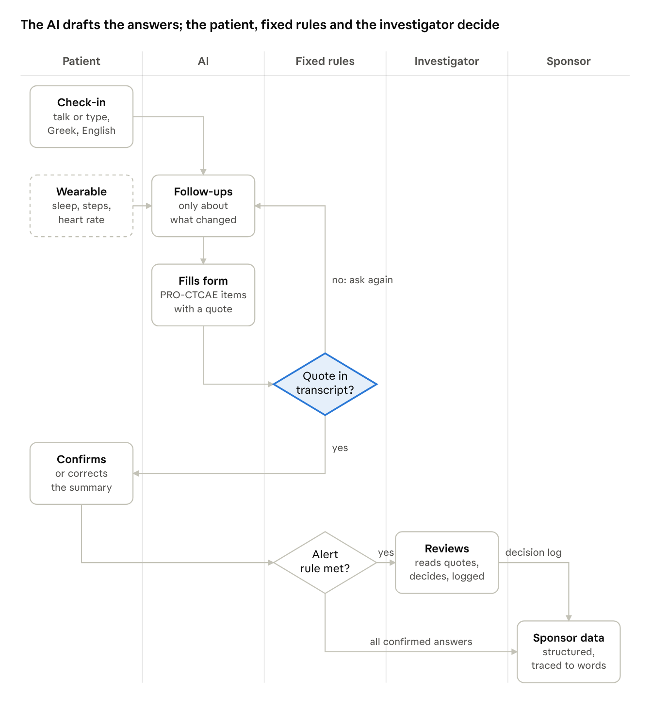
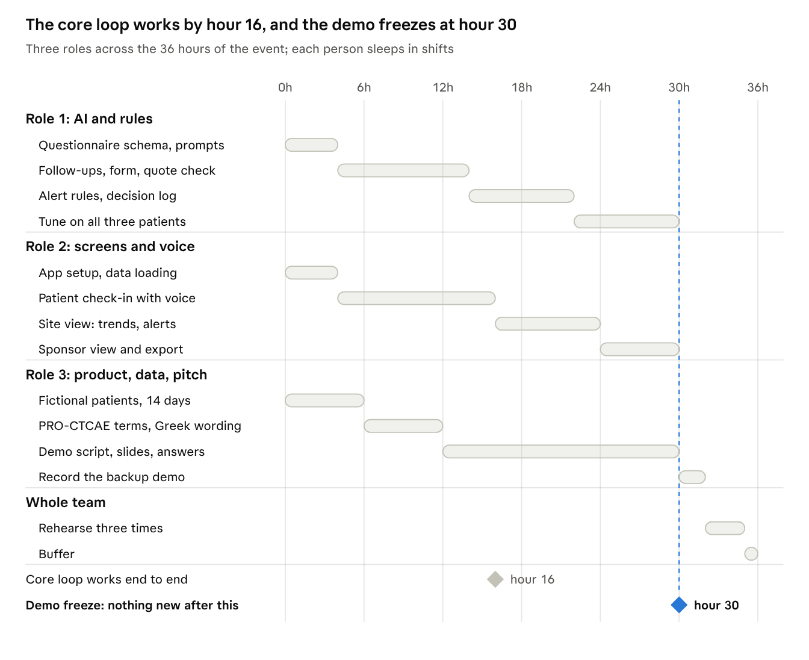
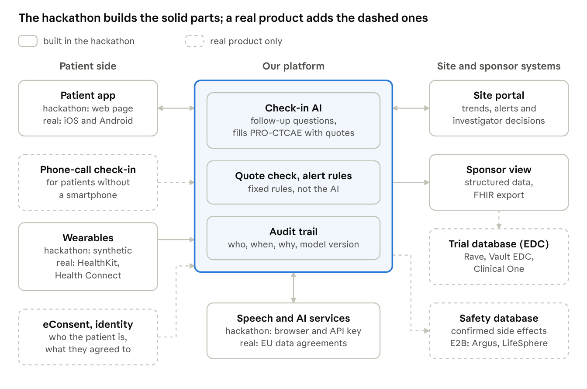

# Conversational ePRO: Challenge 3 build plan

Patient check-ins that become trial evidence · Challenge 3, Patient Experience · Gen AI Summit hackathon · Draft for team review, 14 Nov 2026

## The problem and our answer

We build a one-minute daily check-in where trial patients say how they feel in their own words and language, and AI turns it into the answers of a standard side-effect questionnaire, with the patient's own sentence behind every answer.

Today, how patients feel on a treatment is recorded through questionnaires at site visits. What happens between visits is lost or remembered badly, and the patient's own words rarely reach the trial.

With our check-in, trial sites see a worsening symptom days before the next visit, and sponsors get structured data a regulator could accept. Every value traces back to what the patient actually said, and a person confirms it.

Entry: Challenge 3, Patient Experience. Working name to be decided.

## What we build: three screens

| Screen | Who uses it | What it does |
| --- | --- | --- |
| Patient check-in (phone size) | Trial patient | Talk or type in Greek or English. The AI asks two or three follow-up questions, only about what changed since yesterday. It ends with "Here's what I understood" in plain language, the patient's own sentence under each answer, and the patient confirms or corrects. |
| Trial site view | Study nurse, investigator | Each patient's symptoms over 14 days next to sleep, steps and resting heart rate. A flag appears when a symptom worsens. The investigator opens the flag, reads the patient's words and records a decision. Every step is logged. |
| Sponsor view | Sponsor clinical and data teams | Questionnaire answers in structured form across all patients. A click on any value shows the exact words it came from. Export with full traceability: transcript, quote, confirmation and AI model version. |

The questionnaire we map to is PRO-CTCAE, the US National Cancer Institute's patient-reported version of the standard side-effect grading scale. The demo uses five of its symptoms: fatigue, nausea, insomnia, numbness and tingling, and decreased appetite. Each is scored on its standard 5-point scales for severity, frequency or interference with daily activities.

## How it works

Only the follow-up questions and the questionnaire draft are AI. A quote check, the patient's confirmation, fixed alert rules and the investigator stand between that draft and any decision.

If a quote is not in the transcript, the AI asks again. Nothing reaches the site or the sponsor until the patient has confirmed it.

## Scope for 36 hours

One fictional oncology study, three fictional patients, 14 days of history each, and one live check-in during the demo.

**In scope**

- Real AI calls for the follow-up questions and for mapping answers to the questionnaire.
- Five PRO-CTCAE symptoms with daily recall. The standard recall period is the past 7 days; we say so in the pitch.
- Voice in Greek and English through the browser's speech recognition. Typing always works too.
- Quote check: each answer's quote must appear word for word in the transcript. If not, the answer is marked unconfirmed and the AI asks again.
- Fixed alert rules, not AI: any answer at the top of its scale, severity up two levels within three days, or words that suggest an emergency.
- Synthetic sleep, steps and resting heart rate, used only to prompt a follow-up question.
- Investigator decision with a written reason, logged. Sponsor export as JSON and CSV.
- A recorded backup of the demo.

**Out of scope**

- Real patient data, hospital records and real wearables.
- Diagnosis, medical advice and judging whether a symptom is caused by the drug.
- Clinical validation against the paper questionnaire.
- Log-in, consent flows and hosting beyond one laptop.
- Languages beyond Greek and English, and any claim of validated digital biomarkers.

**Fictional patients**

| Patient | Language and input | Their 14 days | What the demo shows |
| --- | --- | --- | --- |
| Maria, 72 | Greek, voice | Tingling in her hands goes from mild to severe on days 9 to 12; her steps fall | The live check-in, the alert to the site and the investigator's decision |
| Eleni, 58 | Greek, typing | Says she is fine, but sleeps under 5 hours for 4 nights | The wearable data prompts a gentle question, and she describes insomnia she had not mentioned |
| Daniel, 45 | English, typing | Moderate nausea in week 1, improving in week 2 | Improvement is evidence too; the sponsor view shows the trend |

**Challenge bullets covered**

| Challenge bullet | How we cover it |
| --- | --- |
| Smarter, adaptive PRO collection | Follow-up questions only about what changed |
| Free text, voice and conversation | The whole check-in is a conversation |
| Wearables between visits | Synthetic data prompts questions |
| Early detection of side effects | Fixed rules flag worsening symptoms |
| Robust, interpretable endpoints | Partly: standard questionnaire format with full traceability, not yet validated |
| Multilingual and accessible | Greek and English, voice for older patients |

## Three-minute demo

The demo follows Maria from her check-in to the investigator's decision, then shows the sponsor's data.

1. **0:00 to 0:20, the problem.** "Maria is 72 and in a cancer trial. Her next visit is in 12 days. Since Tuesday, the tingling in her hands has been getting worse."
2. **0:20 to 1:20, live check-in.** Maria speaks Greek. The AI asks one follow-up about daily activities. The summary shows "Numbness and tingling: severe" with her own sentence under it and a mark that the quote was found in the transcript. She confirms.
3. **1:20 to 2:00, site view.** Maria's tingling line crosses the alert rule, and her steps fell on the same days. The investigator opens the flag, reads her words and records "Call Maria today" with a reason.
4. **2:00 to 2:20, Eleni.** Her short sleep prompted a gentle question, and she described insomnia she had not mentioned.
5. **2:20 to 2:45, sponsor view.** Structured answers across the three patients. One click on a value shows the words it came from. Export.
6. **2:45 to 3:00, close.** What is real (AI calls, quote check, alert rules), what is fictional (patients and data), and the next step: a pilot at one site that compares the conversation with the standard form.

**Questions judges are likely to ask**

| Question | Our answer |
| --- | --- |
| Is this a validated questionnaire? | The output uses PRO-CTCAE's items and scales. Collecting them through conversation is not validated yet; that is the pilot's job. |
| What if the AI gets it wrong? | Every answer needs a quote that exists in the transcript, the patient confirms it, and alerts come from fixed rules, not from the AI. |
| Who handles a possible serious side effect? | The investigator. The system records and escalates; it never gives medical advice. |
| Where does patient data go? | In the demo, the data is fictional. In a trial, speech and AI would run only on services covered by the trial's consent and data protection agreements. |
| Why not a normal electronic form? | Forms are hard for some older patients and lose the patient's own words. Talking takes a minute and still produces the form's answers. |

## Timeline and roles

Three roles work in parallel from hour 0. The core loop, from check-in to confirmed answers, must work end to end by hour 16, and nothing new is built after hour 30.

The hours are the event's, not each person's: plan sleep in shifts so someone is always building.

| Role | Owns | Who |
| --- | --- | --- |
| 1: AI and rules | Prompts, questionnaire schema, quote check, alert rules, decision log | To decide |
| 2: Screens and voice | Patient check-in, site view, sponsor view, Greek speech input | To decide |
| 3: Product, data and pitch | Fictional patients and data, PRO-CTCAE wording, demo script, slides, judge answers, backup recording | To decide |

## What it needs: hackathon and real product

The hackathon needs one laptop, an AI key and fictional data. A real product also needs a patient app, a site portal, live integrations and formal compliance work.

In the demo, the dashed parts appear only as one pitch slide and the FHIR export.

| Part | Hackathon (36 hours) | Real product |
| --- | --- | --- |
| Patient app | Phone-sized web page opened by QR code; voice through the browser | iOS and Android app with reminders, offline use and large text; a phone-call check-in for patients without a smartphone |
| Site portal | Web page on the demo laptop, no log-in | Secure log-in with roles (nurse, investigator, monitor), alerts by email or text message, audit trail |
| Sponsor data | Export as FHIR QuestionnaireResponse | Confirmed answers flow into the trial database (EDC); submission data in CDISC format |
| Safety | Investigator decision logged in the app | Side effects the investigator confirms go to the sponsor's safety database (E2B standard) |
| Speech and AI | One API key on the laptop; Chrome speech recognition | Services under EU-hosted data processing agreements; no names sent |
| Wearables | Synthetic sleep, steps and heart rate | Apple HealthKit, Google Health Connect or devices provided by the study |
| Consent and identity | Not needed: fictional patients | The study's eConsent platform and site single sign-on |

**Compliance a real product needs**

- Electronic records and audit trails: FDA 21 CFR Part 11 and EMA's guideline on computerised systems and electronic data in clinical trials.
- GDPR for health data, and ethics committee approval of everything the patient sees.
- Formal system validation before any trial uses it.
- A PRO-CTCAE licence check and linguistic validation of each translation.
- A regulatory assessment of whether flagging deterioration makes it medical device software in the EU or US.

In the pitch, say plainly that the prototype has no live integrations, then show the integration slide and the FHIR export. Pharma judges will ask about the EDC and the safety database.

## Safety, privacy and regulatory stance

The system records and escalates. It never advises, diagnoses or decides.

- **Safety.** If the patient uses words that suggest an emergency, the screen tells them to contact their site or emergency services at once, and the site is flagged. Whether a symptom is an adverse event, and how serious it is, stays with the investigator, as in any trial.
- **Privacy.** The demo uses fictional people only. Chrome's speech recognition sends audio to Google's servers, so no real patient voice may ever be used with this prototype. A real product would use speech and AI services covered by the trial's consent and data protection agreements, and send no names.
- **Regulatory.** Regulators expect patient-reported endpoints to come from well-defined, validated questionnaires, which is why our output is PRO-CTCAE and not free-form chat. A conversation is a new way of collecting those answers, so a real product needs a study showing it gives the same answers as the standard form.
- **Audit trail.** Every AI answer stores the transcript, the quote, the patient's confirmation, the model and the prompt version. Every investigator decision stores who, when and why.

## Risks and fallbacks

The two things we never cut are the quote check and the alert rules; everything else can shrink.

| Risk | Fallback |
| --- | --- |
| Judges see "another symptom chatbot" | Show the questionnaire answers with the patient's quote under each within the first 30 seconds of the live part |
| Venue internet or the AI service fails | Recorded backup of the full demo, labelled as recorded |
| Speech recognition mishears an older Greek voice or venue noise | Typing fallback with the sentence ready; rehearse with a headset microphone |
| The AI maps a symptom to the wrong item or level | The patient corrects it on the summary screen; if it happens live, it shows the safeguard working |
| The AI cites words the patient never said | The quote check marks the answer unconfirmed and the AI asks again |
| We run out of time | Cut in this order: sponsor export, Eleni's story, wearable data. Keep Maria's check-in, the quote check, the alert and the investigator's decision |
| PRO-CTCAE terms do not allow our use, or there is no Greek version | Show the items in English while the conversation stays in Greek, or use a simple symptom scale labelled "modelled on PRO-CTCAE" |

## Open decisions

The first two decide when and how we build, so they come first.

- [ ] Is code written before the event allowed? If not, we build only during the 36 hours.
- [ ] Which AI platform does the hackathon require or provide? If none, we use Claude, with the key kept out of the code.
- [ ] Do PRO-CTCAE's terms of use allow a public demo, and is there a Greek version?
- [ ] Who takes each of the three roles?
- [ ] What is the product called?
- [ ] Do we drop RegChain, or keep it as a fallback entry?
- [ ] Which laptop and browser run the demo? Greek voice input needs Chrome or Edge.
